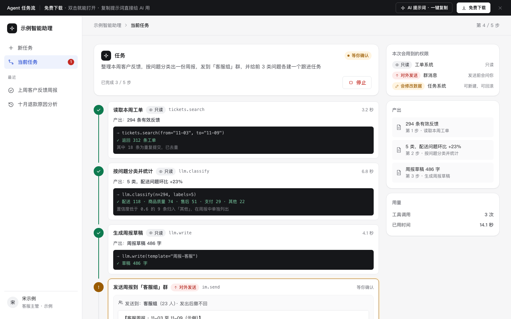

# Agent 任务流

免费下载 · 双击就能打开 · 复制提示词直接给 AI 用。

> 积木盒 · 老岳AI编辑部 · 原型组　|　PC 1440（1280 不横滚）　|　单文件 HTML，离线可用　|　2026-11-10

用户说一句话，AI 拆成步骤自动办完。这一页把 Agent 产品评审必问的都做成能点的样子：先出计划再执行、每步会动什么数据、对外发送前停下来等人确认、出错怎么办、半路停了怎么回滚。

---

## 一、用处

| 项 | 说明 |
|---|---|
| 适合什么需求 | 「帮我把这件事办完」类 AI 产品：办公助理、运营助手、客服主管助手、数据整理 Agent |
| 解决哪一步 | 把「AI 自己动手」的边界讲清楚：哪些步骤只读、哪些会改数据（能回滚）、哪些对外发送（撤不回，必须人工确认） |
| 不适合 | 一问一答的对话（见 `ai-chat`）；AI 单个交互零件（见模块 `m-ai`、组件库 `kit-ai`） |

**包含的页面和状态**

| 页面 | 状态（右下角「原型面板」切换） |
|---|---|
| 新任务 / 计划 | 空白 / 已填任务 / 确认计划 |
| 执行 | 执行中 / 等你确认 / 出错 |
| 已停止 | 待回滚 / 已回滚 / 无影响 |
| 完成 | 已完成 / 跳过了 1 步 |

## 二、用法

1. 双击 `index.html`；右下角「原型面板」切状态，按 `H` 隐藏；直达 `#page=run&state=confirm`。
2. 改数据：`<script>` 顶部 `DATA`——`task` 任务、`examples` 示例任务、`steps` 步骤（`kind` 只读 read / 会修改数据 write / 对外发送 send，`confirm: true` 执行到这步先停，`log` 调用日志，`out` 产出）、`draft` 待发送内容、`failMsg` 出错原因、`perms` 权限。
3. 改颜色：`:root` 的 `--accent`（主色），本模板样式里的 `--k-read` / `--k-write` / `--k-send`（三种步骤类型）。
4. 页面右侧「AI 提示词」3 条：从零生成 / 改成我的业务（变量：场景、任务、步骤、确认规则、权限）/ 加页面或状态（例：定时任务、后台运行、额度不足）。

## 三、规则

| 步骤类型 | 颜色 | 执行前要不要确认 | 停止后能不能回滚 |
|---|---|---|---|
| 只读 | 灰 | 不用 | 不需要（没有影响） |
| 会修改数据 | 黄 | 不用（可按业务改成要确认） | 能，停止后默认勾选回滚 |
| 对外发送 | 红 | 必须，自动暂停并展示内容 | 不能，给「发一条更正」 |

## 四、交互说明

| 元素 | 交互 | 反馈 |
|---|---|---|
| 任务输入 | 写任务 / 点示例 | 示例填进输入框；空或太短时标红并说要补什么；⌘ + 回车提交 |
| 生成计划 | 点击 | 按钮转圈「正在拆步骤」，然后出计划，不直接执行 |
| 计划步骤 | 上移 / 下移 / 删除 | 顶部写几步只读、几步会改数据、几步对外发送；删除可撤销；只剩 1 步时不能删 |
| 开始执行 | 点击 | 时间线逐步执行，当前步转圈，日志逐行出现；完成写产出和耗时；右侧产出和用量实时更新 |
| 人工确认 | 执行到对外发送 | 自动暂停、黄色高亮、侧栏红点；内容可直接改；确认发送 / 跳过这步 / 停止任务 |
| 出错 | — | 红色，写原因和「已完成的步骤不受影响」；重试 / 跳过 / 停止 |
| 停止 | 点击 | 先确认（说明不会自动撤销）；进入已停止页列出已产生影响的步骤 |
| 回滚 | 勾选后点 | 先确认（写会删什么、谁会收到通知）；回滚的步骤划线；已发送的给「发一条更正」 |
| 从停止处继续 | 点击 | 从第一个未执行的步骤接着跑 |
| 完成 | — | 结果摘要（跳过的灰色列出）、用时、调用次数；改一下重跑 / 每周自动跑 / 复制结果 / 不满意反馈 |

## 五、自检

- [x] 状态全：新任务 3 态、执行 3 态、已停止 3 态、完成 2 态
- [x] 对外发送撤不回，必须人工确认；会修改数据的能回滚；危险操作（停止、回滚）先确认
- [x] 删除步骤可撤销；转圈动画尊重「减少动态效果」
- [x] 日志区等宽字、深色；时间线 `aria-live` 播报进度
- [x] 示例数据标「示例」，无真实品牌
- [x] 无 JS 报错（11 个状态逐个打开检查）；19 条交互断言通过（无头 Chrome，含完整跑一遍）

---

本模板由老岳AI编辑部·原型组制作，可免费下载、修改、用于工作项目。
