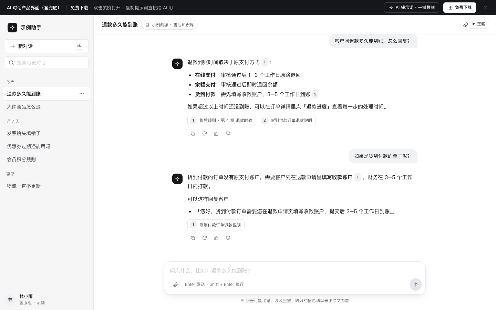

# AI 对话产品界面（含兜底）

免费下载 · 双击就能打开 · 复制提示词直接给 AI 用。

> 积木盒 · 老岳AI编辑部 · 原型组　|　PC 1440　|　单文件 HTML，离线可用　|　2026-11-10

这是一页能点的 AI 对话界面：能发问题、看流式回答、点来源、停止、点踩反馈，答不了和答不准的情况也都摆出来了。



---

## 一、用处

| 项 | 说明 |
|---|---|
| 适合什么需求 | 智能客服助手、内部知识库问答、业务小助手——凡是「用户提问 → AI 根据资料回答」的产品 |
| 解决哪一步 | 评审 AI 功能时最容易漏的是**答错、答不了、生成到一半出错**这几种情况。这个模板把它们都做成了能点的状态，评审时逐个点给研发、测试、法务看 |
| 不适合 | 需要 AI 自动执行多步操作的产品（用后续的「Agent 任务流」模板）；纯表单式生成（用「表单式生成」模板） |

**包含的页面和状态**（右下角「原型面板」切换）

| 状态 | 演示什么 |
|---|---|
| 已有对话 | 多轮对话、引用角标、来源卡片、复制 / 重新生成 / 点赞 / 点踩 |
| 空会话 | 欢迎语 + 4 个推荐问题，点一下直接发送 |
| 加载 | 打开历史对话时的骨架屏 |
| 生成中 | 流式输出 + 光标，发送按钮变成「停止」 |
| 出错 | 回答没生成出来，问题保留，一键重新生成 |
| 拒答 | 问题超出知识范围：说清只能答什么，给「转人工」和「换个问题」两个出路 |
| 低置信 | 资料里没有直接依据：黄色提示「请核对」+ 转人工确认，回答照常给出 |
| 点踩反馈 | 点踩后展开原因标签，选一个就能提交 |
| 无历史 | 左侧会话列表为空 |

## 二、用法

### 2.1 打开

1. 下载整个文件夹，双击 `index.html`，不用联网。
2. 直接在输入框里问「退款多久能到账」「发票怎么开」「明天天气」（会触发拒答）「海外直邮能退吗」（会触发低置信），看不同回答。
3. 右下角「原型面板」切状态，按 `H` 隐藏面板；地址后加 `#page=chat&state=refuse` 可直达某个状态。

### 2.2 改成你的业务（3 处）

| 改什么 | 在哪改 | 怎么改 |
|---|---|---|
| 配色、圆角、字体 | 文件最上面 `:root { ... }` | 主色改 `--accent`；用户气泡底色改 `--bubble-user`；对话列宽改 `--chat-w` |
| 知识范围、推荐问题 | `<script>` 顶部 `DATA.scope`、`DATA.suggestions` | 写清 AI 根据什么回答，比如「人事制度 2026 版」 |
| 示例回答和兜底文案 | `DATA.answers`、`DATA.refuse`、`DATA.lowConf` | 每条回答写 `keys`（命中关键词）、`text`（支持 `- 列表`、`**加粗**`、`[1]` 引用）、`sources`（来源标题 + 原文摘录） |

拒答的触发词在 `pickAnswer` 函数里（默认：天气、股票、彩票、写诗、笑话），按你的业务边界改。

### 2.3 让 AI 帮你改这个原型（复制即用）

> 页面右侧 / 顶部「AI 提示词」可一键复制，变量点一下就能填。页面上有 3 条：从零生成这个原型、改成我的业务、在此基础上加页面 / 状态；下面是另外 2 条进阶用法。

**提示词 1：换成自己的 AI 产品**

```
这是一个单文件 HTML 的 AI 对话原型模板（附件 index.html）。请改成「{{你的产品，例如：门店店长的排班助手}}」：
1. 只改 <script> 顶部 DATA，不要改文件里 KIT 标记之间的共用样式和脚本；
2. scope 写成：{{AI 能依据的资料范围}}；
3. 推荐问题换成用户最常问的 4 个：{{问题1~4}}；
4. 为每个推荐问题写一条示例回答，回答里用 [1] 标出依据，sources 写来源标题和一句原文；
5. 拒答范围改成：{{AI 不该回答的话题}}，拒答文案说清「能答什么」。
改完输出完整文件，并列出 4 条回答各引用了哪份资料。
```

**提示词 2：补一种兜底状态**

```
在这个 AI 对话原型里加一种兜底状态：{{例如：回答涉及金额时，必须先让用户确认订单号}}。
要求：
1. 触发条件写清楚（什么问题、什么情况下出现）；
2. 界面上用和「低置信」一样的提示条样式，但文案和按钮按这个场景写，至少给一个出路；
3. 在 Proto.init 的 states 里加一个状态，能在原型面板一键演示；
4. 在 README 的交互说明表里补一行。
只改必要的地方，输出完整文件。
```

## 三、交互说明

| 元素 | 交互 | 反馈 |
|---|---|---|
| 输入框 | 随内容自动长高（最高 200px）；Enter 发送，Shift + Enter 换行，中文输入法选字时不会误发 | 空内容时发送按钮置灰；超过 1600 字显示字数，超过 2000 字变红且不能发送 |
| 发送按钮 | 点击发送；生成中变成黑色「停止」 | 停止后显示「已停止生成 · 继续生成」 |
| 推荐问题卡片 | 点击直接发送这个问题 | 进入对话，标题取问题前 18 字 |
| 回答 | 先出「正在查资料…」，再流式输出 | 只有最新一条在刷新，已有消息不闪 |
| 引用角标 [1] | 点击 | 下方对应的来源卡片高亮闪一下并获得焦点 |
| 来源卡片 | 点击打开来源预览弹窗，原文摘录高亮 | Esc / 点遮罩关闭，焦点回到卡片 |
| 复制 | 点击复制回答（去掉引用角标和加粗符号） | Toast「已复制回答」 |
| 重新生成 | 点击，替换这一条回答 | 重新走查资料 → 流式输出 |
| 点赞 | 点击切换 | 图标变主色，显示「已收到反馈，谢谢」 |
| 点踩 | 点击展开原因：答非所问 / 内容有误 / 不够详细 / 来源过时，可多选 + 补充说明 | 至少选 1 个原因「提交」才可点；提交后 Toast |
| 出错提示 | 「重新生成」 | 用户的问题保留，不用重新输入 |
| 拒答提示 | 「转人工」或「换个问题」 | 转人工先弹确认框说明会发生什么，确认后 Toast |
| 低置信提示 | 回答照常给，上方黄色提示「请核对」+「转人工确认」 | — |
| 左侧会话 | 搜索（停 0.2 秒后筛选）、点击切换、悬停出现「更多」 | 当前会话白底高亮；搜不到显示「没找到相关对话」 |
| 新对话 | 点击或按 ⌘K / Ctrl+K | 回到空会话 |
| 附件 | 点回形针添加（示例） | 输入框上方出现文件条，可单个移除 |

## 四、自检（按《交互设计规范》）

- [x] 状态全：已有对话 / 空会话 / 加载 / 生成中 / 出错 / 拒答 / 低置信 / 点踩反馈 / 无历史
- [x] AI 答错有出路：低置信提示、点踩反馈、转人工；答不了有出路：说清范围 + 换个问题 + 转人工
- [x] 每条回答标来源，来源可点开看原文
- [x] 主操作（发送）固定在底部，首屏可见；PC 可点元素 ≥ 32px
- [x] 弹窗：Esc、点遮罩关闭、焦点锁定、关闭后焦点回到触发处
- [x] 文字对比度 ≥ 4.5:1；尊重系统「减少动态效果」设置
- [x] 示例数据全部虚构，人名标「示例」
- [x] 无 JS 报错（9 个状态逐个打开 + 发送 / 停止 / 继续 / 点踩 / 来源 / 转人工脚本走查）
- [x] 1440 / 1280 不横向滚动；≤1000 隐藏左栏

---

本模板由老岳AI编辑部·原型组制作，可免费下载、修改、用于工作项目。


状态：已通过浏览器验收（1440/500 宽 0 报错、0 溢出、对比度与触控达标；标准外壳与跨目录比对通过）
