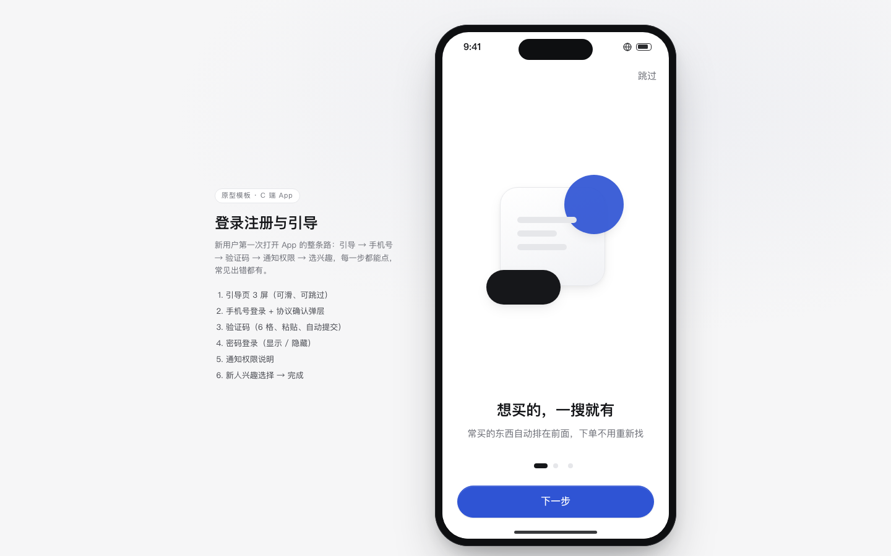

# 登录注册与引导

> 积木盒 · 老岳AI编辑部 · 原型组　|　手机框 390×844　|　单文件 HTML，离线可用　|　2026-11-10

这是新用户第一次打开 App 要走的整条路：引导 3 屏 → 手机号 → 验证码 → 通知权限 → 选兴趣 → 完成。每一步都能点，常见的出错也都做了。



---

## 一、用处

| 项 | 说明 |
|---|---|
| 适合什么需求 | 新 App 首启流程、账号体系改造（加验证码登录 / 密码登录）、想提高通知开启率、新人冷启动推荐 |
| 解决哪一步 | 评审时最容易漏的边界都在：协议没勾怎么办、验证码输错几次、发送太频繁、网络断了、账号被锁、权限被拒 |
| 不适合 | 企业账号的 SSO、扫码登录（流程不同，可在此基础上改） |

**包含的页面和状态**

| 页面 | 状态（右下角「原型面板」切换） |
|---|---|
| 引导页 | 第 1 / 2 / 3 屏（可左右滑、点圆点、跳过） |
| 手机号登录 | 正常 / 未勾协议（弹「同意并继续」）/ 发送过于频繁 / 网络出错 |
| 验证码 | 正常 / 验证码错误 |
| 密码登录 | 正常 / 密码错误 / 账号锁定 |
| 通知权限说明 | 先讲用处，再弹系统授权；可「以后再说」 |
| 兴趣选择 | 至少选 1 个才能继续，可跳过 |
| 完成 | 登录成功，回显所选兴趣 |

## 二、用法

### 2.1 打开

1. 下载整个文件夹，双击 `index.html`（Chrome / Edge / Safari 都行，不用联网）。
2. 右下角「原型面板」切页面和状态；评审时按 `H` 藏起面板。
3. 直达某个状态：地址后加 `#page=code&state=wrong`（页面：`onboard` `login` `code` `password` `permission` `interest` `done`）。
4. 验证码页：输入任意 6 位数字就通过；输入 `000000` 演示「验证码错误」。

### 2.2 改成你的业务（3 处）

| 改什么 | 在哪改 | 怎么改 |
|---|---|---|
| 配色、圆角、字体 | 文件最上面 `:root { ... }` | 换主色改 `--accent` `--accent-soft`；按钮圆角改 `.btn-cta` 的 `border-radius` |
| 引导文案、验证码规则、兴趣标签 | `<script>` 顶部 `const DATA` | `slides` 改 3 屏标题和说明；`codeLen` 改验证码位数（4 或 6）；`resendSec` 改重发等待秒数；`interests` 换兴趣标签；`agreements` 换协议名 |
| 页面文案和结构 | 搜 `function pageLogin` / `pageCode` / `pagePermission` 等 | 每个页面一个函数，改里面的 HTML 即可 |

增删页面：在 `Proto.init({ pages: [...] })` 加一项，再写一个 `pageXxx()`，在 `render` 里按 `page` 调用。

### 2.3 让 AI 帮你改这个原型（复制即用）

**提示词 1：换成自己的产品**

```
这是一个单文件 HTML 登录注册原型（附件 index.html）。请改成「{{你的产品，例如：健身打卡 App}}」：
1. 只改 <script> 顶部 DATA 和各 pageXxx 函数里的文案，不要动 /*@KIT_CSS*/ 和 /*@KIT_JS*/ 之间的代码；
2. 引导页 3 屏分别讲：{{卖点1}}、{{卖点2}}、{{卖点3}}，每屏标题不超过 10 个字；
3. 通知权限页列 3 条「打开后能收到什么」，只写和用户有关的，不写营销；
4. 兴趣标签换成：{{8–12 个标签}}；
5. 保留所有出错状态（验证码错误、发送频繁、网络出错、账号锁定），文案改成符合我产品的说法。
输出完整文件，并列出改了哪几处。
```

**提示词 2：加一种登录方式**

```
在这个登录原型里加「{{例如：本机号码一键登录}}」：
1. 放在手机号登录页最上方作为主按钮，原来的验证码登录降为次要入口；
2. 同样要先同意协议，没勾时弹底部「同意并继续」，不要直接报错；
3. 加两个出错状态：{{例如：取号失败、非本机号码}}，失败时自动回落到验证码登录并说明原因；
4. 在原型面板里加对应状态，能一键演示；触控区域不小于 44px。
只改必要的地方，输出完整文件。
```

## 三、交互说明

| 元素 | 交互 | 反馈 |
|---|---|---|
| 引导页 | 左右滑动（超过 50px 翻页）、点圆点、点「下一步」 | 当前圆点拉长；最后一屏按钮变「开始使用」；右上「跳过」直达登录 |
| 手机号输入 | 数字键盘（`inputmode=numeric`），自动按 3-4-4 分隔 | 输满 11 位「获取验证码」才可点；离开输入框时不足 11 位提示「还差 N 位」，号段不对提示检查前两位 |
| 清除按钮 | 有内容时才出现 | 清空并回到输入框 |
| 协议勾选 | **默认不勾** | 没勾就点「获取验证码」→ 弹底部「请阅读并同意」：点「同意并继续」自动勾上并发送；点「不同意」关闭并抖动协议行提示 |
| 获取验证码 | 点击 | 转圈后进入验证码页，Toast「验证码已发送」 |
| 发送过于频繁 / 网络出错 | 发送失败 | 黄色/红色提示条写明原因和出路（10 分钟后再试 / 改用密码登录 / 重新发送） |
| 验证码 6 格 | 一个输入框驱动 6 格，自动跳格；支持粘贴和短信自动填充（`autocomplete=one-time-code`） | 输满 6 位自动提交，无需点按钮 |
| 验证码错误 | 提交后校验不通过 | 6 格变红并抖动，提示剩余次数，0.9 秒后清空并重新聚焦 |
| 重新获取 | 60 秒内显示「N 秒后可重新获取」，之后变成可点 | 重新计时，Toast「已重新发送」 |
| 密码显示/隐藏 | 点眼睛图标切换 | 图标和读屏文案同步切换 |
| 密码登录按钮 | 手机号 11 位且密码 ≥6 位才可点 | 错误时提示剩余次数；连错 5 次弹「账号已暂时锁定」，给「用验证码登录」「找回密码」两条出路 |
| 通知权限页 | 「打开通知」→ 系统授权弹窗；「以后再说」 | 允许或拒绝都继续往下走；拒绝时告诉用户之后去哪里打开 |
| 兴趣标签 | 多选切换 | 按钮显示「选好了（N）」；一个没选时按钮置灰写「至少选 1 个」；右上可跳过 |

## 四、自检（按《交互设计规范》）

- [x] 状态全：验证码错误、网络出错、账号锁定、发送过于频繁、密码错误、权限拒绝
- [x] 输入方式对：手机号调数字键盘、验证码支持粘贴和自动填充、输满自动提交
- [x] 协议默认不勾；没勾时给「同意并继续」，不直接报错
- [x] 权限先讲用处再请求，可以拒绝且不阻断流程
- [x] 触控目标 ≥ 44px；主操作在底部拇指区
- [x] 弹层：Esc、点遮罩关闭、焦点锁定、关闭后焦点回到触发处
- [x] 示例数据标「示例」，手机号、App 名称全部虚构
- [x] 无 JS 报错（14 个页面状态逐个打开检查）
- [x] 窄屏（≤430px）去掉手机框铺满，不横向滚动

---

本模板由老岳AI编辑部·原型组制作，可免费下载、修改、用于工作项目。
