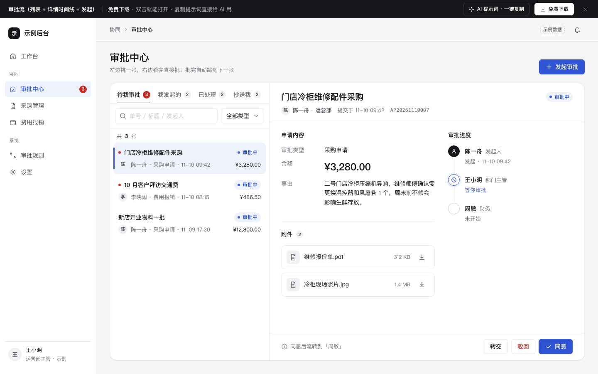

# 审批流（列表 + 详情时间线 + 发起）

免费下载 · 双击就能打开 · 复制提示词直接给 AI 用。

> 积木盒 · 老岳AI编辑部 · 原型组　|　PC 1440　|　单文件 HTML，离线可用　|　2026-11-10

这是一页能点的审批中心：左边挑单、右边看完直接批，批完自动跳下一张；发起时按金额自动算出要走哪几个人。



---

## 一、用处

| 项 | 说明 |
|---|---|
| 适合什么需求 | 需要一个或多个人点头才能往下走的单据：采购、报销、付款、请假、价格调整、合同用印…… |
| 解决哪一步 | 评审时最常吵的三件事都能点给大家看：驳回要不要写原因、转交给谁、金额多少要多加一级审批 |
| 不适合 | 只有一个人确认、没有流程的单据（用「列表 + 详情抽屉」模板）；要画复杂分支流程的规则配置页 |

**包含的页面和状态**

| 页面 | 状态（右下角「原型面板」切换） |
|---|---|
| 审批中心 | 正常 / 空（待我审批已清空，给「看已处理」「发起审批」两个出路）/ 加载（骨架屏）/ 出错（可重试） |
| 驳回弹窗 | 快捷原因一点即填、原因必填校验 |
| 发起审批 | 空表单 / 已填（金额 8,600 元，触发「总监」节点）/ 提交失败（内容保留、可重试） |

四个 Tab：待我审批（红色角标）、我发起的（可撤回、催办）、已处理、抄送我。

## 二、用法

### 2.1 打开

1. 下载整个文件夹，双击 `index.html`（不用联网）。
2. 右下角「原型面板」切页面和状态；评审时按 `H` 隐藏面板。
3. 直达某个状态：`#page=list&state=empty`、`#page=reject`、`#page=create&state=filled`、`#page=create&state=fail`。

### 2.2 改成你的业务（3 处）

| 改什么 | 在哪改 | 怎么改 |
|---|---|---|
| 配色、圆角、字体 | 文件最上面 `:root { ... }` | 换主色只改 `--accent` 和 `--accent-soft` |
| 审批规则 | `<script>` 顶部 `DATA.rules` | `base` 是固定节点；`extra.min` 是加签金额门槛（示例 5000），`extra.node` 是加进来的人，`after` 是加在谁后面 |
| 单据和人 | `DATA.types` `DATA.list` `DATA.people` `DATA.rejectReasons` | 每张单的 `flow` 节点状态：`start` 发起 / `done` 已同意 / `rejected` 已驳回 / `current` 待处理 / `todo` 未到 |

当前登录人是 `DATA.me`，「待我审批」= 当前节点是这个人的单据。

### 2.3 让 AI 帮你改这个原型（复制即用）

> 页面右侧 / 顶部「AI 提示词」可一键复制，变量点一下就能填。页面上有 3 条：从零生成这个原型、改成我的业务、在此基础上加页面 / 状态；下面是另外 2 条进阶用法。

**提示词 1：换成你的审批场景**

```
这是一个单文件 HTML 审批流原型模板（附件 index.html）。请改成「{{你的场景，例如：价格调整审批}}」：
1. 只改 <script> 顶部的 DATA 和详情区字段，不要改文件里 KIT 标记之间的共用样式和脚本；
2. 审批类型改成：{{类型1、类型2}}；
3. 详情「申请内容」里的字段改成：{{字段清单，例如：商品、原价、新价、生效日期、调价原因}}；
4. 审批节点改成：{{节点1（谁）→ 节点2（谁）}}，加签规则改成：{{例如：降价幅度 ≥ 10% 加「运营总监」}}；
5. 发起表单同步改字段，流程预览要跟着规则实时变。
改完输出完整文件，并列出改了哪几处。
```

**提示词 2：加一个「会签」节点**

```
在这个审批流原型里加「会签」：{{例如：财务节点改为 周敏、吴昊 两人都同意才算通过}}。
要求：
1. 时间线里会签节点显示两个人各自的状态（已同意 / 待处理），全部同意后才流转到下一节点；
2. 任意一人驳回，整张单驳回；
3. 当前登录人只能处理属于自己的那一份，按钮文案写清「你同意后还差 1 人」；
4. 原型面板加一个状态「会签中」，能一键演示。
只改必要的地方，输出完整文件。
```

## 三、交互说明

| 元素 | 交互 | 反馈 |
|---|---|---|
| Tab（待我审批 / 我发起的 / 已处理 / 抄送我） | 点击切换 | 待我审批用红色角标显示条数，其余灰色数字；左侧导航同步红点 |
| 搜索框 | 输入即搜（0.22 秒防抖），匹配单号、标题、发起人 | 显示「找到 N 张 · 含『词』」，可一键清除 |
| 类型下拉 | 选择即筛选 | 同上 |
| 列表项 | 点击或用键盘 ↑ ↓ 切换 | 当前项左侧主色竖条；未读的有红点，看过即消失 |
| 附件下载 | 点击 | Toast「已开始下载」 |
| 审批进度 | 只读 | 已同意绿色对勾、已驳回红叉、当前节点主色光圈并写「等你审批」；按金额加进来的节点带「按金额自动加入」标 |
| 同意 | 点击 → 弹窗填意见（选填）→ 确认 | Toast「已同意，已流转到 XX」，4 秒内可撤销；自动选中下一张 |
| 驳回 | 点击 → 弹窗，点常用原因自动填入，可再改 | 原因为空时红框 + 提示「请写驳回原因」；成功后流程结束并通知发起人 |
| 转交 | 点击 → 搜索并选人，留言选填 | 没选人时提示「请选一个人」；成功后时间线写明「由 XX 转交」 |
| 撤回 / 催办（我发起的、审批中） | 撤回需二次确认；催办直接发送 | 「已提醒 XX，今天不再重复提醒」 |
| 发起审批 | 右上主按钮打开右侧抽屉 | 输入金额时，下方流程预览实时变化，满 5,000 元自动加「总监」并说明原因 |
| 提交 | 点击 → 校验必填（标题、金额 > 0、事由）→ 提交中 → 成功 | 错误就近提示并聚焦第一个错项；成功后跳到「我发起的」并选中新单；失败显示红条「内容都还在」+ 重试 |
| 弹窗 / 抽屉 | Esc、点遮罩关闭 | 焦点锁定在弹层内，关闭后回到触发按钮 |

## 四、自检（按《交互设计规范》）

- [x] 状态全：正常 / 空 / 加载 / 出错；表单有校验、提交中、成功、失败
- [x] 列表有搜索、筛选、条数、清除、骨架、空态（带出路）、无结果
- [x] 每屏一个主操作（同意 / 提交），驳回用描边红字，危险操作二次确认
- [x] 弹窗/抽屉：Esc、点遮罩关闭、焦点锁定、关闭后焦点回到触发处
- [x] 文字对比度 ≥ 4.5:1；PC 可点元素 ≥ 32px
- [x] 示例数据标「示例数据」，人名、单号全部虚构
- [x] 无 JS 报错（8 个页面/状态逐个检查）
- [x] 1440 / 1280 不横向滚动；≤1320 详情改单列且「审批进度」排在附件前

---

本模板由老岳AI编辑部·原型组制作，可免费下载、修改、用于工作项目。

状态：已通过浏览器验收（1440/500 宽 0 报错、0 溢出、对比度与触控达标；标准外壳与跨目录比对通过）
