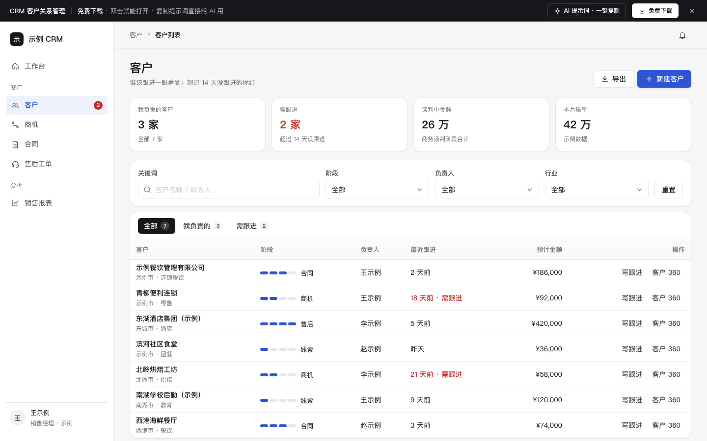

# CRM 客户关系管理

免费下载 · 双击就能打开 · 复制提示词直接给 AI 用。

> 积木盒 · 老岳AI编辑部 · 原型组　|　PC 1440　|　单文件 HTML，离线可用　|　2026-11-10

一个能点的 CRM 后台：客户列表（谁该跟进标红）→ 商机看板（拖动换阶段，金额自动合计）→ 客户 360（线索 → 商机 → 合同 → 售后一条线、写跟进）。双击 `index.html` 就能拿去评审。

---

## 一、用处

| 项 | 说明 |
|---|---|
| 适合什么需求 | B2B 销售团队的客户管理、商机推进、跟进记录；售前 / 售中 / 售后四块串起来 |
| 解决哪一步 | 评审最常追问的都能点给他看：谁多久没跟进、各阶段金额和加权金额怎么算、输单原因怎么收、跟进写在哪、售后工单逾期怎么提醒 |
| 不适合 | 只有订单处理没有销售过程（用「列表 + 详情抽屉」`b-list-drawer`）；审批为主（用 `b-approval`） |

**包含的页面和状态**

| 页面 | 状态（右下角「原型面板」切换） |
|---|---|
| 客户列表 | 正常 / 空 / 加载 / 出错 / 无结果 |
| 客户摘要抽屉 | 点客户名打开 |
| 商机看板 | 正常 / 没有商机 |
| 客户 360 | 跟进记录 / 写跟进中 / 有逾期工单 |

## 二、用法

### 2.1 打开

1. 下载整个文件夹，双击 `index.html`（Chrome / Edge / Safari，不用联网）。
2. 右下角「原型面板」切页面和状态；评审时按 `H` 藏起面板。
3. 直达：`#page=pipeline`、`#page=customer&state=overdue`（页面：`list` `drawer` `pipeline` `customer`）。

### 2.2 改成你的业务（3 处）

| 改什么 | 在哪改 | 怎么改 |
|---|---|---|
| 配色、圆角、字体 | 文件最上面 `:root { ... }` | 换主色改 `--accent` `--accent-soft` |
| 客户、商机、阶段、规则 | `<script>` 顶部 `const DATA` | `stages` 客户阶段；`dealStages` 商机阶段和赢率；`lostReasons` 输单原因；`staleDays` 多少天没跟进算「需跟进」；`customers` `deals` `follows` `contracts` `tickets` 是示例数据 |
| 页面文案和结构 | 搜 `function pageList` / `pagePipeline` / `pageCustomer` | 每个页面一个函数 |

### 2.3 让 AI 帮你改

页面右侧「AI 提示词」有 3 条，变量点一下就能填：

| # | 提示词 | 什么时候用 |
|---|---|---|
| 1 | 从零生成这个原型 | 想让 AI 从头做一个同样的 CRM 后台 |
| 2 | 改成我的业务（变量：业务名称、客户阶段、商机阶段与赢率、输单原因、需跟进规则） | 换成自己的销售流程 |
| 3 | 在此基础上加页面 / 状态（变量：要加的页面或状态） | 评审问「线索怎么分配？合同怎么审批？」 |

## 三、交互说明

| 元素 | 交互 | 反馈 |
|---|---|---|
| 顶部 4 个指标 | — | 由数据算出：我负责的客户、需跟进数、谈判中金额、赢单金额 |
| 筛选 | 关键词输入停 0.2 秒即搜；下拉改了立即生效 | 结果数实时写出，可「清空筛选」；无结果给出路 |
| Tab | 全部 / 我负责的 / 需跟进 | 每个 Tab 带当前筛选下的数量 |
| 最近跟进 | — | 超过 14 天写红字「N 天前 · 需跟进」，左侧导航「客户」角标同步 |
| 客户名称 | 点击 | 右侧抽屉：阶段、联系人、商机、最近跟进；Esc 关闭 |
| 写跟进（列表行 / 抽屉） | 点击 | 弹窗：方式点选（默认电话）、内容必填、下次跟进默认 3 天后；保存后「最近跟进」变「今天」，Toast 可撤销 |
| 商机卡片 | 按住拖到其他列；单击打开客户 360 | 目标列高亮；放下后列头数量、金额、加权金额立即重算；Toast 可撤销 |
| 拖到「输单」 | 松手 | 弹窗必须选输单原因才能确认；取消则卡片留在原列 |
| 停留过久的商机 | — | 超过 14 天没动的卡片黄色左边框 + 「N 天未动」 |
| 客户 360 阶段条 | — | 线索 → 商机 → 合同 → 售后，已过的浅色、当前的主色 |
| 写跟进（客户 360） | 展开表单，保存 | 新记录插到时间线最上面并高亮，可撤销 |
| 逾期工单提醒 | 点「去处理」 | 切到「工单」Tab，逾期工单标红 |

## 四、自检（按《交互设计规范》）

- [x] 状态全：列表 正常 / 空 / 加载 / 出错 / 无结果；看板 正常 / 空；客户 360 三态
- [x] 系统能算的不让人算：指标、需跟进数、列金额合计、加权金额（金额 × 赢率）
- [x] 高频选项有默认值：跟进方式、下次跟进日期默认 3 天后
- [x] 写跟进 3 步内：点「写跟进」→ 写内容 → 保存
- [x] 拖拽之外可点击进入详情；输单原因必填
- [x] 抽屉和弹窗：Esc、点遮罩关闭、焦点锁定、关闭后焦点回到触发处
- [x] 示例数据标「示例」，公司、人名、手机号全部虚构
- [x] 无 JS 报错（9 个页面状态逐个打开检查）
- [x] 1440 设计，1280 不横向滚动

---

本模板由老岳AI编辑部·原型组制作，可免费下载、修改、用于工作项目。
