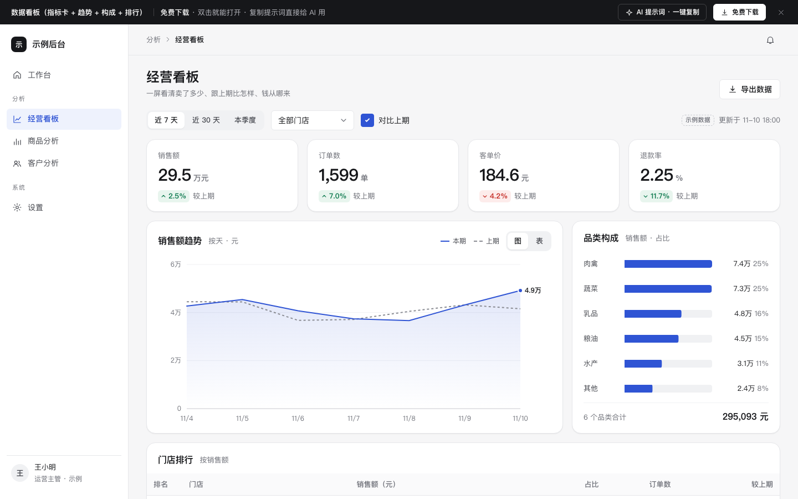

# 数据看板（指标卡 + 趋势 + 构成 + 排行）

免费下载 · 双击就能打开 · 复制提示词直接给 AI 用。

> 积木盒 · 老岳AI编辑部 · 原型组　|　PC 1440　|　单文件 HTML，离线可用　|　2026-11-10

这是一页能点的经营看板：切时间、切门店，四张指标卡、趋势图、品类构成、门店排行一起变，数字互相对得上。



---

## 一、用处

| 项 | 说明 |
|---|---|
| 适合什么需求 | 经营日报、运营周会看板、管理层首页、商家后台「数据概览」 |
| 解决哪一步 | 评审时说清三件事：看哪几个数、和什么比（上期）、按什么切（时间 / 门店）；研发能直接看到每张图的口径和空态 |
| 不适合 | 要拖拽自定义报表、几十个维度自由组合的 BI 工具；只需要一张明细表的页面（用「列表 + 详情抽屉」模板） |

**包含的状态**（右下角「原型面板」切换）

| 状态 | 说明 |
|---|---|
| 正常 | 4 张指标卡（销售额、订单数、客单价、退款率）+ 销售额趋势（本期实线、上期灰色虚线）+ 品类构成条形 + 门店排行 |
| 空（无数据） | 该时间段没有数据，给「看近 30 天」「看全部门店」两个出路 |
| 加载 | 骨架占位，布局和正常态一致，不跳 |
| 出错 | 说明原因 + 重新加载，筛选条件保留 |
| 不对比上期 | 关掉对比：指标卡改显示口径说明，图上去掉上期线，排行去掉「较上期」列 |
| 表格视图 | 趋势图切成表，每天的本期、上期、变化都能直接读 |

## 二、用法

### 2.1 打开

1. 下载整个文件夹，双击 `index.html`（不用联网）。
2. 顶部切「近 7 天 / 近 30 天 / 本季度」、选门店、勾「对比上期」，所有数字一起变。
3. 鼠标在趋势图上移动看每个点的数值；也可以点图表区后用 ← → 键逐个看。
4. 直达状态：`#page=board&state=empty`；直接看 30 天：`#range=30d`。按 `H` 隐藏原型面板。

### 2.2 改成你的业务（3 处）

| 改什么 | 在哪改 | 怎么改 |
|---|---|---|
| 配色 | 文件最上面 `:root` | 改 `--accent` 后折线、条形、占比条一起变；上期线颜色是 `--chart-prev` |
| 指标和维度 | `<script>` 顶部 `DATA` | `metrics` 改指标名；`categories` 改构成项和大致占比；`stores` 改排行对象（门店 / 销售 / 渠道都行） |
| 数据量级 | `DATA.ranges` | 每个时间段的点数和基数；`aov` 客单价、`refundRate` 退款率基数。所有数字由这里算出，总数 = 分项之和 |

### 2.3 让 AI 帮你改这个原型（复制即用）

> 页面右侧 / 顶部「AI 提示词」可一键复制，变量点一下就能填。页面上有 3 条：从零生成这个原型、改成我的业务、在此基础上加页面 / 状态；下面是另外 2 条进阶用法。

**提示词 1：换成你的指标**

```
这是一个单文件 HTML 数据看板原型模板（附件 index.html）。请改成「{{你的看板，例如：客服质量看板}}」：
1. 只改 <script> 顶部的 DATA 和文案，不要改文件里 KIT 标记之间的共用样式和脚本；
2. 4 张指标卡改成：{{指标1（单位，越高越好/越低越好）、指标2……}}，环比颜色按「越高越好 / 越低越好」判断好坏；
3. 趋势图改看：{{指标}}，构成图改成：{{维度，例如：问题类型}}，排行改成：{{对象，例如：客服}}；
4. 每个指标下方写一句口径（怎么算的），例如「首次响应时长 = 首条回复时间 − 进线时间」；
5. 所有数字必须由 DATA 算出，总数等于分项之和。
改完输出完整文件，并列出每个指标的口径。
```

**提示词 2：加一个下钻**

```
在这个看板原型里加下钻：点品类构成里的某一条（例如「蔬菜」），右侧滑出抽屉，显示该品类的 Top 10 商品（商品名、销售额、占比、较上期）。
要求：
1. 抽屉用现有的 .drawer 样式和 Proto.open / Proto.close，Esc 和点遮罩可关闭；
2. 抽屉里的合计等于该品类在构成图上的金额；
3. 时间范围和门店筛选对抽屉同样生效；
4. 原型面板加一个页面「品类下钻」，能一键打开演示。
只改必要的地方，输出完整文件。
```

## 三、交互说明

| 元素 | 交互 | 反馈 |
|---|---|---|
| 时间范围分段 | 点击切换 近 7 天 / 近 30 天 / 本季度（按周） | 旧画面变淡 0.4 秒再换成新数据，不闪白、不跳布局；选择记在本机，下次打开保持 |
| 门店下拉 | 选择即筛选 | 全页数字只算这家门店；排行只剩这一家 |
| 对比上期 | 勾选 / 取消 | 指标卡显示环比或口径说明；图上出现 / 去掉上期灰色虚线和图例 |
| 指标卡环比 | 只读 | 绿底 = 变好、红底 = 变差；退款率是「越低越好」，下降显示绿色；箭头 + 百分比，不只靠颜色 |
| 趋势图 | 鼠标移动：竖线吸附到最近的日期，提示框同时列本期、上期数值；键盘 ← → 逐点查看 | 最后一个点直接标数值；不在每个点上堆数字 |
| 图 / 表 切换 | 点击「表」 | 趋势图换成逐日表格，含变化百分比 |
| 品类构成 | 只读，可键盘聚焦 | 按金额从大到小排，每条右侧直接写金额和占比，底部写合计 |
| 门店排行 | 只读 | 前三名黑底序号；占比条 + 百分比；较上期红绿标 |
| 导出数据 | 点击 | Toast「已导出『近 7 天 · 全部门店』数据」 |
| 空态 / 出错 | 「看近 30 天」「看全部门店」/「重新加载」 | 出错时筛选条件保留 |

## 四、自检（按《交互设计规范》）

- [x] 状态全：正常 / 空 / 加载 / 出错，外加不对比、表格视图
- [x] 筛选一行放在所有图上方，切换后所有卡片和图表用同一份数据，总数 = 分项之和
- [x] 单轴图（不做双 Y 轴）；两条线有图例 + 线型区分（实线 / 虚线），不只靠颜色
- [x] 图表有悬停提示与键盘操作，并提供表格视图
- [x] 「示例数据」全页只标一次；门店名全部为「示例 X 号店」
- [x] 文字对比度 ≥ 4.5:1；PC 可点元素 ≥ 32px
- [x] 无 JS 报错（6 个状态逐个检查）
- [x] 1440 / 1280 不横向滚动；≤1200 指标卡两列、图表上下排

---

本模板由老岳AI编辑部·原型组制作，可免费下载、修改、用于工作项目。

状态：已通过浏览器验收（1440/500 宽 0 报错、0 溢出、对比度与触控达标；标准外壳与跨目录比对通过）
