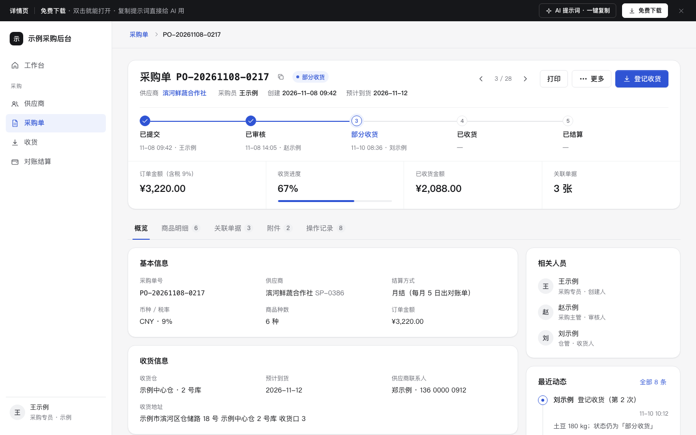

# 详情页（概览 + Tab + 关联单据 + 操作记录）

免费下载 · 双击就能打开 · 复制提示词直接给 AI 用。

> 积木盒 · 老岳AI编辑部 · 原型组　|　PC 1440　|　单文件 HTML，离线可用　|　2026-11-10

后台最常见的「单据详情」：以采购单为例，头部写清单号、状态和下一步该做什么，下面状态进度、关键指标、5 个 Tab（概览 / 商品明细 / 关联单据 / 附件 / 操作记录）。主操作随状态变，不能做的操作写明原因。

---

## 一、用处

| 项 | 说明 |
|---|---|
| 适合什么需求 | 后台任意一类单据或资料的详情：采购单、销售订单、退货单、合同、客户、商品 |
| 解决哪一步 | 评审最常追问的都能点给他看：现在到哪一步了、该谁做什么、哪些操作现在不能做（为什么）、上下游单据在哪、谁什么时候改过什么 |
| 不适合 | 只有几个字段的资料（直接用列表里的右侧抽屉，见 `b-list-drawer`）；新建 / 编辑（见 `b-form`） |

**包含的页面和状态**

| 页面 | 状态（右下角「原型面板」切换） |
|---|---|
| 详情页 | 部分收货 / 待审核（审核人视角）/ 已作废（只读）/ 加载中（骨架）/ 加载失败（可重试）/ 不存在或无权限 |
| 各 Tab | 商品明细 / 关联单据 / 关联单据为空 / 附件 / 操作记录 / 编辑备注 |

## 二、用法

1. 双击 `index.html`；右下角「原型面板」切状态，按 `H` 隐藏；直达 `#page=detail&state=pending`。
2. 改数据：`<script>` 顶部 `DATA`——`order` 单头、`items` 商品明细、`docs` 关联单据（`no:null` 表示这类还没有）、`files` 附件、`logs` 操作记录。
3. 改颜色：最上面 `:root` 的 `--accent`。
4. 页面右侧「AI 提示词」3 条：从零生成 / 改成我的业务（变量：单据名称、状态顺序、各状态可用操作、关联单据类型、字段清单）/ 加页面或状态（例：编辑模式、别人正在改、打印预览）。

## 三、交互说明

| 元素 | 交互 | 反馈 |
|---|---|---|
| 单号旁复制 | 点击 | 复制单号，Toast「已复制单号」 |
| 上一条 / 下一条 | 点击 | 写当前位置「3 / 28」，第一条 / 最后一条时置灰 |
| 主操作 | 随状态变 | 待审核 =「驳回」「通过」；待收货 / 部分收货 =「登记收货」；已作废没有操作，顶部红色横幅写作废人、时间、原因，可「复制为新单」 |
| 更多 › 作废 | 点击 | 已有收货记录时置灰，菜单里直接写「已有收货记录，不能作废，请走退货」；可作废时右侧抽屉选常用原因或手写，原因必填 |
| 驳回 | 点击 | 同上，原因必填；驳回后操作记录加一条红色记录 |
| 登记收货 | 点击 | 右侧抽屉，每个商品预填「剩余未收数」；超过剩余标红并写「最多还能收 N」；底部实时汇总本次种数和金额；提交后进度、状态、指标、关联单据、操作记录一起更新，收齐自动变「已收货」 |
| 状态进度 | — | 5 步，每步写时间和操作人；当前步高亮，驳回 / 作废那一步标红 |
| Tab | 点击 / 左右方向键 | Tab 带数量；往下滚时 Tab 吸顶，左侧显示单号和状态，主操作跟着吸顶 |
| 备注 | 点「编辑」 | 就地变输入框，200 字计数，Ctrl/⌘+Enter 保存、Esc 取消；保存后操作记录加「修改前 → 修改后」 |
| 关联单据 | 点一行（或 Tab 到行上按回车） | 按收货单 / 对账单 / 付款单分组；没有的写「暂无，什么时候生成」；右侧抽屉预览，可「打开完整单据」 |
| 操作记录 | 筛选 全部 / 状态变更 / 字段修改 / 备注 | 时间线；字段修改写「修改前 → 修改后」；超过 6 条折叠「再显示 N 条」 |
| 加载失败 | 点「重试」 | 先显示骨架，再加载出详情 |
| 无权限 | 点「申请查看权限」 | 按钮变「已申请，等待审批」，写审批人 |

## 四、自检

- [x] 状态全：待审核 / 待收货 / 部分收货 / 已收货 / 已作废 + 加载 / 出错 / 无权限 / 关联单据为空
- [x] 主操作随状态变；不能做的操作置灰并写原因，不是直接隐藏
- [x] 必填原因有校验；收货数不超过剩余；改动自动写进操作记录
- [x] 抽屉 Esc 关闭、焦点锁定、关闭后焦点回到触发处；Tab 支持方向键；关联单据行可键盘打开
- [x] 数字前后一致：商品明细合计 = 订单金额，已收金额 = 收货单金额合计
- [x] 示例数据标「示例」，无真实公司名
- [x] 无 JS 报错（12 个状态逐个打开检查）；19 条交互断言通过（无头 Chrome）；1440 设计，1280 不横滚

---

本模板由老岳AI编辑部·原型组制作，可免费下载、修改、用于工作项目。
