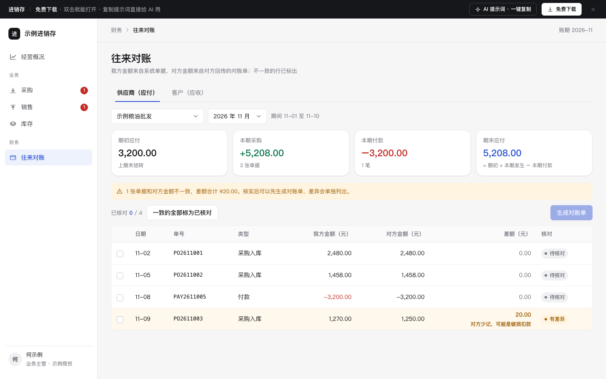

# 进销存

免费下载 · 双击就能打开 · 复制提示词直接给 AI 用。

> 积木盒 · 老岳AI编辑部 · 原型组　|　PC 1440（1280 不横滚）　|　单文件 HTML，离线可用　|　2026-11-10

中小商贸 / 批发的进销存四件事：采购、销售、库存成本、往来对账。重点是把评审最常问的计算做成能点的样子：建议采购量、上次进价、税额、客户价格等级、信用额度、可用库存、移动加权成本、对账公式。

---

## 一、用处

| 项 | 说明 |
|---|---|
| 适合什么需求 | 批发、商贸、门店进货的进销存系统；ERP 里的采购 / 销售 / 库存 / 应收应付模块 |
| 解决哪一步 | 新建单据时哪些值系统预填、哪些要拦、什么情况要审批；库存成本怎么算、怎么给人看懂；对账时差异怎么标 |
| 不适合 | 仓库作业（收货上架拣货，见 `b-wms`）；电商订单发货售后（见 `b-mall-admin`）；总账凭证 |

**包含的页面和状态**

| 页面 | 状态（右下角「原型面板」切换） |
|---|---|
| 采购 | 列表 / 新建（低库存带入） / 校验出错 |
| 销售 | 列表 / 新建 / 超信用额度 / 库存不足 |
| 库存 | 正常 / 成本流水 / 加载中 |
| 往来对账 | 供应商 / 客户 / 已核对一致项 |

## 二、用法

1. 双击 `index.html`；右下角「原型面板」切状态，按 `H` 隐藏；直达 `#page=sale&state=credit`。
2. 改数据：`<script>` 顶部 `DATA`——`items` 商品（安全库存、上次进价、标准售价）、`opening` 期初、`moves` 本月流水、`suppliers` 供应商和账期、`customers` 客户（折扣、信用额度、已用）、`pos` / `sos` 单据、`recon` 对账；阈值 `taxRate`、`approveOver`。
3. 改颜色：`:root` 的 `--accent`（主色），本模板样式里的 `--in`（入库绿）、`--out`（出库红）。
4. 页面右侧「AI 提示词」3 条：从零生成 / 改成我的业务（变量：行业、单位、税率、价格政策、审批线、成本方法）/ 加页面或状态（例：退货、多仓调拨、收付款核销）。

## 三、规则（系统怎么算）

| 规则 | 计算方式 |
|---|---|
| 行金额 | 数量 × 单价 |
| 税额 / 含税合计 | 不含税合计 × 税率（示例 9%）；含税 = 不含税 + 税额，四舍五入到分 |
| 采购单价默认 | 该商品上次进价；高于上次时标黄并写高出百分比 |
| 建议采购量 | 安全库存 × 2 − 当前库存（至少 1） |
| 采购审批 | 含税合计 ≥ 20,000 → 提交主管审批 |
| 销售单价默认 | 标准售价 × 客户价格等级折扣 |
| 可用库存 | 结存 − 待审批销售单占用；同一商品多行合计不能超过可用 |
| 信用额度 | 已用 + 本单含税 > 额度 → 红色提示，按钮变「提交主管审批」 |
| 移动加权成本 | 入库：(原结存 × 原成本价 + 入库数 × 入库价) ÷ (原结存 + 入库数)；出库按当时成本价结转 |
| 对账 | 期末 = 期初 + 本期发生 − 本期付款 / 收款；我方 ≠ 对方的单据标黄并写差额 |

## 四、交互说明

| 元素 | 交互 | 反馈 |
|---|---|---|
| 新建单据 | 右侧宽抽屉 | 选供应商带出账期；选客户带出价格等级、额度条（已用 + 本单） |
| 低库存提示 | 一键带入 | 把低于安全库存且未在单里的商品加进来，数量按建议量、单价按上次进价 |
| 明细行 | 改数量 / 单价 | 金额、税额、合计即时变；只能输整数 / 两位小数；删除行可撤销 |
| 换商品 | 下拉 | 单价按规则重新预填；销售行显示可用库存 |
| 提交 | 点击 | 有错 Toast「还有 N 处要改」并聚焦第一处；需审批的进「待审批」，否则直接入库 / 出库并重算成本 |
| 审批通过 | 列表行按钮 | 先确认（写明金额和原因）；左侧菜单数字同步减少 |
| 库存表 | — | 期初 / 入库 / 出库 / 结存 / 成本价 / 金额；低于安全库存标黄 |
| 成本流水 | 抽屉 | 每次入库后的成本价加粗；底部写公式并代入最近一次入库的数字 |
| 对账 | 勾选 / 一致的全部标为已核对 | 「生成对账单」未核对时置灰；有差异或未核对时先确认 |

## 五、自检

- [x] 状态全：采购 3 态、销售 4 态、库存 3 态、对账 3 态
- [x] 系统能算的不让人算：默认单价、金额税额合计、建议采购量、可用库存、信用额度、成本价、期末余额
- [x] 金额右对齐、等宽数字、两位小数；超额 / 超审批线明确写原因和下一步
- [x] 抽屉和确认框 Esc 关闭、焦点锁定；输入时只局部更新，不丢焦点
- [x] 示例数据标「示例」，无真实品牌
- [x] 无 JS 报错（13 个状态逐个打开检查）；24 条交互断言通过（无头 Chrome）

---

本模板由老岳AI编辑部·原型组制作，可免费下载、修改、用于工作项目。
