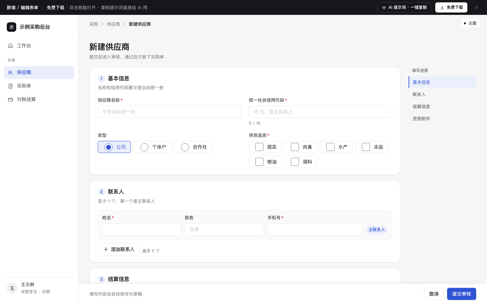

# 新增 / 编辑表单

免费下载 · 双击就能打开 · 复制提示词直接给 AI 用。

> 积木盒 · 老岳AI编辑部 · 原型组　|　PC 1440　|　单文件 HTML，离线可用　|　2026-11-10

后台最常见的「新建供应商」表单，长表单和分步两种做法都有：分组目录、实时校验、重名检查、错误汇总一键跳转、自动存草稿、提交中 / 失败 / 成功、编辑时离开确认。

---

## 一、用处

| 项 | 说明 |
|---|---|
| 适合什么需求 | 后台新建 / 编辑一条资料：供应商、客户、门店、商品、员工 |
| 解决哪一步 | 评审最常追问的都能点给他看：错在哪、怎么改、没填完关了会不会丢、提交失败要不要重填、编辑后不保存直接走怎么办 |
| 不适合 | 字段少于 6 个（直接用弹窗或抽屉）；批量录入（用导入，见功能模块 `m-import-export`） |

**包含的页面和状态**

| 页面 | 状态（右下角「原型面板」切换） |
|---|---|
| 长表单（分组） | 填写中 / 校验出错 / 有草稿可恢复 / 提交中 / 提交会失败 / 编辑模式 |
| 分步表单 | 第 1 步 / 第 2 步 / 第 3 步确认 |
| 提交成功 | — |

## 二、用法

1. 双击 `index.html`；右下角「原型面板」切状态，按 `H` 隐藏；直达 `#page=long&state=errors`。
2. 改选项：`<script>` 顶部 `DATA`（品类、结算方式、已存在的名称、编辑模式的预填数据）；改字段：搜 `RULES`（校验规则和错误文案）和 `g1` ~ `g4`（四组字段）。
3. 页面右侧「AI 提示词」3 条：从零生成 / 改成我的业务（变量：表单名称、字段清单、异步检查字段、提交后流程）/ 加页面或状态（例：字段联动、识别营业执照自动填、驳回后修改）。

## 三、字段说明

| 字段 | 必填 | 校验规则 | 错误文案 |
|---|---|---|---|
| 供应商名称 | 是 | 至少 2 个字；失焦后检查重名 | 已有同名供应商，换个名称或去列表里找找 |
| 统一社会信用代码 | 是 | 18 位数字或大写字母，输入时自动转大写、过滤符号 | 信用代码是 18 位数字或大写字母，现在是 N 位 |
| 类型 | 默认「公司」 | — | — |
| 供货品类 | 是 | 至少 1 个 | 至少选 1 个供货品类 |
| 联系人姓名 / 手机号 | 是 | 最少 1 人、最多 5 人；手机号 11 位数字 | 手机号是 11 位数字 |
| 结算方式 | 默认「月结」 | — | — |
| 开户行 / 银行账号 | 是 | 账号 12–19 位数字，输入时每 4 位加空格 | 银行账号是 12–19 位数字 |
| 营业执照 | 是 | 上传 1 个文件 | 请上传营业执照 |

## 四、交互说明

| 元素 | 交互 | 反馈 |
|---|---|---|
| 字段 | 失焦校验，改对后立刻消除错误 | 错误写在字段下方，说清怎么改 |
| 供应商名称 | 失焦 | 显示「正在检查是否重名…」→「名称可用」或重名提示 |
| 右侧目录 | 滚动 / 点击 | 当前组高亮；有错的组显示错误数，填完的组显示对勾 |
| 联系人 | 添加 / 删除 | 第一个是主联系人不可删；删除可撤销 |
| 底部操作条 | 常驻 | 停止输入 1 秒自动存草稿，写「已自动保存草稿 · 14:32」 |
| 提交审核 | 点击 | 先整体校验：有错就在顶部汇总「还有 N 处要改」，点每条跳到字段并聚焦；无错则按钮转圈、表单只读 |
| 提交失败 | — | 内容全部保留，写原因，再点一次即可 |
| 草稿 | 进入页面时 | 有草稿时顶部提示，「恢复草稿」或「不用了」 |
| 编辑模式 | 改了字段后点「取消」 | 确认「有未保存的修改」 |
| 分步 | 下一步 | 只校验当前步；第 3 步只读汇总，每组「修改」跳回对应步 |

## 五、自检（按《交互设计规范》）

- [x] 状态全：填写 / 出错 / 草稿 / 提交中 / 失败 / 成功 / 编辑
- [x] 高频选项有默认值（类型、结算方式）；能自动处理的自动处理（大写、去符号、账号分组）
- [x] 错误文案说清「错在哪、怎么改」，汇总可一键跳转
- [x] 不丢内容：自动草稿、失败保留、离开确认
- [x] 标签在上、必填红星、对比度 ≥ 4.5:1；弹窗 Esc 可关、焦点归还
- [x] 无 JS 报错（10 个状态逐个打开检查）；1440 设计，1280 不横滚

---

本模板由老岳AI编辑部·原型组制作，可免费下载、修改、用于工作项目。

状态：已通过浏览器验收（1440/500 宽 0 报错、0 溢出、对比度与触控达标；标准外壳与跨目录比对通过）
