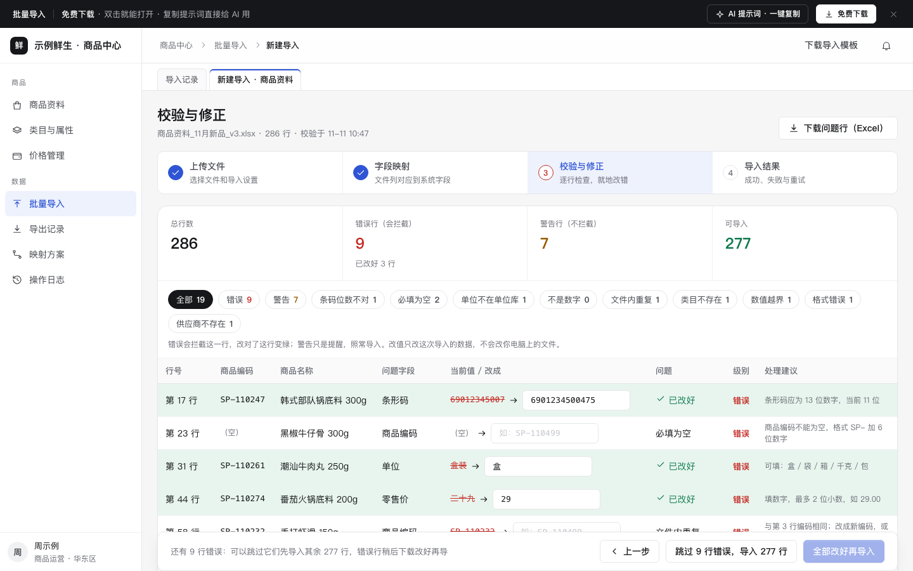

# 批量导入（字段映射 + 逐行校验 + 部分失败重试）

免费下载 · 双击就能打开 · 复制提示词直接给 AI 用。

> 积木盒 · 老岳AI编辑部 · 原型组　|　PC 1440（500 宽不横滚）　|　单文件 HTML，离线可用　|　2026-11-11 重做

后台「Excel 批量导入」整条链路：以商品资料导入为例，导入记录 → 上传文件 → 字段映射 → 校验与修正 → 导入结果。后台框架复用 `b-shell`（侧栏、顶栏面包屑、页签）。示例文件 286 行 14 列，12 行错误、7 行警告、写入时 5 行失败，数字全程对得上。

---

## 一、用处

| 项 | 说明 |
|---|---|
| 适合什么需求 | 任何「用表格批量写进系统」的功能：商品资料、调价、期初库存、客户、供应商、员工 |
| 解决哪一步 | 评审最常追问的都能点给他看：列名对不上怎么办、两列映射到同一字段怎么办、错了几行能不能就地改、能不能跳过错误先导、写入一半失败了怎么重试、导错了能不能整批撤销 |
| 不适合 | 只导出不导入（见 `m-import-export`）；单条新建（见 `b-form`） |

**页面和状态**（右下角「原型面板」切换）

| 页面 | 状态 |
|---|---|
| ① 导入记录 | 正常（12 批，6 种状态）/ 空（从没导入过）/ 加载中 / 加载失败 / 无权限 |
| ② 上传文件 | 已读取文件 / 空（未选文件，拖拽区）/ 加载中 / 文件格式不对 / 无权限 |
| ③ 字段映射 | 自动识别（5 列需确认）/ 必填未映射 + 重复映射 / 空（没有表头）/ 加载中 / 读取失败 / 无权限 |
| ④ 校验与修正 | 12 错误 7 警告 / 改了一部分 / 全部通过 / 校验中（进度）/ 校验中断 / 无权限 |
| ⑤ 导入结果 | 部分失败（5 行）/ 全部成功 / 已撤销 / 写入中 / 加载失败 / 无权限 |

## 二、用法

1. 双击 `index.html`；右下角「原型面板」切页面和状态，按 `H` 隐藏；直达例：`#page=check&state=fixing`。
2. 改数据只改 `<script>` 顶部 `DATA`：`tasks` 导入记录、`reasons` 每批失败原因、`src` 文件列（含前 3 行示例值和自动识别结果）、`tgt` 系统字段（标必填）、`issues` 校验问题（含修正规则）、`writeFails` 写入失败行。
3. 改颜色：`:root` 的 `--accent`。
4. 页面顶部「AI 提示词」3 条：从零生成 / 改成我的业务（变量：导入对象、字段清单、主键、校验规则、写入失败原因）/ 加页面或状态（后台导入、导入前对比、映射方案管理）。

## 三、交互说明

| 元素 | 交互 | 反馈 |
|---|---|---|
| 导入记录筛选 | 关键字（批次号 / 文件名 / 发起人）、导入对象、状态 | 实时过滤，写「共 N 批」；无结果给「清空筛选」 |
| 勾选 + 下载失败报告 | 勾选批次 | 按钮常驻，未选或所选批次无失败行时置灰；选中后写「已选 N 批，含失败 M 行」 |
| 点一行 | 点击 / 回车 | 右侧抽屉：处理过程时间线、失败原因分布（每类行数 + 可重试 / 要改数据）；「重试 N 行」「撤销本批」（只对 24 小时内已完成 / 部分失败可用，否则置灰并写原因） |
| 上传 | 拖拽或点击拖拽区（不露原生文件控件）；或「用示例文件」 | 非 .xlsx / .csv、超过 10 MB 直接提示；上传进度条 → 读出工作表、行数、列数；多工作表可切，选「填写说明」提示没有数据 |
| 导入设置 13 项 | 已按上次预填 | 「已存在的商品」三选一，下方写清后果；数据起始行 ≤ 表头行时标红并拦住下一步；备注计数 |
| 字段映射 | 每列选目标字段 | 示例值显示前 3 行；识别方式标「完全匹配 / 近似·需确认 / 手动」；两列选同一字段两行标红、写「与第 N 列重复」；右侧必填清单实时打勾；有问题时底部写原因并禁用「开始校验」 |
| 开始校验 | 点击 | 进度页（4 类检查逐项打勾），完成后进入问题明细 |
| 问题明细 | 按 全部 / 错误 / 警告 / 问题类型 筛选 | 错误行可就地填新值，失焦或回车校验：对了这行变绿、错误数和可导入数实时变；不对写具体规则（如「只能填：盒 / 袋 / 箱 / 千克 / 包」） |
| 导入 | 「跳过 N 行错误，导入 M 行」或改完后「导入 M 行」 | 二次确认写清跳过几行、警告照导、已存在怎么处理；导入设置为「整批不导入」时跳过按钮置灰 |
| 结果 · 部分失败 | 「重试可重试的 3 行」/ 单行「改好并重试」 | 锁定、超时直接重试成功；条码被占用、类目停用必须先填新值，否则提示原因；失败数、成功数同步更新 |
| 撤销本批 | 点击 | 确认后写清删除几个新建商品、恢复几个被覆盖商品 |
| 无权限 | 「申请导入权限」 | 按钮变「已申请，等待梁示例审批」 |

**数字对账**：可导入 = 286 − 剩余错误行；提交写入 = 可导入；成功 = 提交写入 − 写入失败；新建 = 成功 − 覆盖 2。

## 四、验收结论（2026-11-11 原型组）

**通过。** 对照上轮打回原因逐条处理：

| 上轮问题 | 本次 |
|---|---|
| 列表名称加序号、数值全同 | 12 个批次文件名、对象、行数、耗时、失败原因各不相同；19 条校验问题、5 条写入失败逐条写实 |
| 通用「筛选 + 表格 + 详情」骨架，业务区薄 | 4 步向导 + 映射表 + 必填清单 + 就地修正 + 写入失败分类重试 + 撤销，均为导入专属 |
| 提示词套话 | 3 条写明字段、规则、数字对账口径和边界（重复映射、起始行、跳过错误、锁定 / 超时 vs 改值） |
| 勾选框 13px、输入框 22px | 勾选框外包 28px 点击区；表格内输入 / 下拉 32px |
| 原生「选择文件」控件 | 自绘拖拽区，原生控件隐藏 |

机器验收：`_kit/atest.sh` 1440 / 1280 / 500 宽 × 28 个状态：0 JS 报错、0 横滚、0 对比度问题、0 小于 24px 的可点元素；提示词面板可打开 / 展开 / 复制。交互断言 20 条通过（筛选、勾选、抽屉、上传、起始行校验、重复映射拦截、校验、就地修正计数、跳过导入、分类重试、改值重试、撤销）。`gtest.sh` 面向组件画廊（Gallery），页面模板不适用，以交互断言代替。

---

本模板由老岳AI编辑部·原型组制作，可免费下载、修改、用于工作项目。
