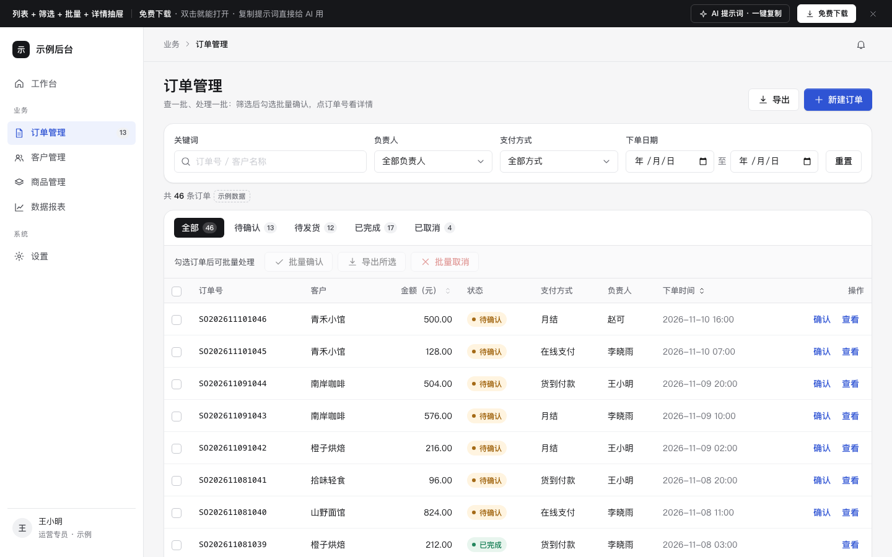

# 列表 + 筛选 + 批量 + 详情抽屉

免费下载 · 双击就能打开 · 复制提示词直接给 AI 用。

> 积木盒 · 老岳AI编辑部 · 原型组　|　PC 1440　|　单文件 HTML，离线可用　|　2026-11-10

这是一页能点的列表页：筛选、批量、抽屉，三样都在。双击 `index.html` 就能拿去评审。



---

## 一、用处

| 项 | 说明 |
|---|---|
| 适合什么需求 | 任何「查一批、处理一批」的后台页：订单、客户、商品、工单、退款单、供应商…… |
| 解决哪一步 | 评审时研发和测试最常追问的地方都能点给他看：筛选怎么联动、批量勾选跨页怎么算、详情在哪看、取消要不要二次确认 |
| 不适合 | 字段特别多、要横向滚很远的报表（用「数据看板」模板）；需要多人审批的单据（用「审批流」模板） |

**包含的页面和状态**

| 页面 | 状态（右下角「原型面板」切换） |
|---|---|
| 订单列表 | 正常 / 空（还没有数据）/ 加载（骨架屏）/ 出错（可重试）/ 无结果（筛选后为 0）/ 已勾选（批量栏亮起） |
| 详情抽屉 | 基本信息、商品明细、操作记录；底部按状态出「确认订单」「取消订单」；可上下切换订单 |

## 二、用法

### 2.1 打开

1. 下载整个文件夹，双击 `index.html`（Chrome / Edge / Safari 都行，不用联网）。
2. 右下角黑色「原型面板」切页面和状态；评审时按 `H` 把面板藏起来。
3. 想直接打开某个状态，在地址后面加：`#page=list&state=empty`（可选：`normal` `empty` `loading` `error` `noresult` `selected`；抽屉用 `#page=drawer`）。

### 2.2 改成你的业务（3 处）

| 改什么 | 在哪改 | 怎么改 |
|---|---|---|
| 配色、圆角、字体 | 文件最上面 `:root { ... }` | 换主色只改 `--accent` 和 `--accent-soft` 两行；圆角改 `--r-sm/md/lg` |
| 数据和字段 | `<script>` 顶部 `const DATA` | `statuses` 改状态枚举和颜色；`owners` `pays` `customers` `products` 换成你的；`total` 改条数，`pageSize` 改每页条数 |
| 列和文案 | 搜 `<thead>` 改表头；搜 `fillDrawer` 改抽屉里的字段 | 加一列：表头加一个 `<th>`，`renderTable` 里对应加一个 `<td>` |

增删页面：在 `Proto.init({ pages: [...] })` 里加一项，`render(page, state)` 里按 `page` 显示对应内容。

### 2.3 让 AI 帮你改这个原型（复制即用）

> 页面右侧 / 顶部「AI 提示词」可一键复制，变量点一下就能填。页面上有 3 条：从零生成这个原型、改成我的业务、在此基础上加页面 / 状态；下面是另外 2 条进阶用法。

**提示词 1：换成自己的业务**

```
这是一个单文件 HTML 原型模板（附件 index.html）。请把它改成「{{你的业务，例如：退款单管理}}」：
1. 只改 <script> 顶部的 DATA 和表头、抽屉字段，不要改文件里 KIT 标记之间的共用样式和脚本；
2. 状态枚举改成：{{状态1、状态2、状态3}}，每个状态配一个 tone（warning/info/success/neutral/danger）；
3. 列表列改成：{{列1、列2、列3……}}，金额列右对齐；
4. 抽屉里分「基本信息 / 明细 / 操作记录」三块，字段用：{{字段清单}}；
5. 批量操作改成：{{批量动作}}，不可操作的单据自动跳过并在确认弹窗里写明跳过几张。
改完输出完整文件，并列出你改了哪几处。
```

**提示词 2：补一条业务规则并让原型能演示**

```
在这个列表原型里加一条规则：{{例如：金额 ≥ 5000 元的订单，确认前必须填写备注}}。
要求：
1. 规则只在符合条件时出现，不影响其他订单；
2. 列表行内「确认」和抽屉底部「确认订单」两个入口都要生效，批量确认时符合条件的单据单独列出来；
3. 填写框有必填校验和错误提示，提交后操作记录里多一条；
4. 在原型面板里加一个状态「规则触发」，能一键演示。
只改必要的地方，输出完整文件。
```

## 三、交互说明

| 元素 | 交互 | 反馈 |
|---|---|---|
| 关键词搜索框 | 输入即搜（停 0.22 秒后筛选），匹配订单号和客户名，不区分大小写、忽略空格 | 列表实时刷新；上方显示「找到 N 条 · 含『词』」；有词时出现清除按钮 |
| 负责人 / 支付方式 / 下单日期 | 选择后立即筛选 | 条数实时更新；负责人和支付方式记在本机，下次打开自动带上并提示「已按你上次选的…筛好」，可一键清除 |
| 重置 / 清除筛选 | 点击 | 清空所有条件，回到「全部」Tab |
| 状态 Tab | 点击切换 | Tab 上的数字是当前筛选条件下的条数 |
| 表头「金额」「下单时间」 | 点击排序，再点切换升降序 | 箭头高亮当前排序列 |
| 行勾选 / 表头全选 | 勾选本页行；全选只选本页，半选显示横杠 | 批量栏显示「已选 N 条」，按钮从置灰变可点；跨页勾选保留 |
| 批量按钮 | **常驻显示**，未勾选时置灰 | 不用找按钮在哪 |
| 批量确认 | 点击 → 确认弹窗写明确认几张、跳过几张 | 成功 Toast「已确认 N 张订单」，4 秒内可撤销 |
| 批量取消 | 点击 → 红色确认弹窗（危险操作） | 已完成/已取消的自动跳过并说明 |
| 订单号 / 查看 / 行空白处 | 点击打开右侧抽屉 | 当前行左侧出现主色竖条；抽屉可用上下箭头切换上一条/下一条 |
| 抽屉 | Esc、点遮罩、点右上角关闭 | 关闭后焦点回到原来点的按钮；抽屉内 Tab 键只在抽屉里循环 |
| 出错态「重新加载」 | 点击 | 先出骨架屏，再回到列表，筛选条件保留 |
| 空态 | 「新建订单」「导入订单」两个出路 | — |

## 四、自检（按《交互设计规范》）

- [x] 状态全：正常 / 空 / 加载 / 出错 / 无结果 / 已勾选
- [x] 列表有搜索框、筛选、排序、条数、一键清除、分页、骨架、空态、无结果
- [x] 主操作首屏可见；PC 可点元素 ≥ 32px
- [x] 弹窗/抽屉：Esc、点遮罩关闭、焦点锁定、关闭后焦点回到触发处
- [x] 文字对比度 ≥ 4.5:1（最浅的说明文字 #6B6D75 白底 5.2:1、灰底 4.8:1；状态标签最低 4.8:1）
- [x] 示例数据标「示例数据」，客户名、单号全部虚构
- [x] 无 JS 报错（6 个状态逐个打开检查）
- [x] 1440 / 1280 不横向滚动；≤1100 侧栏收成图标

---

本模板由老岳AI编辑部·原型组制作，可免费下载、修改、用于工作项目。
