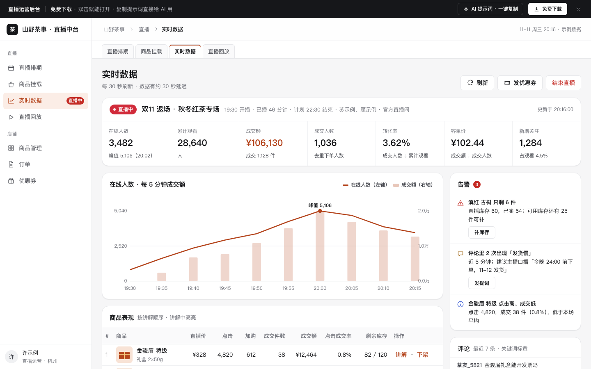

# 直播运营后台（排期 · 商品挂载 · 实时数据 · 回放）

免费下载 · 双击就能打开 · 复制提示词直接给 AI 用。

> 积木盒 · 老岳AI编辑部 · 原型组　|　PC 1440（500 宽不横滚，宽表格在卡片内滚动）　|　单文件 HTML，离线可用　|　2026-11-11 重做

茶叶品牌「山野茶事」的直播中台，当前时间 11-11 周三 20:16，「双11 返场 · 秋冬红茶专场」正在直播：周日历排期（撞档检查与一键修正）→ 给场次挂商品（直播价、折扣、毛利、直播库存校验）→ 直播中盯数据（指标由商品成交算出、库存告警、讲解切换、补库存、发券）→ 结束后回放（片段对账、违规片段处理、公开）。框架复用 `b-shell`（侧栏、顶栏面包屑、页签）。

---

## 一、用处

| 项 | 说明 |
|---|---|
| 适合什么需求 | 品牌自播 / 店播 / 达人直播的运营后台：排期、选品挂载、直播中控、回放复盘 |
| 解决哪一步 | 评审常问的都能点：主播或直播间撞档怎么提示、能不能排过去的时间、直播价能不能低于成本、直播库存能不能超过可用库存、毛利多少算低、转化率和客单价怎么算、库存快没了怎么办、发券推给多少人、提前结束会怎样、回放审核不通过怎么处理 |
| 不适合 | 商品资料维护（见 `b-mall-admin`）；订单与售后（见 `b-list-drawer`）；大屏展示（见 `bi-screen`） |

**页面和状态**（右下角「原型面板」切换）

| 页面 | 状态 |
|---|---|
| ① 直播排期 | 周日历（9 场）/ 列表视图 / 新建时撞档 / 本周无排期 / 加载中 / 加载失败 / 无权限（主播账号） |
| ② 商品挂载 | 正常（6 款）/ 价格库存校验不过 / 还没挂商品 / 加载中 / 加载失败 |
| ③ 实时数据 | 直播中 / 库存告警 · 已售罄 / 未开播（开播检查）/ 加载中 / 数据断开 |
| ④ 直播回放 | 正常（6 场）/ 还没有回放 / 加载中 / 加载失败 |

## 二、用法

1. 双击 `index.html`；右下角「原型面板」切页面和状态，按 `H` 隐藏；直达例：`#page=goods&state=invalid`。
2. 改数据只改 `<script>` 顶部 `DATA`：`hosts` 主播、`rooms` 直播间、`channels` 渠道；`sessions` 场次（第几天、开始结束分钟、主播、直播间、状态、预约、成交）；`goods` 商品库（日常价、成本价、可用库存）；`mounts` 每场挂载（直播价、直播库存、限购、上架方式）；`minMargin` 毛利底线；`live` 直播中的在线、观看、成交人数、每个商品的点击 / 加购 / 成交 / 剩余；`replays` 回放与 `segs` 讲解片段。
3. 改颜色：`:root` 的 `--accent`（默认茶褐）和 `--live`（直播红）。
4. 页面顶部「AI 提示词」3 条：从零生成（写明撞档、挂载校验、指标公式、回放审核）/ 改成我的业务（变量：品牌品类、主播直播间、商品、毛利与时长规则、指标与关键词）/ 加页面或状态（主播业绩、福袋抽奖、多平台推流、直播复盘）。

## 三、交互说明

| 元素 | 交互 | 反馈 |
|---|---|---|
| 周日历 | 日历 / 列表切换 | 场次块按状态上色并写时间、主播、直播间、挂载数与预约；未挂商品的加黄框，顶部提醒「去挂载」；红线 = 现在 |
| 新建场次 | 右侧抽屉 | 标题 1～30 字；结束晚于开始；单场 ≤ 4 小时；不能排过去；至少 1 位主播；主播或直播间撞档逐条写出撞的是哪一场，给「换到空闲直播间」「改到 21:30 开始」一键修正，撞档未解决不能保存 |
| 场次详情 | 点场次 | 状态、时长、主播、直播间、预约、挂载数；待开播可挂载 / 编辑 / 取消（二次确认，通知预约用户）；直播中进实时数据；已结束看回放 |
| 挂载表 | 改直播价 / 库存 / 限购 / 上架方式 | 折扣、毛利率即时算；高于日常价、低于成本价、超过可用库存标红并禁止保存；毛利低于 15% 标黄只提醒；改过就出现「撤销修改」 |
| 讲解顺序 | 上移 / 下移 | 序号即直播讲解顺序 |
| 批量填价 | 9 / 8.5 / 8 折 | 所有商品直播价 = 日常价 × 折扣取整 |
| 商品库 | 搜索、分类、挂载 | 售罄、已挂载置灰；新挂商品按 9 折预填；空场次可一键挂常卖 3 款 |
| 保存 | 保存条 | 写「有 N 处错误 / 提醒」；直播中保存再确认一次；有修改时切场次被拦、离开页面要确认 |
| 实时指标 | 刷新 | 成交额 = 各商品成交件数 × 直播价之和；转化率 = 成交人数 ÷ 累计观看；客单价 = 成交额 ÷ 成交人数；成交柱按总额分摊到每 5 分钟 |
| 商品表现 | 讲解 / 上下架 / 补库存 | 讲解中高亮；剩余 ≤ 10% 标红并出现「补库存」，补货不能超过可用库存；售罄自动下架、不能讲解 |
| 告警 / 评论 | — | 库存告警、评论关键词「发货慢」（可发提词给主播）、点击高成交低；评论关键词标黄 |
| 发券 | 抽屉 + 确认 | 1～5000 张；确认框写清推给多少在线观众、发出不能撤回 |
| 结束直播 | 确认 | 写清提前多久结束；结束后跳到回放，新回放「生成中」 |
| 回放 | 筛选、查看、公开 | 生成中显示进度；审核不通过的片段标红，「去掉这段」后重新生成；各片段成交合计 = 整场成交额；只有可观看的能公开 |
| 未开播 | 实时数据 | 开播检查清单（商品、主播确认、推流测试、预告、封面），未完成项给「去处理」 |

## 四、验收结论（2026-11-11 原型组）

**通过。** 对照上轮打回原因：上轮是通用「筛选 + 表格 + 详情」骨架，排期、挂载、实时数据、回放都没有直播专属的规则和联动。本次：

| 方面 | 本次 |
|---|---|
| 业务密度 | 9 场排期（4 种状态）、14 款商品（价格、成本、库存各不同，含售罄与临期）、4 场挂载、8 款商品实时数据、6 场回放与 7 段讲解片段，数字逐行不同 |
| 直播专属规则 | 撞档检测与一键修正、时长与过去时间校验、价格 / 成本 / 库存校验与毛利提醒、指标公式、库存 ≤10% 告警、补货上限、回放片段对账与审核 |
| 全状态 | 21 个状态，含无权限（主播账号）、未开播检查、数据断开 |
| 提示词 | 3 条写明规则与公式，不是套话 |

机器验收：`_kit/atest.sh` 1440 / 1280 / 500 宽 × 21 个状态：0 JS 报错、0 横滚、0 对比度问题、0 小于 24px 的可点元素；提示词面板可打开 / 展开 / 填变量 / 复制。交互断言 47 条在无头 Chrome 通过（日历与列表、标题必填、主播与直播间撞档、一键换直播间、一键改时间、结束早于开始、过去时间、4 小时上限、创建、详情、取消通知、进入挂载、低于成本 / 高于日常 / 超库存、毛利提醒可保存、批量 8 折、调顺序、售罄不可挂、挂载新品、分类、未保存不能切场次、保存、空挂载一键挂、离开确认、实时指标公式、库存告警、切讲解、下架、补货上限与成功、刷新、发券校验与确认人数、结束直播生成回放、回放筛选、片段对账、去掉违规片段、公开、生成中不能公开、开播检查、售罄自动下架、撞档状态、无权限、出错重试）。`gtest.sh` 面向组件画廊，页面模板不适用，以交互断言代替。

---

本模板由老岳AI编辑部·原型组制作，可免费下载、修改、用于工作项目。
