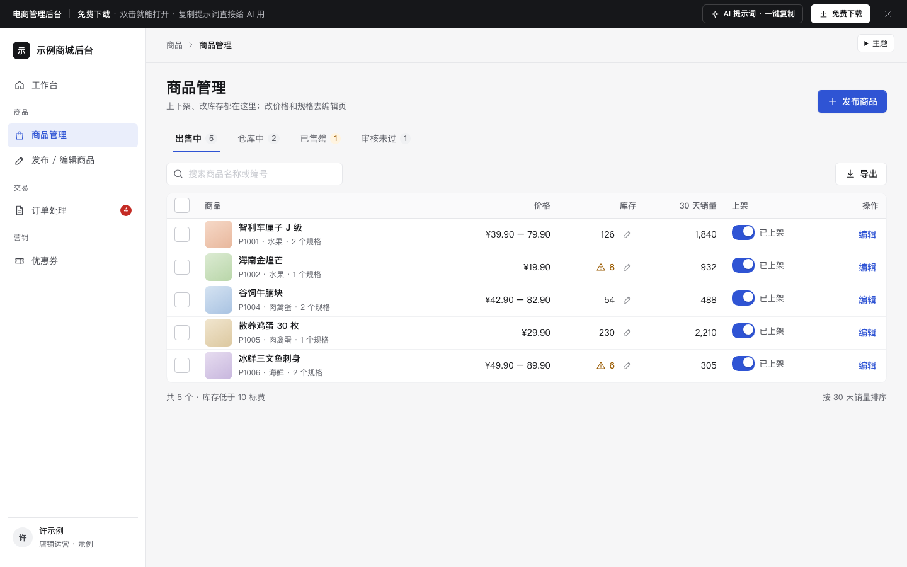

# 电商管理后台（商品 / 订单 / 营销）

免费下载 · 双击就能打开 · 复制提示词直接给 AI 用。

> 积木盒 · 老岳AI编辑部 · 原型组　|　PC 1440　|　单文件 HTML，离线可用　|　2026-11-10

商家每天用得最多的 4 个页面：商品管理（上下架、就地改库存）、发布 / 编辑商品（规格自动组合成 SKU、批量填写）、订单处理（发货、售后）、优惠券（实时预览券面和预计成本）。

---

## 一、用处

| 项 | 说明 |
|---|---|
| 适合什么需求 | 电商、零售、生鲜的商家后台 / 店铺后台；SaaS 电商后台的核心几页 |
| 解决哪一步 | 评审最常追问的都能点给他看：下架有什么影响、库存 0 能不能上架、加一个规格值 SKU 怎么变、批量发货单号怎么填、拒绝售后要不要写原因、券的面额是不是填错了、发这批券大概花多少钱 |
| 不适合 | 平台级运营后台（多店铺、招商审核）；买家端订单与售后（见 `c-order`） |

**包含的页面和状态**

| 页面 | 状态（右下角「原型面板」切换） |
|---|---|
| 商品管理 | 正常 / 已勾选（批量）/ 搜索无结果 / 加载中 |
| 发布 / 编辑商品 | 正常 / 校验出错 |
| 订单处理 | 待发货 / 发货抽屉 / 售后处理 / 都处理完了 |
| 优惠券 | 新建 / 校验出错 / 面额偏高提醒 |

## 二、用法

1. 双击 `index.html`；右下角「原型面板」切状态，按 `H` 隐藏；直达 `#page=sku&state=errors`。
2. 改数据：`<script>` 顶部 `DATA`——`goods` 商品（状态 on / off / audit）、`dims` 规格项、`orders` 订单（ship 待发货 / sent 已发货 / after 售后）、`couriers` 快递公司、`coupons` 已有券、`lowStock` 低库存阈值、`avgOrder` 估算折扣券成本用的客单价。
3. 改颜色：最上面 `:root` 的 `--accent`。
4. 页面右侧「AI 提示词」3 条：从零生成 / 改成我的业务（变量：行业、规格项、售后规则、券类型）/ 加页面或状态（例：定时上架、批量导入发货、限时折扣）。

## 三、交互说明

| 元素 | 交互 | 反馈 |
|---|---|---|
| 商品 Tab | 出售中 / 仓库中 / 已售罄 / 审核未过 | 带数量；已售罄有货时数字标黄 |
| 库存 | 点铅笔就地改；回车保存、Esc 取消、点别处自动保存 | 非整数标红提示；Toast「库存 126 → 50」；低于 10 标黄、为 0 标红 |
| 上下架开关 | 点击 | 下架先确认并写影响（搜不到、购物车失效、已付款照常发），Toast 可撤销；库存 0 不能上架；审核未过置灰并写原因 |
| 批量上下架 | 勾选后批量条 | 不满足条件的自动跳过并写数量和原因 |
| 规格值 | 输入后回车加，× 删除 | SKU 表自动重新组合，已填的价格库存保留；重复值拦住；删除规格项可撤销 |
| SKU 批量填写 | 第一行填售价 / 原价 / 库存，点「填到全部」 | 只填在售的行；填完自动重新校验 |
| SKU 在售开关 | 关掉 | 该行变灰，不参与校验和价格计算 |
| 预览与检查 | 输入即更新 | 右侧显示最低价「起」、规格数、总库存；「发布前检查」6 项逐条打勾 |
| 保存 | 点「保存并上架」 | 有错时顶部汇总、表格内标红并聚焦第一处；库存为 0 的 SKU 会提示买家看到「已售罄」 |
| 发货 | 单个或勾选后批量 | 右侧抽屉，快递公司默认上次用的；单号 10–15 位校验；同城配送不需要单号；发完左侧菜单数字减少 |
| 售后处理 | 点「处理」 | 抽屉显示原因、说明、照片、退款金额、处理截止时间（写时间不做倒计时）；拒绝必须写原因（买家可见） |
| 优惠券类型 | 满减 / 折扣 / 无门槛 | 「优惠内容」一行跟着变；右侧券面实时预览 |
| 优惠券校验 | 输入即检查，保存时汇总 | 面额 ≥ 门槛、折扣不在 1–9.9、限领 > 总量、结束早于开始都会拦住；面额超过门槛 50% 或无门槛超过 20 元给黄色提醒（不拦） |
| 预计成本 | — | 发放量 × 预计使用率 35% × 每张优惠，写出算式 |
| 停止发放 | 进行中的券 | 确认时说明已领的仍可用 |

## 四、自检

- [x] 状态全：4 个页面 13 个状态，含空、加载、校验出错、全部处理完
- [x] 影响大的操作（下架、停止发放、删除规格项）先说明影响，能撤销的给撤销
- [x] 系统能算的都算好：SKU 自动组合、批量填写、最低价、总库存、优惠成本
- [x] 抽屉 Esc 关闭、焦点锁定、关闭后焦点回到触发处；表格勾选、开关切换后焦点不丢
- [x] 示例数据标「示例」，无真实品牌
- [x] 无 JS 报错（13 个状态逐个打开检查）；27 条交互断言通过（无头 Chrome）；1440 设计，1280 不横滚

---

本模板由老岳AI编辑部·原型组制作，可免费下载、修改、用于工作项目。

状态：已通过浏览器验收（1440/500 宽 0 报错、0 溢出、对比度与触控达标；标准外壳与跨目录比对通过）
