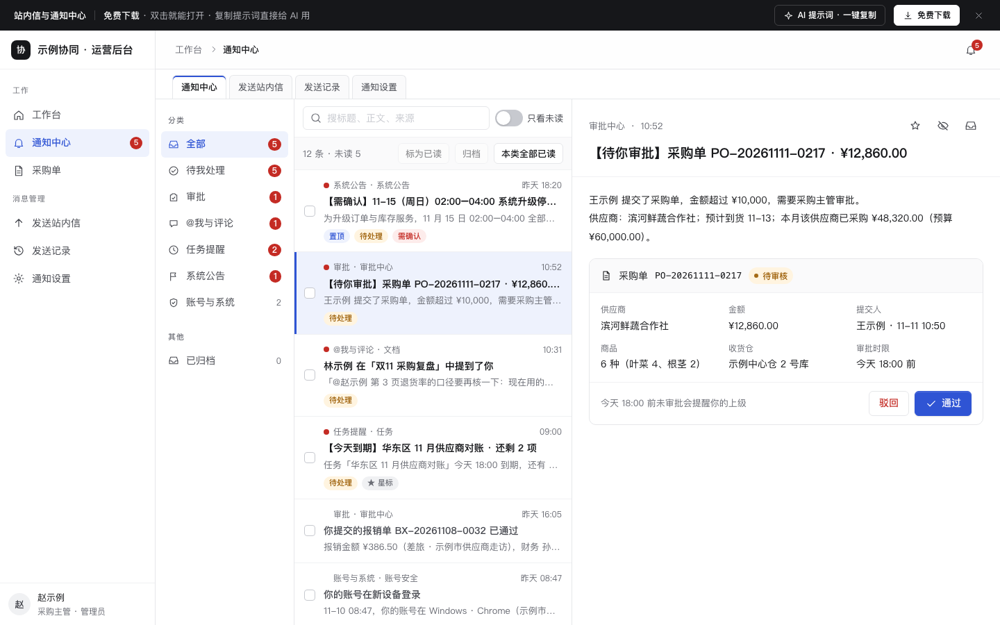

# 站内信与通知中心（收件三栏 + 发送 + 已读统计 + 通知偏好）

免费下载 · 双击就能打开 · 复制提示词直接给 AI 用。

> 积木盒 · 老岳AI编辑部 · 原型组　|　PC 1440（500 宽不横滚）　|　单文件 HTML，离线可用　|　2026-11-11 重做

后台的「消息中心」两头都做了：收的人（三栏通知中心，在消息里直接审批、确认公告、完成任务）和发的人（发站内信、看谁读了没读、催读、撤回），再加个人通知偏好。框架复用 `b-shell`（侧栏、顶栏面包屑、页签），顶栏铃铛未读数和分类、列表三处始终一致。

---

## 一、用处

| 项 | 说明 |
|---|---|
| 适合什么需求 | 后台 / SaaS 的站内信、通知中心、系统公告、待办提醒、通知渠道设置 |
| 解决哪一步 | 评审常问的都能点：消息里能不能直接处理、公告怎么确保大家看过、发错了能不能撤、发给多个部门会不会重复、短信多少钱、谁没读、哪些通知不能关 |
| 不适合 | 即时聊天（见 `m-chat`）；C 端 App 消息页（见 `m-notice`） |

**页面和状态**（右下角「原型面板」切换）

| 页面 | 状态 |
|---|---|
| ① 通知中心 | 正常（12 条、5 条未读）/ 空（全部已读）/ 消息已被撤回 / 关联单据无权限 / 加载中 / 加载失败 |
| ② 发送站内信 | 填写中（已预填）/ 空白新建 / 校验出错 / 发送失败 / 加载中 / 无发送权限 |
| ③ 发送记录 | 正常（9 条，6 种状态）/ 空 / 加载中 / 加载失败 / 无权限 |
| ④ 通知设置 | 正常 / 空（未绑定其他渠道）/ 加载中 / 加载失败 |

## 二、用法

1. 双击 `index.html`；右下角「原型面板」切页面和状态，按 `H` 隐藏；直达例：`#page=compose&state=invalid`。
2. 改数据只改 `<script>` 顶部 `DATA`：`cats` 分类、`msgs` 站内信（`obj` 关联单据及可直接做的操作、`confirm` 需确认、`att` 附件）、`sent` 发送记录、`deptRead` / `unread` 已读统计、`scopes` 接收范围与人数、`prefs` 通知偏好矩阵（最后一位 1 = 不能关闭）。
3. 改颜色：`:root` 的 `--accent`。
4. 页面顶部「AI 提示词」3 条：从零生成 / 改成我的业务（变量：系统名称、分类、关联对象与操作、不能关闭的通知、接收范围）/ 加页面或状态（消息聚合、消息模板、铃铛快览、发送审批）。

## 三、交互说明

| 元素 | 交互 | 反馈 |
|---|---|---|
| 分类 | 点击 | 每类显示未读数（红底）或总数；切换后列表和阅读区同步 |
| 消息列表 | 点击 / 回车 / 上下方向键 | 打开即已读，铃铛、侧栏角标、分类数一起减；标签：置顶 / 待处理 / 已处理 / 需确认 / 星标；置顶排最上 |
| 搜索 · 只看未读 | 输入 / 开关 | 实时过滤；无结果给「清空筛选」 |
| 批量 | 勾选后「标为已读」「归档」；「本类全部已读」 | 按钮常驻，未勾选置灰；归档 Toast 带「撤销」 |
| 关联单据卡片 | 采购单「通过 / 驳回」、任务「标记完成」、评论「去回复」 | 处理后卡片状态变、消息变「已处理」、待处理数减；驳回要二次确认 |
| 需确认公告 | 「我已阅读并知晓」 | 记录确认时间，发送人在发送记录里能看到确认数 |
| 账号安全消息 | 「不是我本人，去改密码」 | 跳转账号安全（示例） |
| 阅读区工具 | 星标 / 标为未读 / 归档 | 标为未读后铃铛数加回 |
| 发送 · 接收范围 | 下拉添加部门 / 角色，可移除；排除休假人员 | 右侧「预计送达」逐项列人数，重复人员自动去重（华东店长同属门店店长 −26），合计实时变 |
| 发送 · 渠道 | 站内信必选；邮件 / 短信 / 企业微信可选 | 勾短信时写条数（超 70 字拆条）和费用 |
| 发送 · 校验 | 点「发送」 | 标题 ≤40 字、正文 ≤1000 字、至少 1 个范围、链接 http(s)、定时晚于现在 5 分钟、确认截止晚于发送时间；顶部汇总「有 N 处要改」并聚焦第一处 |
| 发送 · 预览 | 输入即变 | 收件人视角卡片，变量用 钱示例（仓储部）替换 |
| 发送确认 | 二次确认 | 写人数、撤回规则、短信费用；发出后跳发送记录并高亮新行 |
| 发送记录 | 筛选类型 / 状态 / 关键字；点行 | 已读率进度条（悬停看人数）；抽屉：按部门已读、未读名单、「催读」（24 小时 1 次，催过置灰）、「撤回」（二次确认写清影响）；定时可「取消定时」转草稿；草稿「继续编辑」 |
| 通知设置 | 事件 × 渠道开关 | 站内信列、账号安全行锁定；底部写「有 N 处修改还没保存」，可撤销；未保存就离开会确认 |

## 四、验收结论（2026-11-11 原型组）

**通过。** 对照上轮打回原因逐条处理：

| 上轮问题 | 本次 |
|---|---|
| 数据批量复制（「示例订单通知2…10」） | 12 条站内信、9 条发送记录逐条写实（单号、金额、部门人数、已读数各不相同），人数和已读率前后对得上 |
| 通用「筛选 + 表格 + 详情」骨架 | 三栏收件、消息内直接审批、需确认公告、发送预览与去重人数、催读撤回、偏好矩阵，均为消息专属 |
| 提示词套话 | 3 条写明分类、渠道规则、字数与定时校验、去重、催读撤回边界 |
| 勾选框 13px | 勾选框外包 28px 点击区 |

机器验收：`_kit/atest.sh` 1440 / 1280 / 500 宽 × 21 个状态：0 JS 报错、0 横滚、0 对比度问题、0 小于 24px 的可点元素；提示词面板可打开 / 展开 / 复制。交互断言 23 条通过（未读联动、就地审批、确认阅读、只看未读、全部已读、批量归档与撤销、搜索、发送校验、人数去重、定时校验、发送入记录、已读详情、催读限制、取消定时、筛选、设置改动计数、锁定项、未保存离开确认）。`gtest.sh` 面向组件画廊（Gallery），页面模板不适用，以交互断言代替。

---

本模板由老岳AI编辑部·原型组制作，可免费下载、修改、用于工作项目。
