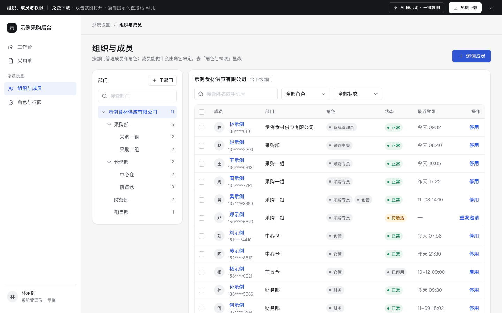

# 组织、成员与权限

免费下载 · 双击就能打开 · 复制提示词直接给 AI 用。

> 积木盒 · 老岳AI编辑部 · 原型组　|　PC 1440　|　单文件 HTML，离线可用　|　2026-11-10

后台「系统设置」里最难讲清的一块：部门树 + 成员表、角色 + 权限勾选、数据范围。重点做了评审最常卡住的地方——勾选联动（勾操作自动勾查看）、改了没保存、系统角色只读、「这个人为什么能看到这个」。

---

## 一、用处

| 项 | 说明 |
|---|---|
| 适合什么需求 | 新系统要上权限；老系统权限乱了要重新梳理；要给研发讲清「功能权限」和「数据范围」的区别 |
| 解决哪一步 | 评审最常追问的都能点给他看：一个人有两个角色权限怎么算、勾了编辑没勾查看会怎样、改了一半切走怎么办、最后一个管理员能不能停用、有人的角色能不能删 |
| 不适合 | 只有 2–3 个固定角色、不需要配置的小工具（写死即可）；字段级权限（可用第 3 条提示词加） |

**包含的页面和状态**

| 页面 | 状态（右下角「原型面板」切换） |
|---|---|
| 组织与成员 | 正常 / 已勾选（批量）/ 搜索无结果 / 部门没有人 / 加载中 / 加载失败 |
| 角色与权限 | 正常 / 有未保存修改 / 系统角色只读 / 新建角色 / 数据范围 |

## 二、用法

1. 双击 `index.html`；右下角「原型面板」切状态，按 `H` 隐藏；直达 `#page=roles&state=dirty`。
2. 改数据：`<script>` 顶部 `DATA`——`depts` 部门树、`roles` 角色（`sys:true` 为内置只读，`scope` 为数据范围）、`members` 成员、`perms` 权限点（模块 › 页面 › 操作，第 1 个操作默认是「查看」）、`grants` 各角色已有权限。
3. 改颜色：最上面 `:root` 的 `--accent`。
4. 页面右侧「AI 提示词」3 条：从零生成 / 改成我的业务（变量：系统名称、部门树、角色、权限点、依赖关系、数据范围选项）/ 加页面或状态（例：字段权限、权限变更记录、离职交接）。

## 三、交互说明

| 元素 | 交互 | 反馈 |
|---|---|---|
| 部门树 | 点名称选中（含下级部门的成员）；点箭头展开收起；方向键 ↑↓ 移动、→ 展开、← 收起 | 每个部门写人数（不含已停用）；搜索部门时命中字高亮、自动展开上级 |
| 新建子部门 | 点「子部门」 | 在当前选中部门下新建并选中 |
| 成员搜索 / 筛选 | 输入姓名或手机号；按角色（含「未分配」）、状态筛选 | 有筛选时出现「清空筛选」；无结果给「清空筛选」「在全公司搜索」 |
| 勾选成员 | 勾选 / 表头全选（半选态） | 出现批量条：调整部门、设置角色、停用、取消选择 |
| 邀请成员 | 右侧抽屉 | 部门默认当前选中部门、角色默认「采购专员」；手机号 11 位、重复校验；发送后显示「待激活」，可「重发邀请」 |
| 点成员姓名 | 右侧抽屉 | 列出实际权限，每条写「来自：哪个角色」；多个角色数据范围取最大 |
| 停用 | 确认后执行 | Toast 5 秒内可撤销；正常状态的系统管理员只剩 1 个时拦住并写原因 |
| 角色列表 | 点切换 | 写人数和数据范围；有未保存修改时切走先确认；内置角色带锁 |
| 功能权限 | 勾选操作 / 页面全选 / 模块全选 | 勾任一操作自动勾「查看」并提示；取消「查看」同页面其他操作一起取消并提示；改过的项标黄；模块写「已选 N / M」 |
| 数据范围 | 单选 5 种 | 每种写一句举例；「指定部门」至少选 1 个，否则不能保存 |
| 保存条 | 有修改时浮在底部 | 写「有 N 处修改，保存后 X 位成员下次刷新生效」；放弃 / 保存 |
| 内置角色 | — | 全部置灰，提示「可复制为新角色」 |
| 删除角色 | 点「删除」 | 还有成员时拦住：「还有 N 人，先把他们换到别的角色」；没人时二次确认 |

## 四、自检

- [x] 状态全：成员页 6 态、角色页 5 态，含空、加载、出错、无结果
- [x] 危险操作有拦截和原因（最后一个管理员、有人的角色），停用可撤销
- [x] 权限依赖自动联动并提示，不靠用户记规则；改动标黄、计数，离开前确认
- [x] 抽屉 Esc 关闭、焦点锁定、关闭后焦点回到触发处；部门树可键盘操作；表格勾选后焦点不丢
- [x] 示例数据标「示例」，手机号脱敏，无真实公司名
- [x] 无 JS 报错（11 个状态逐个打开检查）；21 条交互断言通过（无头 Chrome）；1440 设计，1280 不横滚

---

本模板由老岳AI编辑部·原型组制作，可免费下载、修改、用于工作项目。
