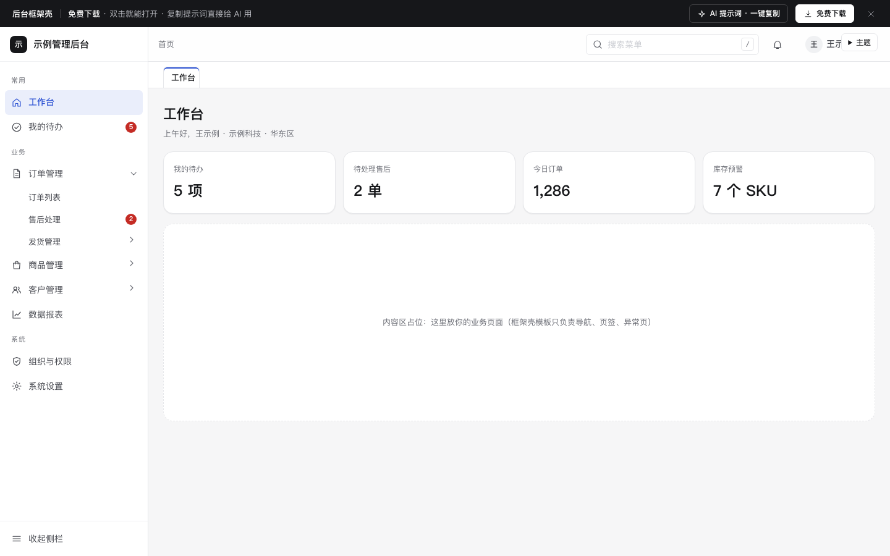

# 后台框架壳

免费下载 · 双击就能打开 · 复制提示词直接给 AI 用。

> 积木盒 · 老岳AI编辑部 · 原型组　|　PC 1440　|　单文件 HTML，离线可用　|　2026-11-10

新后台的「壳」：三级侧栏（可收起成图标栏）、面包屑、菜单搜索、多页签、用户菜单，以及 403 / 404 / 500 三个异常页。内容区留空，放你自己的页面。

---

## 一、用处

| 项 | 说明 |
|---|---|
| 适合什么需求 | 新建一套中后台、或给老后台重新梳理导航时，先把框架定下来 |
| 解决哪一步 | 评审最常追问的都能点给他看：菜单几级、收起后怎么找子菜单、菜单多了怎么搜、打开很多页怎么切、没权限 / 页面不存在 / 出错时用户看到什么 |
| 不适合 | 具体业务页面（列表用 `b-list-drawer`、看板用 `b-dashboard`、CRM 用 `b-crm`，可以直接塞进这个壳的内容区） |

**包含的状态**

| 页面 | 状态（右下角「原型面板」切换） |
|---|---|
| 框架 | 侧栏展开 / 侧栏收起 / 搜索菜单中 / 多个页签 |
| 异常页 | 403 无权限 / 404 / 500 |

## 二、用法

1. 双击 `index.html`；右下角「原型面板」切状态，按 `H` 隐藏；直达 `#page=error&state=e404`。
2. 改菜单：`<script>` 顶部 `DATA.menu`——`sec` 是分组标题，`children` 是下级（最多三级），`badge` 是待办数，`perm:false` 表示当前角色没权限（点了进 403）。
3. 改颜色：最上面 `:root` 的 `--accent`。
4. 页面右侧「AI 提示词」3 条：从零生成 / 改成我的业务（变量：系统名称、菜单结构、角色、无权限菜单、有待办的菜单）/ 加页面或状态（例：切换组织、工作台首页、会话过期）。

## 三、交互说明

| 元素 | 交互 | 反馈 |
|---|---|---|
| 带子菜单的项 | 点击 | 展开 / 收起，箭头旋转；当前页高亮，上级加粗；收起时显示子菜单待办合计 |
| 收起侧栏 | 点底部按钮或 Ctrl/⌘ + B | 收成 64px 图标栏；状态记在本机，下次打开保持 |
| 收起后的图标 | 悬停或点击 | 右侧弹出子菜单浮层；有待办的图标右上角红点 |
| 菜单搜索 | 按 `/` 聚焦，输入即过滤 | 自动展开命中项、命中字高亮，命中上级时下级全部显示；回车打开第一个；Esc 清空 |
| 面包屑 | 点上级 | 打开该上级的第一个页面；最后一级不可点 |
| 页签 | 打开菜单自动加页签；点切换；× 关闭 | 关闭当前页签回到右边一个（没有就左边）；最多 8 个，超出关闭最早的并提示；工作台不可关 |
| 用户菜单 | 点击 | 姓名、角色、组织；退出登录先确认 |
| 403 | 点无权限菜单 | 写清缺哪个权限、找谁开通；「申请权限」后按钮变「已申请，等待审批」 |
| 404 / 500 | — | 404 给返回和菜单搜索；500 给重试和错误编号（可复制） |

## 四、自检

- [x] 状态全：展开 / 收起 / 搜索 / 多页签 / 403 / 404 / 500
- [x] 键盘可用：`/` 搜索、Ctrl/⌘+B 收起、Esc 关浮层、Tab 走完菜单
- [x] 异常页都有出路，写清原因，不只写错误码
- [x] 侧栏折叠状态记忆；页签数量有上限并提示
- [x] 示例数据标「示例」，无真实公司名
- [x] 无 JS 报错（7 个状态逐个打开检查）；1440 设计，1280 不横滚

---

本模板由老岳AI编辑部·原型组制作，可免费下载、修改、用于工作项目。

状态：已通过浏览器验收（1440/500 宽 0 报错、0 溢出、对比度与触控达标；标准外壳与跨目录比对通过）
