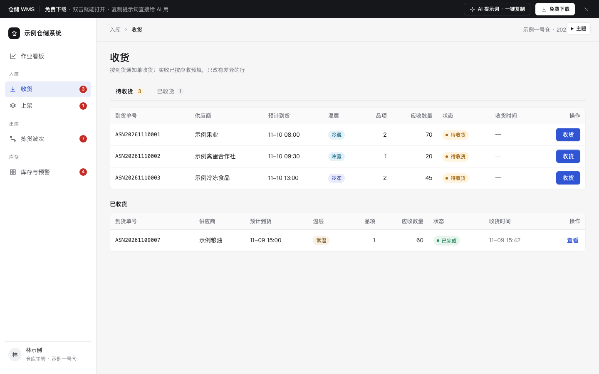

# 仓储 WMS（入库 / 出库 / 库存）

免费下载 · 双击就能打开 · 复制提示词直接给 AI 用。

> 积木盒 · 老岳AI编辑部 · 原型组　|　PC 1440（1280 不横滚）　|　单文件 HTML，离线可用　|　2026-11-10

仓库一线作业的四个页面：收货、上架、拣货波次、库存与预警。重点是「系统算好，人只确认」：实收按应收预填、到期日自动算、库位自动推荐、自动组波、按先到期先出分配批次、补货量自动算。

---

## 一、用处

| 项 | 说明 |
|---|---|
| 适合什么需求 | 生鲜、食品、电商、零售的仓库管理系统；有温层、有保质期的仓尤其合适 |
| 解决哪一步 | 把评审最常问的规则做成能点的样子：收货有差异怎么记、临期货收不收、库位怎么推荐、波次怎么组、拣货先拿哪一批、库存不够怎么办、什么时候该补货 |
| 不适合 | 运输调度（TMS，P2 待做）；进销存的采购销售对账（`b-erp`，P1 待做）；手持 PDA 的扫码界面（可用第 3 条提示词改成手机框） |

**包含的页面和状态**

| 页面 | 状态（右下角「原型面板」切换） |
|---|---|
| 收货 | 待收货 / 收货抽屉 / 有差异·临期 / 都收完了 |
| 上架 | 正常 / 库位放不下 |
| 拣货波次 | 待组波 / 组波预览 / 拣货单 / 缺货 |
| 库存与预警 | 正常 / 临期预警 / 加载中 / 搜索无结果 |

## 二、用法

1. 双击 `index.html`；右下角「原型面板」切状态，按 `H` 隐藏；直达 `#page=wave&state=short`。
2. 改数据：`<script>` 顶部 `DATA`——`goods` 货品主数据（温层、保质期、安全库存）、`locs` 库位和容量、`inv` 批次库存、`asn` 到货通知单、`putaway` 待上架、`orders` 待出库订单、`diffReasons` 差异原因；规则阈值 `minLifeRatio`（拒收线）、`nearDays`（临期天数）、`waveMax`（每波单数）。
3. 改颜色：`:root` 的 `--accent`（主色），本模板样式里的 `--t-amb` / `--t-cold` / `--t-frz`（常温 / 冷藏 / 冷冻）。
4. 页面右侧「AI 提示词」3 条：从零生成 / 改成我的业务（变量：仓库类型、货品单位、温层、拒收和组波规则）/ 加页面或状态（例：盘点、退货入库、移库）。

## 三、规则（系统怎么算）

| 规则 | 计算方式 |
|---|---|
| 到期日 | 生产日期 + 保质期天数 |
| 收货临期提醒 | 剩余天数 < 保质期 × 1/3 → 黄色「建议拒收」（只提醒不拦截） |
| 收货差异 | 实收 − 应收；不为 0 必须选原因，少收只能选少货 / 破损 / 不合格，多收只能选多货 |
| 推荐库位 | 只在同温层里选 → 同一货品已在且放得下的库位优先 → 否则剩余空间最大的 |
| 组波 | 同线路 + 同温层合成一波，每波最多 `waveMax` 单；不勾选就按全部待组波订单 |
| 拣货分配 | 同一货品合并 → 按到期日从早到晚（先到期先出）扣可用库存，过期批次不分配 → 按库位编码排序成拣货路径；不够的单独一行「缺 N」 |
| 可用库存 | 批次数量 − 已分配；过期批次不计入 |
| 低库存 / 补货建议 | 货品可用合计 < 安全库存 → 低库存；建议补货 = 安全库存 × 2 − 可用合计（≤ 0 不补） |

## 四、交互说明

| 元素 | 交互 | 反馈 |
|---|---|---|
| 收货抽屉 | 点「收货」 | 实收已按应收填好；改了实收，差异和合计即时变；有差异才出现原因下拉 |
| 生产日期 | 选日期 | 到期日和剩余天数自动算；不能晚于今天；临期行标黄 |
| 确认收货 | 点击 | 有错 Toast「还有 N 处要改」并聚焦第一处；成功后按收货生成上架任务，单子状态「已完成 / 有差异」 |
| 上架库位 | 下拉 | 默认推荐库位并写理由；温层不符的选项置灰；数量超过剩余空间时报错，该行「上架」置灰 |
| 批量上架 | 勾选后点 | 按钮常驻，未勾选置灰；放不下的行会拦截并点名 |
| 自动组波 | 点击 | 弹窗预览每个波次（线路、温层、单数、件数、单号），确认后生成 |
| 拣货单 | 点波次 | 抽屉里按路径排好；缺货行标红，必须「标记缺货」后才能「拣货完成」 |
| 库存 Tab | 全部 / 低库存 / 临期 / 已过期 | 带数量；临期黄、过期红；顶部 4 个数同口径 |
| 生成补货单 | 勾选后点 | 按钮常驻，未勾选置灰；确认框逐个写「可用 N，建议补 M」；库存充足的不补 |
| 转报损 | 勾选后点 | 先确认（含未过期批次时额外提醒）；完成后 Toast 可撤销 |

## 五、自检

- [x] 状态全：收货 4 态、上架 2 态、波次 4 态、库存 4 态
- [x] 系统能算的不让人算：实收预填、到期日、差异、推荐库位、组波、FEFO 分配、补货量
- [x] 批量按钮常驻、未勾选置灰；危险操作（报损）先确认且可撤销
- [x] 数字列右对齐、等宽数字；抽屉和弹窗 Esc 关闭、焦点锁定
- [x] 示例数据标「示例」，无真实品牌
- [x] 无 JS 报错（14 个状态逐个打开检查）；29 条交互断言通过（无头 Chrome）

---

本模板由老岳AI编辑部·原型组制作，可免费下载、修改、用于工作项目。

状态：已通过浏览器验收（1440/500 宽 0 报错、0 溢出、对比度与触控达标；标准外壳与跨目录比对通过）
