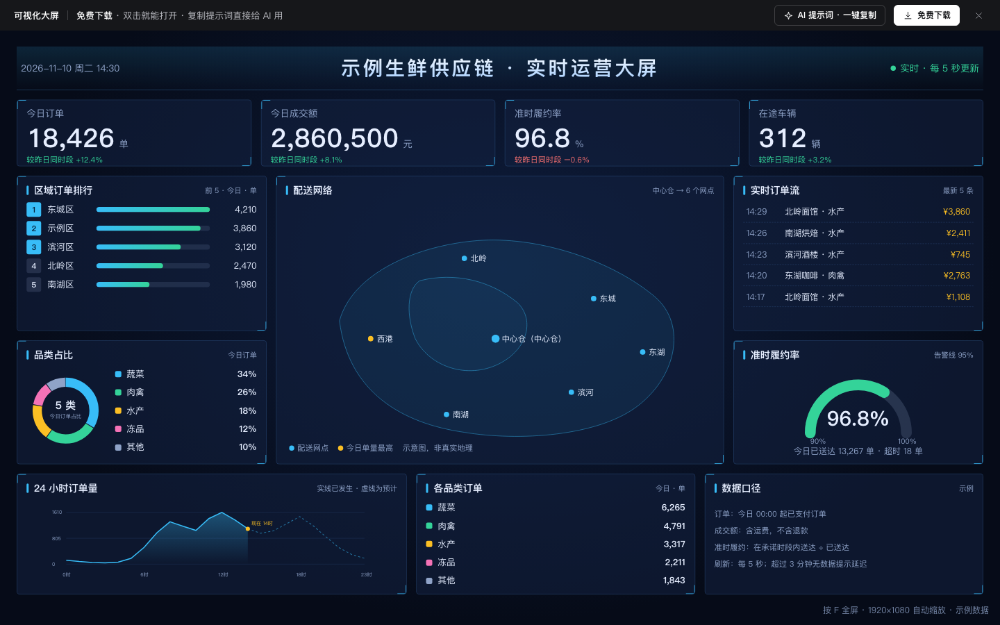

# 可视化大屏

免费下载 · 双击就能打开 · 复制提示词直接给 AI 用。

> 积木盒 · 老岳AI编辑部 · 原型组　|　1920×1080 自动缩放　|　单文件 HTML，离线可用，不依赖图表库　|　2026-11-10

一块能动的运营大屏：指标数字逐位滚动、区域排行、配送网络飞线、实时订单流、履约率仪表、24 小时趋势。双击 `index.html`，按 `F` 全屏就能投到会议室。

---

## 一、用处

| 项 | 说明 |
|---|---|
| 适合什么需求 | 运营指挥中心、仓配调度、门店经营、展厅演示这类「挂在墙上看」的大屏 |
| 解决哪一步 | 评审最常追问的都能演示：数据断了怎么显示、指标低于告警线怎么提醒、数字怎么变化、口径写在哪 |
| 不适合 | 要在电脑上筛选、下钻、导出的分析看板（用 `b-dashboard`） |

**包含的状态**

| 页面 | 状态（右下角「原型面板」切换） |
|---|---|
| 运营大屏 | 正常（每 5 秒模拟刷新）/ 加载（骨架）/ 数据延迟（黄色横幅，数字变灰不清空）/ 指标告警（红框闪烁 + 红色横幅写原因） |

## 二、用法

### 2.1 打开

1. 下载整个文件夹，双击 `index.html`（不用联网，也不用装图表库）。
2. 按 `F` 全屏；页面按窗口等比缩放，不变形、不出滚动条。
3. 右下角「原型面板」切状态，按 `H` 隐藏；直达：`#page=screen&state=alarm`。

### 2.2 改成你的业务（3 处）

| 改什么 | 在哪改 | 怎么改 |
|---|---|---|
| 颜色 | 本模板样式开头 `--bs-*` 变量 | `--bs-bg` 背景、`--bs-c1` 主色、`--bs-bad` 告警色 |
| 指标、区域、网点、趋势 | `<script>` 顶部 `const DATA` | `kpis` 的 `alarmBelow` 是告警线、`step` 是模拟刷新的增量；`regions` 排行；`cities` 地图点位（示意坐标）；`trend` 24 小时数据；`refreshSec` `staleMin` 刷新与延迟判断 |
| 模块和文案 | 搜 `function render` | 每个面板一段 HTML，图表函数 `mapSvg` `trendSvg` `donutSvg` `gaugeSvg` |

### 2.3 让 AI 帮你改

页面「AI 提示词」有 3 条：从零生成这个原型 / 改成我的业务（变量：大屏主题、指标清单、排行维度、网点清单、图表）/ 在此基础上加页面或状态（例：区域下钻、自动轮播、夜间值守）。

## 三、交互说明

| 元素 | 交互 | 反馈 |
|---|---|---|
| 整屏 | 窗口大小变化 | 1920×1080 画布等比缩放居中 |
| 全屏 | 按 F | 进入 / 退出全屏 |
| 指标数字 | 每 5 秒刷新 | 只变化的位逐位滚动；涨跌由数据算出（涨绿跌红） |
| 区域排行 | 每 5 秒刷新 | 重新排序，横条长度按最大值比例过渡 |
| 实时订单流 | 新订单进来 | 从上方滑入，只保留最新 5 条 |
| 配送网络 | — | 网点波纹、中心仓到网点的流动飞线；单量最高的网点标黄 |
| 24 小时趋势 | — | 实线已发生、虚线为预计，标出「现在」 |
| 数据延迟 | 超过 3 分钟无新数据 | 右上角状态灯变黄、顶部黄色横幅写「显示的是 14:27 的数据」；数字变灰但不清空；恢复后自动刷新 |
| 指标告警 | 准时履约率低于 95% | 卡片红框闪烁、仪表变红，顶部红色横幅写原因和处理情况 |
| 减少动态效果 | 系统开启时 | 关闭滚动、波纹、飞线、闪烁动画 |

## 四、自检

- [x] 状态全：正常 / 加载 / 数据延迟 / 指标告警
- [x] 所有比例、涨跌、横条长度、品类单量由数据算出
- [x] 3 米外可读：正文 ≥ 15px、指标 50px（按 1920 画布）
- [x] 数据延迟不清空数字，只提示；告警写原因不只写「异常」
- [x] 尊重「减少动态效果」设置
- [x] 不依赖外部图表库，图表全部内联 SVG，离线可开
- [x] 地图为示意图并标注「非真实地理」，示例数据标「示例」
- [x] 无 JS 报错（4 个状态逐个打开检查）

---

本模板由老岳AI编辑部·原型组制作，可免费下载、修改、用于工作项目。
