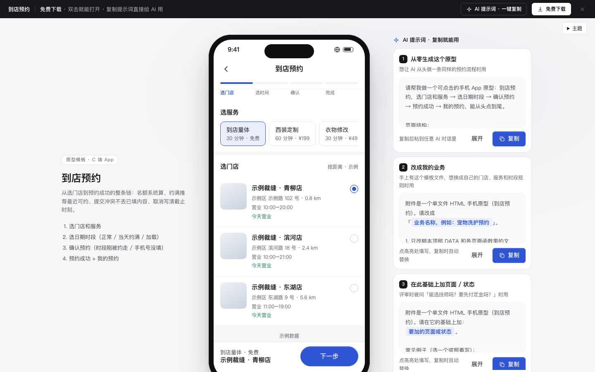

# 到店预约

免费下载 · 双击就能打开 · 复制提示词直接给 AI 用。

> 积木盒 · 老岳AI编辑部 · 原型组　|　手机框 390×844　|　单文件 HTML，离线可用　|　2026-11-10

这是一条能从头点到尾的预约流程：选门店和服务 → 选日期时段 → 确认预约 → 预约成功 → 我的预约。双击 `index.html` 就能拿去评审。

---

## 一、用处

| 项 | 说明 |
|---|---|
| 适合什么需求 | 到店服务、挂号体检、场地 / 自习室、上门服务这类「选时段占名额」的预约需求 |
| 解决哪一步 | 评审最常追问的边界都能点给他看：当天约满怎么办、只剩 1 个名额怎么提示、提交时被别人约走了怎么办、取消到几点前免费 |
| 不适合 | 买东西付款（用「电商下单链路」`c-checkout`）、B 端排班（用功能模块「日历与日程」`m-calendar`） |

**包含的页面和状态**

| 页面 | 状态（右下角「原型面板」切换） |
|---|---|
| 选门店和服务 | 正常 / 加载（骨架）/ 出错（可重试） |
| 选日期时段 | 正常 / 当天约满（推荐最近可约）/ 加载 |
| 确认预约 | 正常 / 提交会冲突（点提交演示）/ 时段刚被约走 / 手机号没填 |
| 预约成功 | 成功 |
| 我的预约 | 有预约 / 空 / 刚取消 |

## 二、用法

### 2.1 打开

1. 下载整个文件夹，双击 `index.html`（Chrome / Edge / Safari 都行，不用联网）。
2. 右下角「原型面板」切页面和状态；评审时按 `H` 藏起面板。
3. 直达某个状态：地址后加 `#page=slot&state=full`（页面：`store` `slot` `confirm` `result` `mine`）。
4. 手机上演示：窄屏下自动去掉手机框、铺满屏幕。

### 2.2 改成你的业务（3 处）

| 改什么 | 在哪改 | 怎么改 |
|---|---|---|
| 配色、圆角、字体 | 文件最上面 `:root { ... }` | 换主色改 `--accent` `--accent-soft` |
| 服务、门店、时段、名额 | `<script>` 顶部 `const DATA` | `services` 写时长和价格；`stores` 的 `closed` 是店休的星期；`slots` 是时段；`cap` 是每档名额；`booked` 是已约人数；`cancelBefore` 是免费取消提前几小时 |
| 页面文案和结构 | 搜 `function pageStore` / `pageSlot` / `pageConfirm` / `pageResult` / `pageMine` | 每个页面一个函数 |

### 2.3 让 AI 帮你改

页面右侧「AI 提示词」有 3 条，变量点一下就能填：

| # | 提示词 | 什么时候用 |
|---|---|---|
| 1 | 从零生成这个原型 | 想让 AI 从头做一条同样的预约流程 |
| 2 | 改成我的业务（变量：业务名称、服务清单、门店清单、时段规则、取消规则） | 换成自己的门店、服务和规则 |
| 3 | 在此基础上加页面 / 状态（变量：要加的页面或状态） | 评审问「能选技师吗？要先付定金吗？」 |

## 三、交互说明

| 元素 | 交互 | 反馈 |
|---|---|---|
| 服务卡片 | 横滑点选，默认第一个 | 底栏同步显示服务和费用；时长影响后面的结束时间 |
| 门店列表 | 按距离排序，单选 | 写营业时间、距离，今天店休的写「今天店休，可约明天起」 |
| 日期条 | 横滑 7 天，点选 | 约满或店休的置灰并写原因；切日期清空已选时段 |
| 当天约满提示 | 点「改约这天」 | 直接切到系统算出的最近可约日期 |
| 时段格 | 点选 | 写「余 N」，剩 1 个写「仅剩 1」（黄色），约满置灰「已满」；底栏写完整时间段（结束时间系统算） |
| 下一步 | 没选时段时置灰 | 进入确认页 |
| 联系人 / 手机号 | 预填上次的 | 手机号为空或格式不对时标红并聚焦，Toast 说明 |
| 取消规则 | — | 写具体截止时刻「11月11日 周三 12:30 前免费取消」，不做倒计时 |
| 确认预约 | 点击 | 全屏「正在提交…」；成功进结果页 |
| 提交冲突 | 提交时时段刚被约走 | 原时间划掉，给 3 个相邻可约时段一键改，已填内容不丢 |
| 加到日历 | 点击 | Toast 已添加 |
| 取消预约 | 点击 → 确认弹窗 | 写清现在取消是否收费；取消后卡片变灰、名额释放 |
| 改约 | 点击 | 回到选时段，门店和服务保留 |

## 四、自检（按《交互设计规范》）

- [x] 状态全：门店 正常 / 加载 / 出错；时段 正常 / 约满 / 加载；确认 正常 / 冲突 / 缺手机号；我的预约 有 / 空 / 已取消
- [x] 系统能算的不让人算：剩余名额、结束时间、最近可约日、免费取消截止时间
- [x] 高频选项有默认值：服务默认第一个、门店默认最近、联系人和手机号预填
- [x] 核心路径 3 步：选门店 → 选时段 → 确认
- [x] 触控目标 ≥ 44px；主操作在底部拇指区；不做跳秒倒计时
- [x] 弹层：Esc、点遮罩关闭、焦点锁定、关闭后焦点回到触发处
- [x] 示例数据标「示例」，门店、人名、手机号全部虚构
- [x] 无 JS 报错（13 个页面状态逐个打开检查）
- [x] 窄屏（≤430px）去掉手机框铺满，不横向滚动

---

本模板由老岳AI编辑部·原型组制作，可免费下载、修改、用于工作项目。

状态：已通过浏览器验收（1440/500 宽 0 报错、0 溢出、对比度与触控达标；标准外壳与跨目录比对通过）
