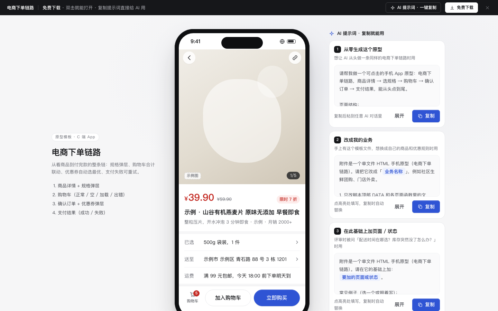

# 电商下单链路

免费下载 · 双击就能打开 · 复制提示词直接给 AI 用。

> 积木盒 · 老岳AI编辑部 · 原型组　|　手机框 390×844　|　单文件 HTML，离线可用　|　2026-11-10

这是一条能从头点到尾的下单链：商品详情 → 选规格 → 购物车 → 确认订单 → 支付结果。双击 `index.html` 就能拿去评审。



---

## 一、用处

| 项 | 说明 |
|---|---|
| 适合什么需求 | 电商、零售、外卖、团购等「挑商品 → 付款」的 C 端下单需求；也适合改造已有下单流程前先演示一遍 |
| 解决哪一步 | 评审最常追问的计算和边界都能点给他看：规格售罄怎么显示、勾选改数量后合计怎么联动、券怎么自动选、运费门槛、支付失败怎么办 |
| 不适合 | 预约类（选日期时段）下单、B 端批量下单（用「列表 + 详情抽屉」模板） |

**包含的页面和状态**

| 页面 | 状态（右下角「原型面板」切换） |
|---|---|
| 商品详情 | 正常 / 规格弹层（售罄规格置灰、库存少时提示、数量上限） |
| 购物车 | 正常 / 空（去逛逛）/ 加载（骨架）/ 出错（可重试）；含已失效商品分组 |
| 确认订单 | 正常 / 优惠券弹层（已自动选最优）/ 下单会失败（演示支付失败） |
| 支付结果 | 成功 / 失败（没扣款，可重新支付或换方式） |

## 二、用法

### 2.1 打开

1. 下载整个文件夹，双击 `index.html`（Chrome / Edge / Safari 都行，不用联网）。
2. 右下角「原型面板」切页面和状态；评审时按 `H` 藏起面板。
3. 直达某个状态：地址后加 `#page=cart&state=empty`（页面：`detail` `cart` `checkout` `result`）。
4. 手机上演示：把文件发到手机用浏览器打开，窄屏下自动去掉手机框、铺满屏幕。

### 2.2 改成你的业务（3 处）

| 改什么 | 在哪改 | 怎么改 |
|---|---|---|
| 配色、圆角、字体 | 文件最上面 `:root { ... }` | 换主色改 `--accent` `--accent-soft`；价格红色用的是 `--danger` |
| 商品、规格、购物车、券 | `<script>` 顶部 `const DATA` | `product.specs` 里 `stock: 0` 就是售罄；`coupons` 的 `min` 是门槛、`off` 是减多少；`freight` 改包邮门槛和运费；`pays` 改支付方式 |
| 页面文案和结构 | 搜 `function pageDetail` / `pageCart` / `pageCheckout` / `pageResult` | 每个页面一个函数，改里面的 HTML 即可 |

增删页面：在 `Proto.init({ pages: [...] })` 加一项，再写一个 `pageXxx()`，在 `render` 里按 `page` 调用。

### 2.3 让 AI 帮你改这个原型（复制即用）

> 页面右侧 / 顶部「AI 提示词」可一键复制，变量点一下就能填。页面上有 3 条：从零生成这个原型、改成我的业务、在此基础上加页面 / 状态；下面是另外 2 条进阶用法。

**提示词 1：换成自己的商品和优惠规则**

```
这是一个单文件 HTML 下单链路原型（附件 index.html）。请改成「{{你的业务，例如：社区生鲜团购}}」：
1. 只改 <script> 顶部 DATA 和各 pageXxx 函数里的文案，不要改文件里 KIT 标记之间的共用样式和脚本；
2. 商品换成 {{3–5 个商品，带规格和库存}}，其中至少 1 个规格售罄；
3. 优惠规则改成：{{例如：满 59 减 8、满 99 减 20、新人券 3 元，只能用 1 张}}，仍按「省得最多」自动选；
4. 运费规则：{{例如：满 49 免运费，否则 5 元}}；
5. 所有金额都由系统算（合计、运费、优惠、应付），改完后自己算一遍示例数字核对。
输出完整文件，并列出改了哪几处。
```

**提示词 2：加一个业务环节**

```
在这个下单链路原型里加一个环节：{{例如：确认订单页增加「配送时间」选择，今天/明天分时段，已约满的时段置灰}}。
要求：
1. 用底部弹层（.sheet）实现，默认选最早可用的时段，选完在确认订单页回显；
2. 选不同时段如果影响运费，应付金额自动联动；
3. 在原型面板「确认订单」下加一个状态，能一键打开这个弹层演示；
4. 触控区域不小于 44px，主按钮放在底部。
只改必要的地方，输出完整文件。
```

## 三、交互说明

| 元素 | 交互 | 反馈 |
|---|---|---|
| 「已选」行 / 加入购物车 / 立即购买 | 点击打开规格弹层 | 弹层底部按钮文案随入口变化；立即购买时按钮上直接显示金额 |
| 规格选项 | 点击切换；售罄规格虚线置灰、不可点 | 价格、库存、「已选」实时更新；库存 ≤5 提示「快没了」 |
| 数量步进器 | 加减，最少 1，最多到库存 | 到上限时加号置灰并提示「最多买 N 件」 |
| 加入购物车 | 确认 | Toast「已加入购物车」，底栏购物车角标数字增加；同规格再加会合并数量 |
| 购物车勾选 / 全选 | 勾选商品；全选只选有货的 | 合计、去结算件数、可用券提示、免运费提示条同时联动 |
| 购物车步进器 | 加减数量 | 合计即时更新 |
| 删除（垃圾桶） | 点击直接删 | Toast「已删除 1 件商品」，4 秒内可撤销，不弹二次确认 |
| 清空失效 | 点击 | 失效商品清空，可撤销 |
| 去结算 | 未勾选时置灰 | 进入确认订单 |
| 优惠券行 | 进入时已自动选「省得最多」的一张；点击打开券弹层 | 不满足门槛的券置灰并写「还差 ¥N 可用」；可选「不使用优惠券」；应付金额自动重算 |
| 支付方式 | 单选，默认选上次用的（存本机），并标「上次使用」 | — |
| 备注 | 选填，最多 50 字 | — |
| 提交订单 | 点击 | 全屏「正在支付…」，然后到支付结果 |
| 支付失败页 | 「重新支付」「换个方式」 | 写明没扣款、订单保留 30 分钟 |
| 购物车出错「重新加载」 | 点击 | 先出骨架，再回到购物车 |

## 四、自检（按《交互设计规范》）

- [x] 状态全：购物车 正常 / 空 / 加载 / 出错；支付 成功 / 失败；规格售罄、库存上限
- [x] 系统能算的不让人算：合计、运费、优惠、应付全部自动联动；券自动选最优
- [x] 高频选项有默认值：规格默认第一个有货的、支付方式默认上次
- [x] 触控目标 ≥ 44px（步进器、勾选、删除按钮均扩了热区）；主操作在底部拇指区
- [x] 弹层：Esc、点遮罩关闭、焦点锁定、关闭后焦点回到触发处
- [x] 示例数据标「示例」，商品名、地址、手机号全部虚构
- [x] 无 JS 报错（10 个页面状态逐个打开检查）
- [x] 窄屏（≤430px）去掉手机框铺满，不横向滚动

---

本模板由老岳AI编辑部·原型组制作，可免费下载、修改、用于工作项目。

状态：已通过浏览器验收（1440/500 宽 0 报错、0 溢出、对比度与触控达标；标准外壳与跨目录比对通过）
