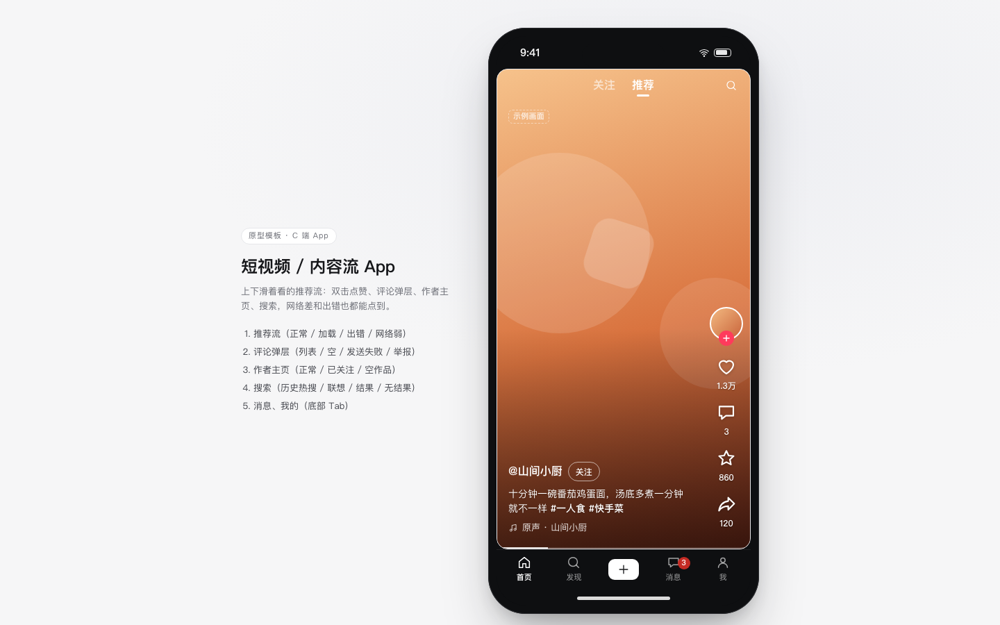

# 短视频 / 内容流 App

> 积木盒 · 老岳AI编辑部 · 原型组　|　手机框 390×844　|　单文件 HTML，离线可用　|　2026-11-10

这是一个能上下滑着看的推荐流：双击点赞、评论弹层、作者主页、搜索都能点，网络差和出错也摆出来了。双击 `index.html` 就能拿去评审。



---

## 一、用处

| 项 | 说明 |
|---|---|
| 适合什么需求 | 短视频、图文笔记、直播回放、课程短片等「一条一条刷着看」的内容 App；也适合给已有内容流加评论、关注、搜索功能前先演示 |
| 解决哪一步 | 评审最常追问的地方都能点给他看：单击和双击怎么区分、点赞计数怎么联动、评论发送失败怎么办、举报走几步、关注状态在几个地方怎么同步、网络差时显示什么 |
| 不适合 | 商品下单（用「电商下单链路」模板）；长文阅读类内容详情 |

> 只借鉴了这类 App 常见的页面类型和交互，画面、文案、图标都是重新做的，不对应任何真实产品。

**包含的页面和状态**

| 页面 | 状态（右下角「原型面板」切换） |
|---|---|
| 推荐流 | 正常 / 已暂停 / 已点赞 / 加载（骨架 + 缓冲圈）/ 出错（可重试）/ 网络弱（顶部提示 + 重试，画面转圈） |
| 评论弹层 | 有评论 / 空评论 / 发送失败（点击重试）/ 举报（选原因提交） |
| 作者主页 | 正常 / 已关注（粉丝数 +1）/ 空作品 |
| 搜索 | 历史热搜 / 联想（命中词高亮）/ 结果（综合·作品·用户）/ 无结果 |
| 消息、我的 | 底部 Tab 的消息列表；「我的」是空作品主页，引导去发布 |

## 二、用法

### 2.1 打开

1. 下载整个文件夹，双击 `index.html`（Chrome / Edge / Safari 都行，不用联网）。
2. 在推荐流上：鼠标按住上下拖、滚轮、或点一下画面后按 ↑ ↓ 键切换；单击暂停，双击点赞。
3. 右下角「原型面板」切页面和状态；评审时按 `H` 藏起面板。直达某个状态：地址后加 `#page=feed&state=weak`（页面：`feed` `comments` `profile` `search` `msg` `me`）。
4. 手机上演示：把文件发到手机用浏览器打开，窄屏下自动去掉手机框、铺满屏幕，手指上下滑即可。

### 2.2 改成你的业务（3 处）

| 改什么 | 在哪改 | 怎么改 |
|---|---|---|
| 配色、圆角、字体 | 文件最上面 `:root { ... }` | 主色改 `--accent`；推荐流底色改 `--feed-bg`；点赞红改 `--like` |
| 内容、作者、评论、热搜 | `<script>` 顶部 `const DATA` | `posts` 是推荐流（`g` 是画面占位渐变，接真素材时换成图片地址）；`authors.works` 设为 0 就是空作品；`comments` 按视频 id 写；`hot` 的 `tag` 填「热」「新」；`reportReasons` 改举报原因 |
| 页面结构和文案 | 搜 `function pageFeed` / `openComments` / `pageProfile` / `pageSearch` / `pageMsg` | 每个页面一个函数，改里面的 HTML 即可 |

增删页面：在 `Proto.init({ pages: [...] })` 加一项，再写一个 `pageXxx()`，在 `render` 里按 `page` 调用。

### 2.3 让 AI 帮你改这个原型（复制即用）

**提示词 1：换成自己的内容和作者**

```
这是一个单文件 HTML 的内容流 App 原型（附件 index.html）。请改成「{{你的产品，例如：家常菜教学短片}}」：
1. 只改 <script> 顶部 DATA 和各 pageXxx 函数里的文案，不要动 /*@KIT_CSS*/ 和 /*@KIT_JS*/ 之间的代码；
2. 推荐流换成 {{4 条内容：标题、话题标签、作者}}，作者 3 位，其中 1 位作品数为 0；
3. 每条内容配 0–3 条评论，至少 1 条内容没有评论（演示空评论）；
4. 热搜换成用户真会搜的 8 个词，前 2 个分别标「热」「新」；
5. 不出现任何真实 App 名称、品牌或人名，示例数据标「示例」。
输出完整文件，并列出改了哪几处。
```

**提示词 2：加一个互动功能**

```
在这个内容流原型里加一个功能：{{例如：长按画面弹出「不感兴趣」，选原因后这条内容从推荐流移除，可撤销}}。
要求：
1. 用底部弹层（.sheet）实现，选项触控高度不小于 44px，有取消；
2. 操作后给 Toast 反馈并支持 4 秒内撤销，推荐流自动切到下一条；
3. 不影响现有的单击暂停、双击点赞、上下滑；
4. 在原型面板「推荐流」下加一个状态，能一键打开这个弹层演示；
5. 在 README 交互说明表里补一行。
只改必要的地方，输出完整文件。
```

## 三、交互说明

| 元素 | 交互 | 反馈 |
|---|---|---|
| 推荐流画面 | 上下拖动超过 60px 切到上一条 / 下一条；滚轮、↑ ↓ 键同样可切 | 卡片跟手移动，松手后缓动到位；第一条再往上、最后一条再往下时提示「已经是第一条了」「暂时没有更多了」 |
| 画面单击 | 暂停 / 继续播放 | 中间出现播放图标 |
| 画面双击 | 只点赞、不取消（再双击不会取消） | 点击处飘出一颗心，右侧点赞图标变红并弹一下，计数 +1 |
| 点赞按钮 | 点击切换赞 / 取消 | 图标、计数同步 |
| 收藏按钮 | 点击切换 | Toast「已收藏 / 已取消收藏」 |
| 关注（作者名旁 / 头像下的 +） | 点击切换 | 同一作者在推荐流所有卡片、作者主页、搜索结果里的关注状态同步 |
| 文案「展开」 | 超过 30 字时出现 | 展开全部 / 收起 |
| 评论按钮 | 打开评论底部弹层 | 标题显示条数；没有评论时显示「还没有评论」 |
| 评论输入框 | 有字才能点「发送」；回车也能发 | 新评论出现在最上面，先显示「发送中…」，成功后 Toast；评论数同步到推荐流 |
| 发送失败 | 「发送失败，点击重试」 | 重试后转「发送中…」再成功，不用重新输入 |
| 长按评论（0.5 秒）或点「···」 | 弹出操作：复制、举报（自己的评论是删除） | 删除可撤销 |
| 举报 | 单选原因后「提交举报」才可点 | Toast「已提交举报」 |
| 作者主页「关注」 | 点击切换 | 粉丝数 +1 / −1，按钮变灰「已关注」 |
| 作品格子 | 点击 | 回到推荐流播放这一条 |
| 搜索框 | 打开即聚焦；输入停 0.2 秒出联想，命中词高亮 | 有词时出现清除按钮 |
| 最近搜索 | 点击直接搜；「清空」 | 清空可撤销；记录存在本机，最多 10 条 |
| 搜索结果 | 综合 / 作品 / 用户 切换 | 显示「找到 N 条 · 含『词』」；无结果时给 2 个热搜词作出路 |
| 底部 Tab | 首页 / 发现 / 发布（占位）/ 消息 / 我 | 当前项加粗高亮；推荐流页 Tab 栏变深色 |
| 网络弱提示条 | 「重试」 | 先出加载态，再回到推荐流 |
| 出错态「重新加载」 | 点击 | 同上 |

## 四、自检（按《交互设计规范》）

- [x] 状态全：推荐流 正常 / 暂停 / 加载 / 出错 / 网络弱；评论 有 / 空 / 发送失败；主页 空作品；搜索 无结果
- [x] 每个手势都有可见的替代按钮：双击点赞有点赞按钮，长按评论有「···」按钮，滑动有键盘和滚轮
- [x] 关联状态自动联动：评论数、点赞数、关注状态、粉丝数
- [x] 触控目标 ≥ 44px（右侧互动按钮 52×56，评论点赞、Tab、热搜行都扩了热区）；发布、发送在底部拇指区
- [x] 弹层：Esc、点遮罩关闭、焦点锁定、关闭后焦点回到触发处
- [x] 示例数据标「示例」，作者、评论、热搜全部虚构，不出现真实 App 名称和品牌
- [x] 无 JS 报错（19 个页面状态逐个打开 + 双击点赞 / 滑动 / 发评论 / 举报 / 搜索 / 跳主页脚本走查）
- [x] 窄屏（≤430px）去掉手机框铺满，不横向滚动

---

本模板由老岳AI编辑部·原型组制作，可免费下载、修改、用于工作项目。
