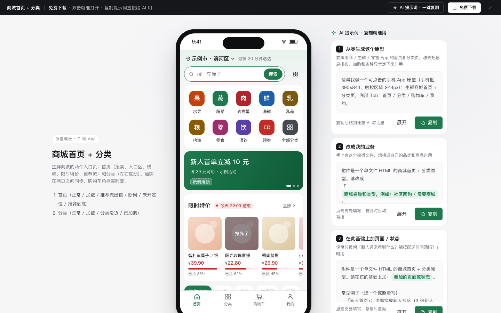

# 商城首页 + 分类

免费下载 · 双击就能打开 · 复制提示词直接给 AI 用。

> 积木盒 · 老岳AI编辑部 · 原型组　|　手机框 390×844　|　单文件 HTML，离线可用　|　2026-11-10

生鲜商城的两个入口页：首页（搜索、入口区、横幅、限时特价、推荐流）和分类（左右联动）。加购在两页之间同步，底部「购物车」角标实时变；断网、没开定位、推荐流出错、分类没货这些情况都能切出来看。

---

## 一、用处

| 项 | 说明 |
|---|---|
| 适合什么需求 | 电商、生鲜、社区团购、零售 App / 小程序的首页和分类页 |
| 解决哪一步 | 评审最常追问的都能点给他看：首页模块怎么排、点入口去哪、推荐流加载失败上面还在不在、断网显示什么、分类页左右怎么联动、加了购物车别的页面变不变 |
| 不适合 | 商品详情、购物车、下单（见 `c-checkout`）；搜索页（见 `c-search`，P1 待做） |

**包含的页面和状态**

| 页面 | 状态（右下角「原型面板」切换） |
|---|---|
| 首页 | 正常 / 加载中（骨架）/ 推荐流出错（局部重试）/ 网络断开（显示缓存）/ 未开定位 / 推荐到底 |
| 分类 | 正常 / 加载中 / 该品类没货 / 已加购（底部购物车条） |

## 二、用法

1. 双击 `index.html`；右下角「原型面板」切状态，按 `H` 隐藏；直达 `#page=cat&state=carted`。
2. 改数据：`<script>` 顶部 `DATA`——`entries` 入口区（文字或 `icon:图标名`）、`banners` 横幅、`goods` 商品（库存填 0 即售罄）、`cats` 一级品类、`hotWords` 搜索框轮换热词、`pageSize` / `maxPages` 推荐流分页。
3. 改颜色：最上面本模板样式里的 `--accent`、`--accent-soft`（主色）和 `--price`（价格红）。
4. 页面右侧「AI 提示词」3 条：从零生成 / 改成我的业务（变量：商城类型、主色、入口、品类树）/ 加页面或状态（例：新人首页、超出配送范围、分类页筛选）。

## 三、交互说明

| 元素 | 交互 | 反馈 |
|---|---|---|
| 位置 | 点击 | 切换地址（示例）；没开定位时先按默认城市显示，顶部条「开启定位」 |
| 搜索框 | 点击 | 进搜索页（示例）；框里每 3.5 秒换一个热词（系统设置了减少动态效果时不换） |
| 入口区 | 点品类 | 直接进分类页并选中该品类；「全部分类」进分类页；「领券」进领券中心（示例） |
| 横幅 | 左右滑 | 吸附整张，指示点跟着变；不自动轮播 |
| 限时特价 | 横向滑 | 写原价、已抢百分比；结束时间写「今天 22:00 结束」，不做跳秒倒计时；抢光的盖「抢光了」 |
| 推荐流品类 | 点击 | 吸顶；切换后回到推荐流顶部 |
| 加购 | 点「+」 | 变数量步进器，角标 +1 并轻微弹跳；减到 0 变回「+」；超过库存 Toast 提示 |
| 售罄 | 点「到货提醒」 | 变「已设提醒」，再点取消 |
| 推荐流加载 | 滚到底 | 自动加载下一页；3 页后写「没有更多了 · 去分类页看看全部商品」；出错时只在推荐流位置给「重试」 |
| 回到顶部 | 滚动超过 600 后出现 | 回到顶部，焦点回搜索框 |
| 断网 | — | 顶部黄条「网络断开，显示的是上次的内容」+「重新连接」 |
| 分类左侧 | 点击 | 右侧换成该品类；有已加购商品的品类右上红点 |
| 分类二级 | 点击 / 滚动右侧 | 点了跳到分组；滚动时二级高亮跟着变 |
| 分类看完 | — | 底部「继续看「下一个品类」」 |
| 购物车条 | 分类页有加购时浮起 | 件数、合计、离免配送费还差多少，「去结算」 |

## 四、自检

- [x] 状态全：首页 6 态、分类 4 态，含骨架、局部出错、断网、没开定位、没货、到底
- [x] 加购在两页同步，角标、红点、购物车条联动，不用手动刷新
- [x] 触控区域 ≥ 44px（含步进器、到货提醒、全部、搜索框）；价格红、主色绿对比度 ≥ 4.5:1
- [x] 不做跳秒倒计时、不自动轮播；尊重「减少动态效果」
- [x] 示例数据标「示例」，无真实品牌
- [x] 无 JS 报错（10 个状态逐个打开检查）；18 条交互断言通过（无头 Chrome）

---

本模板由老岳AI编辑部·原型组制作，可免费下载、修改、用于工作项目。

状态：已通过浏览器验收（1440/1024/500/390 宽 0 报错、0 溢出、对比度与触控达标；标准外壳与跨目录比对通过）
