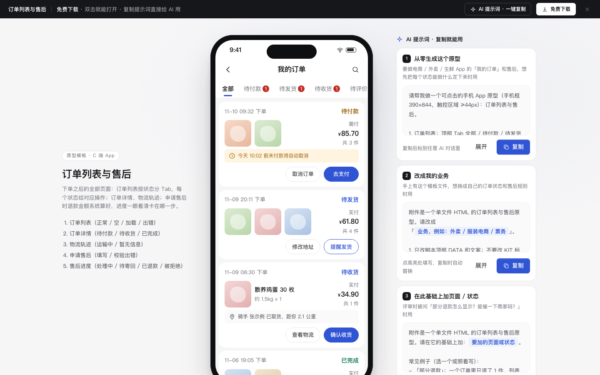

# 订单列表与售后

免费下载 · 双击就能打开 · 复制提示词直接给 AI 用。

> 积木盒 · 老岳AI编辑部 · 原型组　|　手机框 390×844　|　单文件 HTML，离线可用　|　2026-11-10

下单之后的全部页面：订单列表按状态分 Tab，每个状态给对应的操作；订单详情、物流轨迹；申请售后时退款金额系统按实付分摊算好；售后进度一眼看清卡在哪一步、下一步该谁做。

---

## 一、用处

| 项 | 说明 |
|---|---|
| 适合什么需求 | 电商、生鲜、外卖 App 的「我的订单」、订单详情、售后申请与进度 |
| 解决哪一步 | 评审最常追问的都能点给他看：每个状态能做什么、取消 / 确认收货要不要二次确认、退款能退多少怎么算、哪些原因必须传照片、被拒绝了怎么办 |
| 不适合 | 下单与支付（见 `c-checkout`）；商家端处理售后（可用第 3 条提示词，或参考 `b-mall-admin`，P1 待做） |

**包含的页面和状态**

| 页面 | 状态（右下角「原型面板」切换） |
|---|---|
| 订单列表 | 正常 / 空 / 加载中 / 加载失败 |
| 订单详情 | 待付款 / 待收货 / 已完成 |
| 物流轨迹 | 配送中 / 暂无信息 |
| 申请售后 | 填写中 / 校验出错 |
| 售后进度 | 等待商家处理 / 待寄回 / 已退款 / 被拒绝 |

## 二、用法

1. 双击 `index.html`；右下角「原型面板」切状态，按 `H` 隐藏；直达 `#page=prog&state=ret`。
2. 改数据：`<script>` 顶部 `DATA`——`orders` 订单（`st`：pay 待付款 / ship 待发货 / recv 待收货 / done 已完成 / cancel 已取消 / refund 售后中）、`track` 物流、`reasons` 售后原因、`returnAddr` 退货地址。
3. 改颜色：`:root` 的 `--accent`（主色）和本模板样式里的 `--price`（价格红）。
4. 页面右侧「AI 提示词」3 条：从零生成 / 改成我的业务（变量：业务类型、状态顺序、各状态操作、售后规则、原因清单）/ 加页面或状态（例：部分退款、商家超时自动同意、评价）。

## 三、交互说明

| 元素 | 交互 | 反馈 |
|---|---|---|
| 状态 Tab | 点击 | 有数量的 Tab 带红色数字；当前 Tab 滚到中间；没有订单时写「没有待 XX 的订单」+「看全部订单」 |
| 待付款 | 取消订单 / 去支付 | 写「今天 10:02 前未付款将自动取消」（截止时间，不做跳秒倒计时）；取消先确认，并说明优惠券会退回 |
| 待发货 | 修改地址 / 提醒发货 | 提醒后按钮变「已提醒」不可再点 |
| 待收货 | 查看物流 / 确认收货 | 卡片上直接显示最新物流一行；确认收货先确认，说明之后仍可售后 |
| 已完成 | 申请售后 / 评价 / 再来一单 | 再来一单 Toast「已把 N 件商品加入购物车」 |
| 已取消 | 删除订单 / 再来一单 | 删除后 Toast 可撤销 |
| 订单卡 | 点商品区 | 进订单详情：状态大字 + 下一步说明、最新物流、地址、商品（每件可单独申请售后）、金额明细、订单号可复制 |
| 物流 | — | 骑手信息 + 联系；时间线最新一条高亮；没有信息时可开「有更新时通知我」 |
| 售后类型 | 单选 | 未发货时「退货退款」置灰并写原因 |
| 原因 | 底部弹层选 | 必选；变质、破损、少件、不符、规格不对这些原因要求至少 1 张照片 |
| 退款金额 | 系统预填最多可退 | 写清怎么算（商品金额按比例扣订单优惠，配送费不退）；可改小，超过上限报错；只能输数字和两位小数 |
| 提交 | 点击 | 有错时 Toast「还有 N 处要改」并滚到第一处；成功进售后进度 |
| 售后进度 | — | 步骤条当前步高亮；等待处理可「撤销申请」；待寄回给退货地址（可复制）和快递单号（8–20 位校验）；被拒绝写原因，可「修改后再次申请」（带入上次内容）或联系客服 |

## 四、自检

- [x] 状态全：列表 4 态、详情 3 态、物流 2 态、售后 2 态、进度 4 态
- [x] 每个订单状态的操作不同，危险操作（取消、确认收货、撤销）先确认，删除可撤销
- [x] 退款金额系统算好并预填，写清计算方式，不让用户心算
- [x] 触控区域 ≥ 44px（小按钮用扩大点击区）；底部弹层 Esc / 点遮罩关闭
- [x] 示例数据标「示例」，手机号脱敏，无真实品牌
- [x] 无 JS 报错（15 个状态逐个打开检查）；22 条交互断言通过（无头 Chrome）

---

本模板由老岳AI编辑部·原型组制作，可免费下载、修改、用于工作项目。

状态：已通过浏览器验收（1440/500 宽 0 报错、0 溢出、对比度与触控达标；标准外壳与跨目录比对通过）
