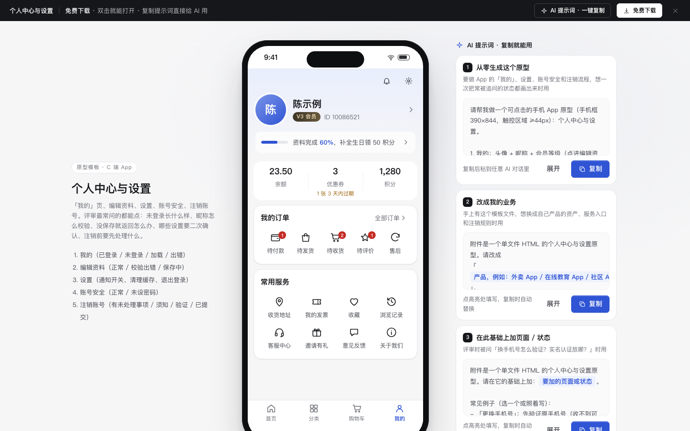

# 个人中心与设置

免费下载 · 双击就能打开 · 复制提示词直接给 AI 用。

> 积木盒 · 老岳AI编辑部 · 原型组　|　手机框 390×844　|　单文件 HTML，离线可用　|　2026-11-10

App 的「我的」页、编辑资料、设置、账号安全、注销账号。评审最常追问的都能点给他看：未登录长什么样、昵称怎么校验、没保存就返回怎么办、哪些开关要二次确认、注销前必须先处理什么。

---

## 一、用处

| 项 | 说明 |
|---|---|
| 适合什么需求 | 电商、外卖、教育、社区等 App 的「我的」Tab、资料编辑、设置页、账号安全、注销流程 |
| 解决哪一步 | 把「我的」页的信息层级（身份 → 资产 → 订单 → 服务）、设置项分组、注销前置检查一次定下来；应用商店审核要求的「App 内可注销」也有完整流程 |
| 不适合 | 登录注册（见 `app-auth`）；订单列表与售后（见 `c-order`）；后台的成员与权限（见 `b-rbac`） |

**包含的页面和状态**

| 页面 | 状态（右下角「原型面板」切换） |
|---|---|
| 我的 | 已登录 / 未登录 / 加载中 / 加载失败 |
| 编辑资料 | 正常 / 校验出错 / 保存中 |
| 设置 | 正常（开关、清理缓存、退出登录都可点） |
| 账号与安全 | 正常 / 未设密码 |
| 注销账号 | 有未处理事项 / 注销须知 / 验证身份 / 已提交 |

## 二、用法

1. 双击 `index.html`；右下角「原型面板」切状态，按 `H` 隐藏；直达 `#page=delete&state=block`。
2. 改数据：`<script>` 顶部 `DATA`——`user` 用户资料、`assets` 资产（`soon` 快过期的券数）、`orders` 订单入口和数字、`services` 常用服务、`devices` 登录设备、`deleteChecks` 注销检查项（`block: true` 阻断，`warn: true` 只提醒）、`coolDays` 冷静期、`demoCode` 演示验证码。
3. 改颜色：`:root` 的 `--accent`（主色）和本模板样式里的 `--me-top`（我的页顶部底色）。
4. 页面右侧「AI 提示词」3 条：从零生成 / 改成我的业务（变量：产品、资产三格、订单入口、注销阻断项、冷静期）/ 加页面或状态（例：更换手机号、实名认证、深色模式）。

## 三、交互说明

| 元素 | 交互 | 反馈 |
|---|---|---|
| 头像昵称区 | 点击 | 已登录进编辑资料；未登录是「登录 / 注册」 |
| 资料完成度条 | 点击 | 写「完成 60%，补全生日领 50 积分」，进编辑资料；100% 后不再显示 |
| 资产三格 | 点击 | 有快过期的优惠券在下面标「1 张 3 天内过期」；未登录显示「--」，点了提示先登录 |
| 订单入口 | 点击 | 有数量的带红色数字；未登录点击提示先登录 |
| 编辑资料 · 昵称 | 输入 / 失焦 | 实时字数；失焦即校验（2–16 字，中英文数字下划线），错误写在框下 |
| 编辑资料 · 生日 | 底部弹层选年月日 | 切月份自动修正天数（2 月没有 30 号） |
| 编辑资料 · 保存 | 点击 | 没改动时置灰；有错 Toast「还有 N 处要改」并聚焦第一处；保存中转圈，成功回「我的」页并更新 |
| 编辑资料 · 返回 | 点击 | 有未保存修改先确认「放弃这次修改？」 |
| 设置 · 开关 | 点击 | 关闭订单通知、关闭个性化推荐先确认（写清会错过什么）；其余直接切换并 Toast |
| 设置 · 清理缓存 | 点击 | 确认框写清只清图片和临时文件；清理后显示 0 MB 并置灰 |
| 设置 · 退出登录 | 点击 | 确认后回到未登录的「我的」页，写明购物车保留 |
| 账号安全 · 登录设备 | 下线 | 本机标「本机」不能下线；其他设备先确认，建议同时改密码 |
| 账号安全 · 未设密码 | — | 顶部提示条 + 「建议设置」标签，点击即设置 |
| 注销 · 第 1 步 | 自动检查 | 余额、进行中订单、处理中售后任一未处理就阻断，按钮写「还有 N 项要处理」，每项给「去处理」；优惠券积分只提醒会作废 |
| 注销 · 第 2 步 | 勾选 | 列出会失去什么；没勾「我已了解」点下一步时勾选框标红 |
| 注销 · 第 3 步 | 输 6 位验证码 | 输满自动提交；错了写「还可以再试 N 次」，3 次后要重新获取；重新获取写「1 分钟后可重新获取」，不做跳秒倒计时 |
| 注销 · 已提交 | — | 写 7 天冷静期截止日期；可「撤销注销」（先确认）或「我知道了」（退出登录） |

## 四、自检

- [x] 状态全：我的 4 态、编辑资料 3 态、设置、账号安全 2 态、注销 4 态
- [x] 危险操作（关闭订单通知、下线设备、退出登录、放弃修改、撤销注销）先确认；确认框写清后果
- [x] 系统能算的不让人算：资料完成度、快过期券数、注销阻断项都由系统检查好
- [x] 开关 `role="switch"`、分段 `role="radio"`；触控区域 ≥ 44px；底部弹层和确认框 Esc / 点遮罩关闭
- [x] 示例数据标「示例」，手机号脱敏，无真实品牌
- [x] 无 JS 报错（14 个状态逐个打开检查）；29 条交互断言通过（无头 Chrome）

---

本模板由老岳AI编辑部·原型组制作，可免费下载、修改、用于工作项目。
