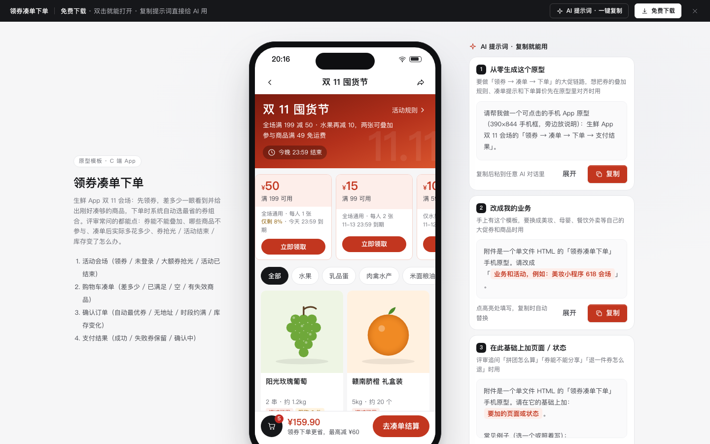

# 领券凑单下单（活动会场 · 购物车凑单 · 确认订单 · 支付结果）

免费下载 · 双击就能打开 · 复制提示词直接给 AI 用。

> 积木盒 · 老岳AI编辑部 · 原型组　|　手机 App 390×844（430 宽以下铺满）　|　单文件 HTML，离线可用　|　2026-11-11 重做

生鲜 App「双 11 囤货节」的大促链路：会场领券 → 购物车看差多少并给出刚好凑够的商品 → 确认订单自动选最省的券组合 → 支付结果。所有金额由 `DATA` 算出：默认购物车 ¥159.90，差 ¥39.10 可用满199减50、差 ¥9.10 可用水果券；凑一串葡萄后两张叠加省 ¥60，实付 ¥139.80。手机框与 `c-profile`、`c-checkout` 相同。

---

## 一、用处

| 项 | 说明 |
|---|---|
| 适合什么需求 | 电商 / 生鲜 / 外卖的大促会场、满减券、凑单、下单算价 |
| 解决哪一步 | 评审常问的都能点：券能不能叠加、哪些商品不参与满减、差多少怎么提示、凑单后实际多花多少多省多少、券抢光 / 活动结束 / 库存变了 / 没地址 / 时段约满 / 支付失败怎么办 |
| 不适合 | 商品详情与规格选择（见 `web-mall`、`c-mall-home`）；订单列表与售后（见 `c-order`） |

**页面和状态**（右下角「原型面板」切换）

| 页面 | 状态 |
|---|---|
| ① 活动会场 | 正常（未领券）/ 未登录（领券先一键登录）/ 大额券已抢光 / 活动已结束 / 加载中 / 加载失败 |
| ② 购物车凑单 | 差 ¥39.10 / 已满足门槛 / 还没领券 / 有失效商品 / 购物车空 / 加载中 / 加载失败 |
| ③ 确认订单 | 自动选最优券 / 没有收货地址 / 今天时段约满 / 库存变化 · 优惠变少 / 加载中 / 加载失败 |
| ④ 支付结果 | 支付成功 / 支付失败 · 券保留 / 结果确认中 |

## 二、用法

1. 双击 `index.html`；右下角「原型面板」切页面和状态，按 `H` 隐藏；直达例：`#page=cart&state=reached`。
2. 改数据只改 `<script>` 顶部 `DATA`：`coupons` 券（范围 all / fruit、门槛、减额、仅新人）；`goods` 商品（价格、分类、插画、限购、库存、不参与满减）；`cart` 初始购物车；`dead` 失效商品；`addrs` 地址；`slots` 配送时段；`freeShip` / `shipFee` 运费规则。
3. 改颜色：`:root` 的 `--accent`（默认促销红）和 `--price`。商品图是内置 SVG 插画（`art()`），不依赖外部图片。
4. 手机框右侧「AI 提示词」3 条：从零生成（写明券规则与算价）/ 改成我的业务（变量：活动、券清单、叠加规则、不参与商品、运费）/ 加页面或状态（部分退款券分摊、分享领券、定金膨胀、凑单筛选）。

## 三、交互说明

| 元素 | 交互 | 反馈 |
|---|---|---|
| 活动横幅 | 点「活动规则」 | 底部弹层列 6 条规则：时间、每人限领、每日库存与补券、全场券二选一、水果券可叠加、退款按比例扣回 |
| 券条 | 点「立即领取」 | 变「已领取 · 去使用」并加「已领」角标；未登录先弹本机号码一键登录，登录后自动领这张 |
| 不可领的券 | 点击 | 写原因：新人券「你已经下过 12 单」；抢光「明天 10:00 补 2000 张」；活动结束 |
| 分类 / 商品卡 | 分类筛选；点 + 加购 | 加购后变数量加减；限购、仅剩件数（带进度条）、不参与满减都标在卡上 |
| 底部结算条 | — | 实时写「再买 ¥39.10 可用满199减50」；满足后写已享哪几张券、省多少 |
| 凑单进度 | — | 主目标券进度条，刻度按门槛比例摆放；第二目标水果券差额；奶粉不计入门槛单独说明 |
| 刚好凑够 | 点 + | 按「能否凑够、价格接近差额」排序：凑够的写「多省 ¥45.00 · 多花 ¥39.90」，不够的写「还差 ¥2.30」；加完 Toast 提示多省多少 |
| 购物车行 | 勾选、加减 | 取消勾选、改数量时差额、合计、优惠即时联动；限购到顶按钮置灰并写「已到限购上限」；减到 0 移出 |
| 失效商品 | 找相似 / 到货提醒 / 清空 | 单独一组写失效原因，不计入结算；清空二次确认 |
| 确认订单 · 地址 | 点击切换 | 无地址时只显示「新建收货地址」，提交被拦截并就地报错 |
| 送达时间 | 6 个时段 | 约满置灰，点击提示「已约满，选其他时段」 |
| 优惠券 | 点优惠券行 | 默认「已选最优」；弹层里全场券二选一、未满门槛写「还差 ¥x」并置灰、水果券可叠加开关、「恢复最优」；关掉弹层价格明细与实付联动 |
| 价格明细 | — | 商品金额 → 优惠券 → 运费（满 49 免，划掉 ¥6.00）→ 实付，逐行相加等于实付 |
| 库存变化 | 进入页面 | 顶部黄条写「三文鱼被抢光已移出，参与满减 ¥199.80 → ¥154.30，优惠 ¥60.00 → ¥25.00」，给「回购物车补一件」 |
| 支付 | 提交订单 | 支付弹层：余额不足置灰并写还差多少；订单保留 30 分钟；可模拟支付失败 |
| 支付结果 | — | 成功：订单号、实付、本单共省（含运费）、送达时段、下单奖励券；失败：没扣款，订单和券保留到 20:46，可换方式重付；确认中：不要重复付款 |

## 四、验收结论（2026-11-11 原型组）

**通过。** 对照上轮打回原因逐条处理：

| 上轮问题 | 本次 |
|---|---|
| 商品图是单个汉字占位块，会场只有一张券、四个商品 | 12 款商品各有 SVG 插画、规格、划线价、限购 / 库存 / 不参与满减标记；4 张券四种领取状态 |
| 缺少活动规则、库存紧张等核心模块 | 活动规则弹层、库存进度条、凑单进度与刻度、刚好凑够推荐、失效商品组、库存变化后优惠变少提示 |
| 每张商品卡一个大蓝按钮，层级弱 | 商品卡改圆形 + 号；每屏只有底部结算条一个主按钮 |
| 提示词套话，写了「后台复用侧栏」 | 3 条写明券规则、叠加关系、凑单算法和各状态，均为手机端 |

机器验收：`_kit/atest.sh` 1440 / 1280 / 500 宽 × 22 个状态：0 JS 报错、0 横滚、0 对比度问题、0 小于 24px 的可点元素；提示词面板可打开 / 展开 / 填变量 / 复制。交互断言 36 条在无头 Chrome 通过（领券后差额、新人券原因、奶粉不计门槛、减到 0 移出、凑单推荐多省 45、取消勾选联动、凑够后省 60、限购 2 件、自动最优 ¥139.80、手动换券 ¥174.80、恢复最优、约满时段、备注计数、余额不足、支付失败券保留、重付成功省 66、未登录领券、券抢光、活动结束、失效商品清空、一键领券、空购物车、无地址拦截、库存变化提示、时段约满、出错重试等）。`gtest.sh` 面向组件画廊，页面模板不适用，以交互断言代替。

---

本模板由老岳AI编辑部·原型组制作，可免费下载、修改、用于工作项目。
