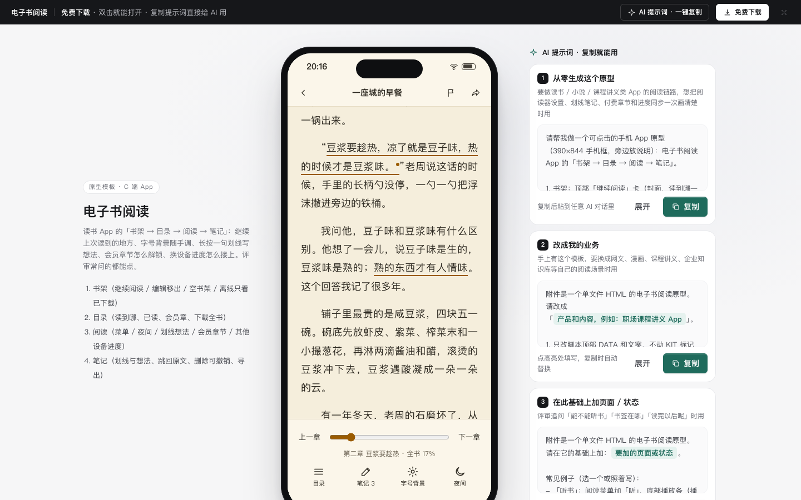

# 电子书阅读（书架 · 目录 · 阅读 · 笔记）

免费下载 · 双击就能打开 · 复制提示词直接给 AI 用。

> 积木盒 · 老岳AI编辑部 · 原型组　|　手机 App 390×844（430 宽以下铺满）　|　单文件 HTML，离线可用　|　2026-11-11 重做

读书 App 的完整阅读链路，以原创示例书《一座城的早餐》（14 章，前 7 章免费）为例：书架继续上次读到的地方 → 目录看读到哪、哪些是会员章 → 阅读器调字号背景、长按一句划线写想法、会员章节解锁、换设备进度接续 → 笔记按章节整理、跳回原文、导出。正文、书名、作者全部原创虚构。手机框与 `c-profile` 相同。

---

## 一、用处

| 项 | 说明 |
|---|---|
| 适合什么需求 | 电子书、网文、课程讲义、企业知识库等「长文阅读 + 笔记」类 App |
| 解决哪一步 | 评审常问的都能点：上次读到哪、字号到头怎么办、夜间看不看得清、划线和想法怎么存、怎么找回原文、会员章节怎么解锁、余额不够怎么提示、两台设备进度不一致听谁的、离线能读什么、移出书架进度丢不丢 |
| 不适合 | 书城推荐与搜索（见 `c-feed`、`c-search`）；账户与会员管理（见 `c-profile`） |

**页面和状态**（右下角「原型面板」切换）

| 页面 | 状态 |
|---|---|
| ① 书架 | 正常（8 本）/ 编辑模式（多选）/ 离线（只看已下载）/ 空书架 / 加载中 / 同步失败 |
| ② 目录 | 正常 / 下载全书中 / 加载中 / 加载失败 |
| ③ 阅读 | 正文（米黄背景）/ 呼出菜单 / 夜间模式 / 选中一句 / 会员章节 / 其他设备进度更靠后 / 打开章节中 / 章节打开失败 |
| ④ 笔记 | 6 条（3 条有想法）/ 还没有笔记 / 加载中 / 同步失败 |

## 二、用法

1. 双击 `index.html`；右下角「原型面板」切页面和状态，按 `H` 隐藏；直达例：`#page=reader&state=menu`。
2. 改数据只改 `<script>` 顶部 `DATA`：`books` 书架（进度、读到、是否已下载、封面色、更新提示）；`book` 当前书（免费章数、书币价、会员价）；`chapters` 章节标题、字数、正文段落；`cur` 当前进度；`other` 另一台设备的进度；`notes` 笔记（划线原文必须是该段里的一句）；`user` 书币余额、阅读目标与统计。
3. 改颜色：`:root` 的 `--accent`；4 种阅读背景在 `.t-white / .t-paper / .t-green / .t-night`，每种背景的正文和次要文字对比度都 ≥ 4.5。封面是内置 SVG（`cover()`）。
4. 手机框右侧「AI 提示词」3 条：从零生成（写明阅读器设置、划线想法、会员章、进度同步）/ 改成我的业务（变量：产品和内容、目录单位、免费范围、付费方式、笔记扩展）/ 加页面或状态（听书、书签、读完卡片、翻页模式）。

## 三、交互说明

| 元素 | 交互 | 反馈 |
|---|---|---|
| 继续阅读卡 | 点「继续读」/「目录」 | 写读到哪一章、本章 % 和全书 %；今日已读 18 / 30 分钟目标条、连续天数 |
| 书架 | 排序、点书 | 最近阅读 / 按书名；连载标「更新至 86 章」「新 3 章」，已下载有小图标 |
| 编辑书架 | 右上角更多 → 多选 | 底部导航换成「下载 / 移出书架 (n)」，未选置灰；移出二次确认（进度和笔记保留）+ 4 秒撤销 |
| 离线 | — | 顶部黄条；未下载的书置灰写「未下载，联网后可读」，点击提示原因 |
| 目录 | 正序 / 倒序、点章节 | 已读灰色、当前章「读到这里 42%」、会员章带锁；点会员章直接进解锁页 |
| 下载全书 | 点击 / 取消 | 进度条「正在下载 3 / 14 章」，只下载免费章，完成后按钮变「已下载」 |
| 正文 | 点一下 | 呼出 / 收起菜单；滚动时页脚「本章 % · 全书 %」实时更新 |
| 菜单 | 进度滑块、上一章 / 下一章 | 拖动时预告「松手跳到 第九章 · 会员章」，松手跳章；第一章 / 最后一章时按钮置灰 |
| 字号背景 | 弹层 | 字号 14～24（到头置灰）、行距 紧凑 / 标准 / 宽松、4 种背景，正文和弹层里的预览同时变 |
| 夜间 | 菜单一键 | 夜间 / 日间切换，状态栏跟着变色 |
| 选中一句 | 长按一段（桌面右键） | 选中该段第一句并高亮，浮出「划线 / 写想法 / 复制 / 取消」；重复划线提示「已经划过」 |
| 写想法 | 弹层 | 引用原句，1～200 字计数，空的不能保存；可选公开；保存后下划线带小圆点 |
| 已有划线 | 点下划线 | 弹层看想法、修改、删除；删除可撤销 |
| 会员章节 | 选解锁方式 | 显示开头一段；开通会员（首月 ¥6）/ 单章 30 书币（余额 12，置灰写「还差 18」）；开通前二次确认；「开通后自动解锁下一章」开关 |
| 进度同步 | 打开时 | 另一台设备读得更后时提示「跳过去 / 留在这里」 |
| 笔记 | 筛选、原文、删除、导出 | 全部 / 只划线 / 有想法；按章节分组；「原文」跳回对应章节并高亮该段；删除可撤销；导出复制为 Markdown |
| 我的 | 底部导航 | 今日分钟、连续天数、今年读完，近 7 天柱状图（没到目标的浅色） |

## 四、验收结论（2026-11-11 原型组）

**通过。** 对照上轮打回原因：上轮版本只有通用列表与表单骨架、正文是占位文字、阅读器没有设置与划线。本次：

| 方面 | 本次 |
|---|---|
| 业务密度 | 8 本书进度 / 更新 / 下载各不相同；14 章标题与字数逐章不同；第二章 8 段原创正文；6 条笔记分布在 3 章 |
| 阅读专属交互 | 进度滑块预告、字号行距背景、夜间、长按选句、划线与想法、会员解锁、进度同步、跳回原文 |
| 全状态 | 22 个状态，每页都有加载与出错，空书架 / 空笔记 / 离线都有下一步 |
| 提示词 | 3 条写明阅读器设置、付费章、同步与笔记规则 |

机器验收：`_kit/atest.sh` 1440 / 1280 / 500 宽 × 22 个状态（含夜间）：0 JS 报错、0 横滚、0 对比度问题、0 小于 24px 的可点元素；提示词面板可打开 / 展开 / 填变量 / 复制。交互断言 40 条在无头 Chrome 通过（书架排序、编辑多选、移出与撤销、目录读到这里与会员章、倒序、下载进度与完成、打开章节与已有划线、滚动进度、呼出菜单、字号上限、夜间背景、滑块预告与跳章、长按选句、划线、空想法拦截、字数、保存想法、查看与删除想法、撤销、笔记统计与筛选、跳回原文、导出、会员章书币不足、开通解锁、进度同步跳转、离线置灰、空书架、空笔记、出错重试）。`gtest.sh` 面向组件画廊，页面模板不适用，以交互断言代替。

---

本模板由老岳AI编辑部·原型组制作，可免费下载、修改、用于工作项目。
