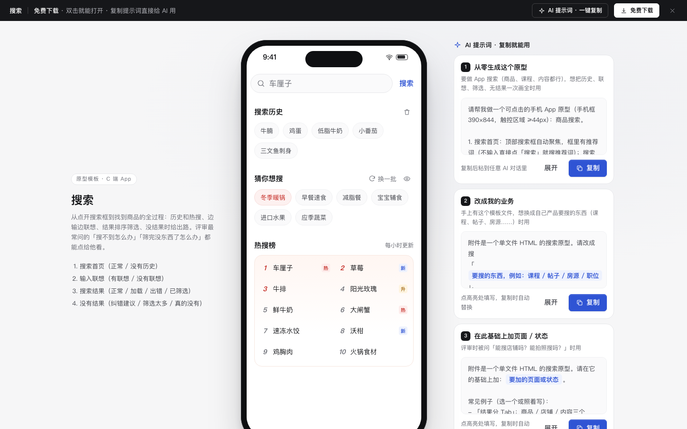

# 搜索

免费下载 · 双击就能打开 · 复制提示词直接给 AI 用。

> 积木盒 · 老岳AI编辑部 · 原型组　|　手机框 390×844　|　单文件 HTML，离线可用　|　2026-11-10

从点开搜索框到找到商品的全过程：历史和热搜、边输边联想、结果排序筛选、没有结果时给出路。评审最常问的「输错字怎么办」「筛完没东西了怎么办」「真搜不到给什么」都能点给他看。

---

## 一、用处

| 项 | 说明 |
|---|---|
| 适合什么需求 | 电商、生鲜、外卖、内容、课程类 App 的搜索；换掉卡片字段就能搜别的东西 |
| 解决哪一步 | 把搜索的四个阶段（搜什么 → 边输边提示 → 结果怎么排怎么筛 → 搜不到怎么办）一次定下来；无结果分三种情况分别给出路 |
| 不适合 | PC 后台列表的筛选（见 `b-list-drawer`）；只是一个搜索框组件（见模块 `m-search`） |

**包含的页面和状态**

| 页面 | 状态（右下角「原型面板」切换） |
|---|---|
| 搜索首页 | 正常 / 没有历史 |
| 输入联想 | 有联想 / 没有联想 |
| 搜索结果 | 正常 / 加载中 / 加载失败 / 已筛选 |
| 没有结果 | 错别字纠正 / 筛选太多 / 真的没有 |

## 二、用法

1. 双击 `index.html`；右下角「原型面板」切状态，按 `H` 隐藏；直达 `#page=none&state=over`。
2. 改数据：`<script>` 顶部 `DATA`——`placeholder` 框内推荐词、`history` 搜索历史、`hot` 热搜（第 2 项 `hotl` / `new` / `up` 是小标）、`guess` 猜你想搜、`goods` 商品（名称、规格、价格、已售、分类、标签、有货）、`sugExtra` 联想词、`typo` 错别字表、`tagOpts` 和 `pricePresets` 筛选项。
3. 改颜色：`:root` 的 `--accent`（主色），本模板样式里的 `--hl`（命中词高亮）和 `--price`（价格）。
4. 页面右侧「AI 提示词」3 条：从零生成 / 改成我的业务（变量：搜什么、卡片字段、排序和筛选项、热搜词）/ 加页面或状态（例：结果分 Tab、拍照搜、功能直达）。

## 三、交互说明

| 元素 | 交互 | 反馈 |
|---|---|---|
| 搜索框 | 进入页面 | 自动聚焦；框里是推荐词，不输入直接点「搜索」就搜它；字号 16px 防止手机自动放大 |
| 搜索历史 | 点词 / 垃圾桶 | 点词直接搜；垃圾桶进入管理：逐个删，或「全部删除」（先确认，Toast 可撤销） |
| 猜你想搜 | 换一批 / 眼睛 | 换一批轮换；眼睛图标隐藏或显示这一块 |
| 热搜榜 | 点击 | 两列 10 条，前 3 名红色，带「热 / 新 / 升」 |
| 联想 | 每输一个字 | 命中部分标红；第一条「在『水果』分类里搜」；右侧箭头把词填进框里继续改；没有联想时提示直接搜 |
| 搜索 | 回车 / 点联想 / 点历史 | 先出骨架再出结果；搜索词放进历史最前面（重复的移到最前，最多 10 条） |
| 排序 | 综合 / 销量 / 价格 | 价格再点切换升降，箭头显示方向；综合排序把售罄的放后面 |
| 筛选 | 底部弹层 | 价格可填可选预设（再点取消）；最低价高于最高价时标红、确定置灰；「确定（N 件）」随选择实时变化；「重置」清空 |
| 已选条件 | 小标签 | 显示在排序条下面，点 × 去掉单个，「清除全部」一次去掉 |
| 商品卡 | 加购 | 名称里的搜索词标红；售罄的加购置灰；加购后右下角购物车数字跳一下 |
| 无结果 · 错别字 | — | 直接搜纠正后的词，顶部写「已为你搜『车厘子』，仍然搜『车里子』」 |
| 无结果 · 筛选太多 | — | 系统算出去掉哪一个条件结果最多，按钮写「去掉『次日达』，有 N 件」；另给「清除全部筛选」 |
| 无结果 · 真的没有 | — | 给 3 条换词建议 + 「为你推荐」 |

## 四、自检

- [x] 状态全：首页 2 态、联想 2 态、结果 4 态、无结果 3 态
- [x] 系统能算的不让人算：筛选弹层实时显示件数；筛选太多时系统算好去掉哪个条件
- [x] 危险操作（清空历史）先确认且可撤销；单条删除直接删
- [x] 触控区域 ≥ 44px；底部弹层 Esc / 点遮罩关闭；排序按钮 `aria-pressed`
- [x] 示例数据标「示例」，无真实品牌
- [x] 无 JS 报错（11 个状态逐个打开检查）；26 条交互断言通过（无头 Chrome）

---

本模板由老岳AI编辑部·原型组制作，可免费下载、修改、用于工作项目。
