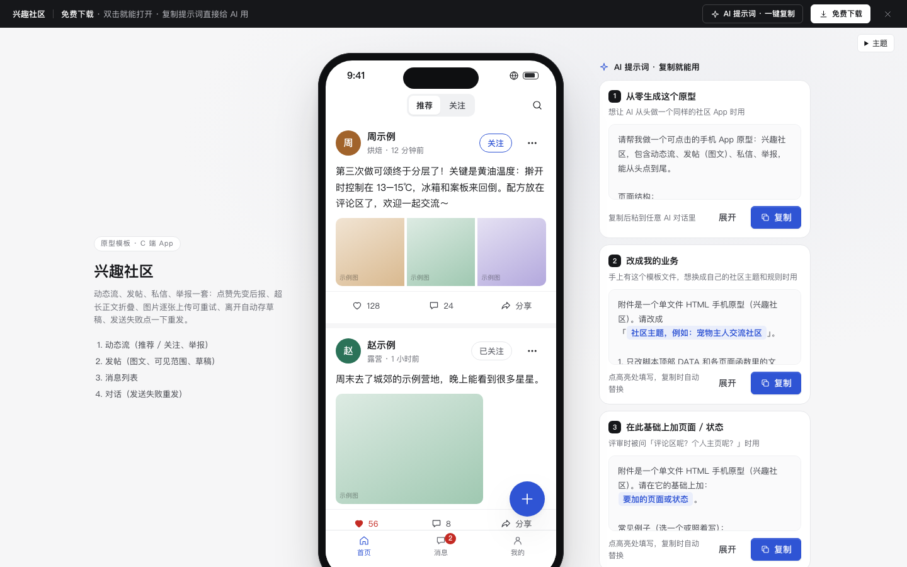

# 兴趣社区

免费下载 · 双击就能打开 · 复制提示词直接给 AI 用。

> 积木盒 · 老岳AI编辑部 · 原型组　|　手机框 390×844　|　单文件 HTML，离线可用　|　2026-11-10

一个能点的社区 App：动态流（推荐 / 关注）→ 发帖（图文）→ 私信对话 → 举报。双击 `index.html` 就能拿去评审。

---

## 一、用处

| 项 | 说明 |
|---|---|
| 适合什么需求 | 兴趣社区、内容社区、App 内的用户交流区；动态 + 发帖 + 私信 + 举报的基础闭环 |
| 解决哪一步 | 评审最常追问的都能点给他看：点赞失败怎么办、长文怎么折叠、图片传一半失败怎么办、没发完退出会不会丢、私信发不出去怎么办、举报后还看得到吗 |
| 不适合 | 短视频沉浸流（用 `c-feed`）、纯评论区做法（用功能模块 `m-comment`） |

**包含的页面和状态**

| 页面 | 状态（右下角「原型面板」切换） |
|---|---|
| 动态流 | 正常 / 加载 / 关注页为空 / 出错 / 举报弹层 / 点赞会失败 |
| 发帖 | 编辑中 / 图片上传失败 / 发布中 / 有草稿 |
| 消息 | 正常 / 空 |
| 对话 | 正常 / 发送失败 |

## 二、用法

### 2.1 打开

1. 下载整个文件夹，双击 `index.html`（不用联网）。
2. 右下角「原型面板」切页面和状态；评审时按 `H` 藏起面板。
3. 直达：`#page=post&state=fail`（页面：`feed` `post` `inbox` `chat`）。

### 2.2 改成你的业务（3 处）

| 改什么 | 在哪改 | 怎么改 |
|---|---|---|
| 配色、圆角、字体 | 文件最上面 `:root { ... }` | 换主色改 `--accent` `--accent-soft` |
| 动态、会话、规则 | `<script>` 顶部 `const DATA` | `posts` 的 `imgs` 是图片张数；`reasons` 举报原因；`maxText` `maxPics` 发帖上限；`scopes` 可见范围 |
| 页面文案和结构 | 搜 `function pageFeed` / `pagePost` / `pageInbox` / `pageChat` | 每个页面一个函数 |

### 2.3 让 AI 帮你改

页面右侧「AI 提示词」有 3 条：从零生成这个原型 / 改成我的业务（变量：社区主题、圈子清单、举报原因清单、规则）/ 在此基础上加页面或状态（例：评论区、个人主页、首帖审核）。

## 三、交互说明

| 元素 | 交互 | 反馈 |
|---|---|---|
| 推荐 / 关注 | 切换 | 关注页没人时引导「去看推荐」 |
| 正文 | 超过 4 行折叠 | 「展开」后显示全文 |
| 点赞 | 点击 | 立刻变红 +1 并轻弹；失败自动退回 + Toast（「点赞会失败」状态演示） |
| 关注 | 点击 | 即时变「已关注」；取消关注先确认 |
| 「…」更多 | 点击 | 底部弹层：不感兴趣 / 复制链接 / 举报；不感兴趣后该条折叠，可撤销 |
| 举报 | 选原因提交 | 选「其他」才出现补充说明；提交后折叠为「已举报，处理前对你隐藏」，可撤销 |
| 发帖正文 | 输入 | 「N / 1000」实时；超出标红、发布禁用 |
| 加图片 | 点「+」 | 每张显示上传进度；失败标红「点击重试」；有失败或上传中时发布禁用并说明 |
| 谁可以看 | 点击切换 | 默认「所有人可见」 |
| 关闭发帖 | 有内容时 | 自动存草稿，下次进来顶部「恢复」 |
| 发布 | 点击 | 按钮转圈「发布中」→ 回到动态流第一条「刚刚」 |
| 会话 | 点击 | 进入对话，未读清零，底部 Tab 角标同步 |
| 发消息 | 回车或点发送 | 气泡带转圈 → 发送成功；失败显示红色「!」，点一下重发；输入框随内容长高 |

## 四、自检（按《交互设计规范》）

- [x] 状态全：动态流 6 态、发帖 4 态、消息 2 态、对话 2 态
- [x] 失败不丢内容：点赞失败回滚、图片单张重试、草稿自动保存、消息点一下重发
- [x] 高频选项有默认值：可见范围默认所有人、圈子默认上次
- [x] 发帖 3 步内：点「+」→ 写内容 / 加图 → 发布
- [x] 触控目标 ≥ 44px；主操作在拇指区
- [x] 弹层：Esc、点遮罩关闭、焦点锁定、关闭后焦点回到触发处
- [x] 示例数据标「示例」，昵称内容全部虚构
- [x] 无 JS 报错（14 个页面状态逐个打开检查）
- [x] 窄屏（≤430px）去掉手机框铺满

---

本模板由老岳AI编辑部·原型组制作，可免费下载、修改、用于工作项目。

状态：已通过浏览器验收（1440/500 宽 0 报错、0 溢出、对比度与触控达标；标准外壳与跨目录比对通过）
