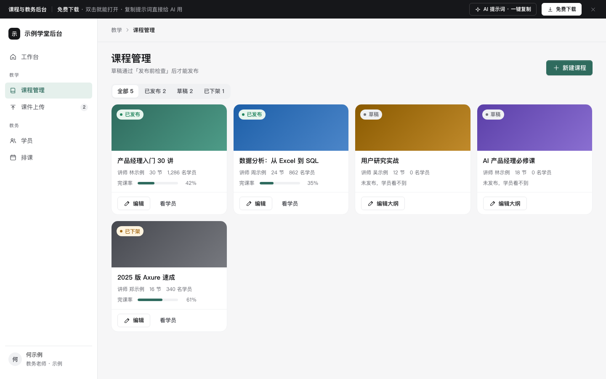

# 课程与教务后台

免费下载 · 双击就能打开 · 复制提示词直接给 AI 用。

> 积木盒 · 老岳AI编辑部 · 原型组　|　PC 1440　|　单文件 HTML，离线可用　|　2026-11-10

在线教育 / 培训机构后台的 4 个核心页面：课程管理（大纲排序 + 发布前检查）、课件上传（队列各状态）、学员（进度、超期未学提醒）、排课（周视图 + 冲突检测）。

---

## 一、用处

| 项 | 说明 |
|---|---|
| 适合什么需求 | 网校、企业内训、职业培训、兴趣班的教学与教务后台 |
| 解决哪一步 | 评审最常追问的都能点给他看：什么情况下课程不能发布、视频还在转码能不能发、上传失败怎么办、哪些学员该催、提醒会不会重复发、排课撞了怎么发现怎么改 |
| 不适合 | 学员端学习页（见 `edu-course`）；考试组卷与阅卷（可用第 3 条提示词加） |

**包含的页面和状态**

| 页面 | 状态（右下角「原型面板」切换） |
|---|---|
| 课程管理 | 课程列表 / 大纲编辑（检查不通过）/ 大纲编辑（可发布） |
| 课件上传 | 队列（上传中 / 暂停 / 转码中 / 完成 / 失败混合）/ 空 |
| 学员 | 正常 / 超 7 天未学 / 提醒预览 |
| 排课 | 本周 / 有冲突 / 新建（会冲突） |

## 二、用法

1. 双击 `index.html`；右下角「原型面板」切状态，按 `H` 隐藏；直达 `#page=sched&state=conflict`。
2. 改数据：`<script>` 顶部 `DATA`——`courses` 课程、`chapters` 大纲（节状态 ok / miss 缺课件 / proc 转码中）、`uploads` 上传队列、`students` 学员、`inactiveDays` 多少天没学算超期、`classes` 本周排课、`teachers` / `rooms` / `hours` 排课资源和时间范围。
3. 改颜色：本模板样式最上面的 `--accent`、`--accent-soft`。
4. 页面右侧「AI 提示词」3 条：从零生成 / 改成我的业务（变量：机构类型、课程、提醒规则、讲师教室）/ 加页面或状态（例：批量导入学员、讲师课时统计、调课）。

## 三、交互说明

| 元素 | 交互 | 反馈 |
|---|---|---|
| 课程状态筛选 | 全部 / 已发布 / 草稿 / 已下架 | 带数量；草稿卡片写「未发布，学员看不到」 |
| 大纲排序 | 每节 ↑ ↓ | 到章首 / 章尾再移会跨到上一章 / 下一章并提示；第一节不能上移、最后一节不能下移 |
| 删除小节 | 点垃圾桶 | Toast 可撤销 |
| 试看 | 视频节勾「试看」 | 发布检查「至少 1 节试看」实时更新 |
| 发布前检查 | 实时 | 5 项：每节有课件、没有转码中、测验 ≥ 3 题、至少 1 节试看、章节数；不通过的点「去处理」滚到那一节并高亮；全部通过前「发布」不可用 |
| 上传区 | 拖文件进来 / 点「选择文件」/ 回车 | 先检查格式和 2 GB 上限，不合格的直接进队列标失败并写原因 |
| 上传队列 | 暂停 / 继续 / 取消 | 写进度和剩余秒数；取消已上传一部分的先确认；视频传完自动进入「转码中」 |
| 失败项 | 换个文件 / 删除 | 原因写清（超过 2 GB、格式不支持）；左侧菜单显示进行中数量 |
| 学员筛选 | 学习状态 + 课程 | 每个状态带人数；超 7 天没学的「最近学习」标黄并写天数 |
| 发学习提醒 | 勾选后点击 | 抽屉预览消息（自动带姓名、进度、剩余节数）；已学完、24 小时内提醒过的自动跳过并列出 |
| 学员详情 | 点「详情」 | 各章进度条；可单独提醒 |
| 排课 | 点空白格 / 「排一节课」 | 抽屉预填点的那天那个小时；改讲师、教室、时间时实时查冲突，并给「改到最近的空闲」一键调整；有冲突不能保存 |
| 冲突 | 周视图 | 冲突的两节并排标红；顶部写清是同一讲师还是同一教室，「把后排的那节改到最近的空闲时间」可撤销 |
| 周切换 | 上一周 / 本周 / 下一周 | 今天日期用主色 |

## 四、自检

- [x] 状态全：4 个页面 11 个状态，含空、失败、冲突、检查不通过
- [x] 系统能判断的不让人记：发布条件、格式与大小、超期学员、提醒频率、排课冲突和空闲时间都由系统算
- [x] 删除、取消上传、排课调整可撤销或先确认
- [x] 抽屉 Esc 关闭、焦点锁定；排课格子、上传区可键盘操作
- [x] 示例数据标「示例」，手机号脱敏，无真实机构名
- [x] 无 JS 报错（11 个状态逐个打开检查）；23 条交互断言通过（无头 Chrome）；1440 设计，1280 不横滚

---

本模板由老岳AI编辑部·原型组制作，可免费下载、修改、用于工作项目。

状态：已通过浏览器验收（1440/500 宽 0 报错、0 溢出、对比度与触控达标；标准外壳与跨目录比对通过）
