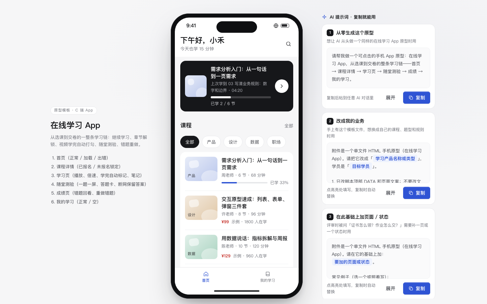

# 在线学习 App

免费下载 · 双击就能打开 · 复制提示词直接给 AI 用。

> 积木盒 · 老岳AI编辑部 · 原型组　|　手机框 390×844　|　单文件 HTML，离线可用　|　2026-11-10

这是一条能从头点到尾的学习链：首页继续学习 → 课程目录 → 看视频、学完自动打勾 → 随堂测验 → 成绩和错题重做。双击 `index.html` 就能拿去评审。



---

## 一、用处

| 项 | 说明 |
|---|---|
| 适合什么需求 | 在线课程、企业内训、知识付费、考证刷题等「看课 + 做题」的学习类 App；也适合给已有学习产品补测验、证书 |
| 解决哪一步 | 评审最常追问的规则都能点给他看：哪几节能试看、没报名点了会怎样、看到多少算学完、多选题怎么算分、没答完能不能交卷、断网时答案会不会丢 |
| 不适合 | 直播课（要连麦、举手、互动）；纯题库刷题（没有视频章节，用后续的题库模板） |

**包含的页面和状态**

| 页面 | 状态（右下角「原型面板」切换） |
|---|---|
| 首页 | 正常（继续学习卡 + 分类 + 课程列表）/ 加载（骨架）/ 出错（可重试） |
| 课程详情 | 已报名 / 未报名锁定（前 2 节试看，其余带锁）/ 点锁定章节（底部弹层「报名后解锁」） |
| 学习页 | 暂停中 / 播放中 / 学完（自动打勾 + 下一节）/ 笔记 |
| 随堂测验 | 答题（单选、多选、判断，一题一屏）/ 有题没答（交卷时提醒）/ 断网保留答案 |
| 成绩 | 有错题（错题回看 + 重做错题）/ 全对 |
| 我的学习 | 正常（在学课程 + 证书进度）/ 空（去选课） |

## 二、用法

### 2.1 打开

1. 下载整个文件夹，双击 `index.html`（Chrome / Edge / Safari 都行，不用联网）。
2. 右下角「原型面板」切页面和状态；评审时按 `H` 藏起面板。
3. 直达某个状态：地址后加 `#page=quiz&state=neterr`（页面：`home` `course` `learn` `quiz` `result` `mine`）。
4. 手机上演示：把文件发到手机用浏览器打开，窄屏下自动去掉手机框、铺满屏幕。

> 学习页的进度条做了加速（约 10 秒放完一节），方便演示「学完自动打勾」；页面上有「进度已加速演示」标记。

### 2.2 改成你的业务（3 处）

| 改什么 | 在哪改 | 怎么改 |
|---|---|---|
| 配色、圆角、字体 | 文件最上面 `:root { ... }` | 换主色改 `--accent` `--accent-soft`；及格/不及格用 `--success` `--danger` |
| 课程、章节、测验题 | `<script>` 顶部 `const DATA` | `courses` 里 `owned` 是否已报名、`price: 0` 就是免费；`chapters` 里 `trial: true` 可试看、`sec` 是时长秒数；`quiz` 里 `type` 选 `single` / `multi` / `judge`，`ans` 写正确选项下标，`ex` 写解析；`passScore` 改及格线 |
| 页面文案和结构 | 搜 `function pageHome` / `pageCourse` / `pageLearn` / `pageQuiz` / `pageResult` / `pageMine` | 每个页面一个函数，改里面的 HTML 即可 |

两条规则在代码里写死了，按你的业务改：学完的判定在 `togglePlay`（默认看到最后 30 秒算学完）；多选题计分在 `submitQuiz`（默认全对才得分）。

### 2.3 让 AI 帮你改这个原型（复制即用）

> 页面右侧 / 顶部「AI 提示词」可一键复制，变量点一下就能填。页面上有 3 条：从零生成这个原型、改成我的业务、在此基础上加页面 / 状态；下面是另外 2 条进阶用法。

**提示词 1：换成自己的课程和题**

```
这是一个单文件 HTML 在线学习原型（附件 index.html）。请改成「{{你的业务，例如：门店新员工入职培训}}」：
1. 只改 <script> 顶部 DATA 和各 pageXxx 函数里的文案，不要改文件里 KIT 标记之间的共用样式和脚本；
2. 课程换成 {{3–4 门课，写清是否免费、价格}}，第一门课写 {{5–8 节}} 章节，前 {{N}} 节可试看；
3. 随堂测验换成 {{5 道题，至少各有 1 道单选、多选、判断}}，每题写正确答案和一句解析；
4. 及格线改成 {{分数}}；
5. 改完自己按「全答对」和「错 2 道」各算一遍分数，确认成绩页显示对得上。
输出完整文件，并列出改了哪几处。
```

**提示词 2：加一条学习规则并能演示**

```
在这个学习原型里加一条规则：{{例如：上一节学完才能看下一节；或：测验不及格 24 小时内只能重做 3 次}}。
要求：
1. 目录、学习页、「下一节」按钮三个入口都要生效，被拦住时用底部弹层说明原因并给出路；
2. 规则用到的数字写进 DATA，方便以后改；
3. 在 Proto.init 的 states 里加一个状态，能在原型面板一键演示被拦住的样子；
4. 在 README 的交互说明表里补一行。
只改必要的地方，输出完整文件。
```

## 三、交互说明

| 元素 | 交互 | 反馈 |
|---|---|---|
| 继续学习卡 | 点击直接进学习页，从上次的位置接着看 | 卡片上写「上次学到第几节 · 几分几秒」和已学节数 |
| 分类标签 | 点击筛选课程 | 当前分类黑底高亮；没有课时提示「换个分类看看」 |
| 课程卡片 | 点击进课程详情 | 已报名显示进度条，未报名显示价格和在学人数 |
| 简介 / 目录 | 分段切换，切换条吸顶 | — |
| 章节（已报名） | 点击进学习页 | 学完的绿色打勾，上次学到的主色高亮并写「上次学到这里」 |
| 章节（未报名） | 前 2 节标「试看」可直接看；其余带锁，点击弹出底部弹层「报名后解锁」 | 弹层给「先试看」「免费报名」两个出路，不直接报错 |
| 报名按钮 | 免费课一点即报名；付费课先弹确认框写明金额 | Toast「报名成功，全部章节已解锁」，锁全部消失 |
| 播放 / 暂停 | 点画面中间或左下按钮 | 两个按钮图标同步切换 |
| 进度条 | 点击或拖动跳转；键盘左右键每次 10 秒 | 时间、笔记的时间点同步更新 |
| 倍速 | 点击在 1× / 1.25× / 1.5× / 2× 之间轮换 | Toast「已切换 1.5 倍速」 |
| 学完判定 | 看到最后 30 秒自动算学完 | Toast + 绿色提示条「这一节已学完，进度已保存」+「下一节」按钮；目录里自动打勾 |
| 笔记 | 输入后「保存」，自动带上当前时间点 | 笔记列表最上面多一条；点时间标签跳回那个时间点 |
| 选项 | 单选、判断点一下即选中；多选可多选，再点取消 | 选中主色描边；顶部「已答 N」和进度条实时更新；答案自动存本机 |
| 答题卡 | 点击打开底部弹层，已答 / 未答分颜色 | 点题号直接跳到那题 |
| 交卷（有题没答） | 弹框写明还有几题没答 | 「去作答」跳到第一道没答的题；「仍然交卷」按 0 分算 |
| 交卷（全部答完） | 二次确认「交卷后不能再改答案」 | 进入成绩页 |
| 断网 | 交卷失败时顶部红色提示 | 写明「答案已保存在本机」，「重新交卷」即可，不用重答 |
| 退出测验 | 点左上角关闭，先确认 | 已答的题保存在本机，下次进来接着答 |
| 成绩环 | 进入时按得分画出，及格绿色、不及格红色 | 下方答对 / 答错 / 总题数 |
| 错题回看 | 展开 / 收起，默认展开第一道 | 显示你的答案、正确答案、解析 |
| 重做错题 | 只重做答错的题 | 进入测验，标题变成「重做错题」 |
| 证书 | 没学完时显示还差几节，点击去学习；学完可查看 | — |

## 四、自检（按《交互设计规范》）

- [x] 状态全：首页 正常 / 加载 / 出错；我的学习 空态带「去选课」；测验断网有出路且答案不丢；课程未报名锁定有出路
- [x] 系统能算的不让人算：学完自动打勾、进度和已答数自动更新、成绩自动算、默认跳到上次学到的位置
- [x] 主操作在底部拇指区，高 48px；所有可点元素 ≥ 44px
- [x] 弹窗 / 底部弹层：Esc、点遮罩关闭，焦点锁定，关闭后焦点回到触发处
- [x] 文字对比度 ≥ 4.5:1；尊重系统「减少动态效果」设置
- [x] 示例数据全部虚构：课程、老师、人数都标「示例」，封面和视频是纯 CSS 占位
- [x] 无 JS 报错（6 个页面 17 个状态逐个打开 + 选课 / 播放 / 笔记 / 答题 / 交卷 / 重做 / 报名脚本走查）
- [x] 窄屏（≤430px）自动去掉手机框铺满，不横向滚动

---

本模板由老岳AI编辑部·原型组制作，可免费下载、修改、用于工作项目。
