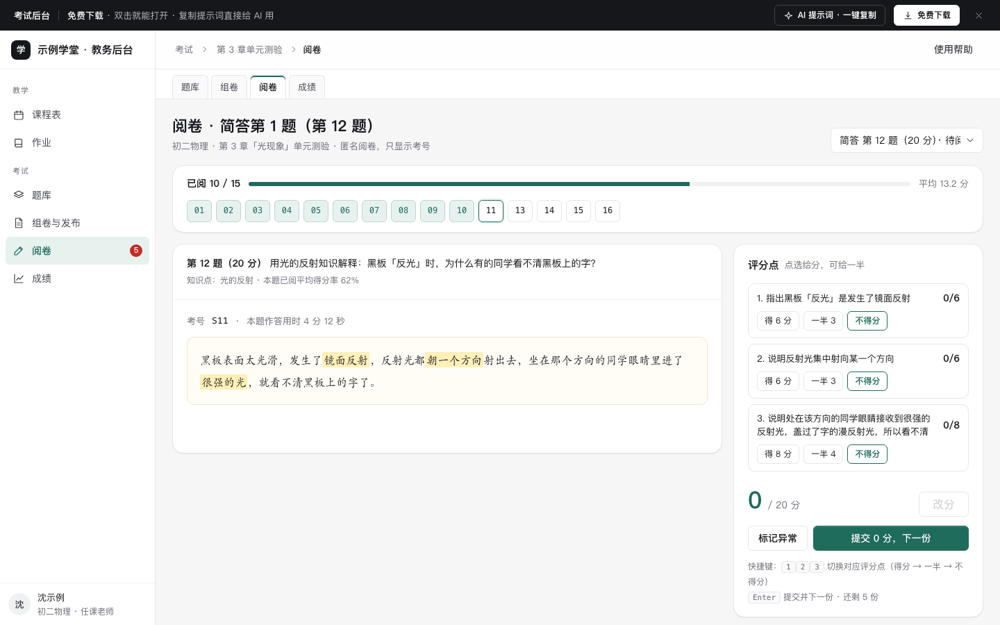

# 考试后台（出题 · 组卷 · 阅卷 · 成绩）

免费下载 · 双击就能打开 · 复制提示词直接给 AI 用。

> 积木盒 · 老岳AI编辑部 · 原型组　|　PC 1440（500 宽不横滚）　|　单文件 HTML，离线可用　|　2026-11-11 重做

老师视角的在线测验后台，以「初二物理 · 第 3 章光现象单元测验」、16 名学生为例：题库（筛选、勾选加入试卷、按题型变化的出题表单）→ 组卷（按蓝图核对总分 / 题型 / 难度 / 知识点，不满足就不能发布）→ 阅卷（匿名、按评分点点选给分、快捷键、相似度提醒）→ 成绩（统计、分数段、易错题、阅完才能发布）。框架复用 `b-shell`（侧栏、顶栏面包屑、页签）。阅完一份，成绩页那位学生的总分和排名跟着变。

---

## 一、用处

| 项 | 说明 |
|---|---|
| 适合什么需求 | 学校 / 培训机构的单元测验、企业培训考核、资格认证考试的出题与阅卷后台 |
| 解决哪一步 | 评审常问的都能点：选择题答案怎么校验、组卷怎么保证 100 分且题型齐全、难度怎么控、主观题怎么给分才一致、疑似抄袭怎么处理、没阅完能不能发成绩、缺考和切屏怎么算 |
| 不适合 | 学生作答端（见 `edu-course`）；排课教务（见 `edu-admin`） |

**页面和状态**（右下角「原型面板」切换）

| 页面 | 状态 |
|---|---|
| ① 题库（出题） | 正常（15 题）/ 空 / 加载中 / 加载失败 / 无权限 |
| ② 组卷与发布 | 差 1 题（80 分）/ 已满 100 分可发布 / 空试卷 / 加载中 / 加载失败 / 已锁定无权修改 |
| ③ 阅卷 | 待阅 5 份 / 本题阅完 / 加载中 / 加载失败 / 无权限 |
| ④ 成绩 | 阅卷中（不可发布）/ 已全部阅完可发布 / 空（未开考）/ 加载中 / 加载失败 / 无权限 |

## 二、用法

1. 双击 `index.html`；右下角「原型面板」切页面和状态，按 `H` 隐藏；直达例：`#page=paper&state=full`。
2. 改数据只改 `<script>` 顶部 `DATA`：`exam` 考试信息、`bank` 题库（题型、知识点、难度、正确率、状态、答案）、`blueprint` 试卷蓝图（题型 × 题数 × 每题分值）、`paper` 已选题、`diffTarget` 难度目标、`rubric` 评分点、`students` 学生成绩、`answers` 待阅答案（关键词高亮、相似度）、`qRate` 易错题。
3. 改颜色：`:root` 的 `--accent`（默认墨绿）。
4. 页面顶部「AI 提示词」3 条：从零生成 / 改成我的业务（变量：考试场景、题型蓝图、总分及格线、知识点、评分点、防作弊规则、人数）/ 加页面或状态（双评仲裁、成绩复核、考试监控、试卷分析）。

## 三、交互说明

| 元素 | 交互 | 反馈 |
|---|---|---|
| 题库筛选 | 关键字、题型、知识点、难度、状态 | 实时过滤；正确率 <60% 标红；主观题显示得分率 |
| 勾选加入试卷 | 勾选 → 「加入试卷」 | 已在试卷里、待审核、已停用的题勾选框置灰；加入后提示试卷总分和还差什么 |
| 编辑 / 新建题目 | 点一行 / 「新建题目」，右侧抽屉 | 题型切换表单跟着变：选择题 A～D 选项（单选只能 1 个正确、多选至少 2 个、选项不能重复）、判断对 / 错、填空多个答案用 \| 隔开、主观题评分点；12 个字段；保存时校验并在顶部写出原因；可提交审核 |
| 组卷 | 改每题分值、上下移、移出（可撤销）；空位「从题库选」 | 空位按题型画出；跳到题库时自动筛出该题型的已审核题 |
| 发布前核对 | 实时 | 各题型已选 / 计划、总分是否 = 100、难度分布 vs 目标 4:3:3、知识点覆盖；有一项不满足「发布考试」置灰并写原因；「自动补齐」从已审核题里补 |
| 考试设置 | 抽屉 | 名称、班级、时长、开始时间、结束时间（自动算）、及格线、迟到限制、切屏次数、何时显示答案、题目乱序、选项乱序；时长 10～180、及格线 1～99 校验 |
| 发布 / 撤回 | 二次确认 | 发布后可在开考前撤回 |
| 阅卷 | 评分点点「得分 / 一半 / 不得分」 | 总分自动加；也可手改，超过满分拦截；数字键 1/2/3 切换评分点，回车提交并跳下一份 |
| 考号格子 | 点待阅考号跳转 | 已阅绿色、当前描边、异常红框 |
| 相似度提醒 | — | ≥90% 显示「与 S07 相似度 91%」，可「标记异常」交教研组长复核 |
| 成绩统计 | — | 应考 / 实考、平均分、及格率、最高最低、阅卷进度、分数段柱状图（不及格段另一种颜色）、易错 5 题；都由学生数据算出，缺考不计入 |
| 成绩明细 | 按总分 / 按考号排序 | 同分并列排名；阅卷中的学生写「阅卷中（已得 N）」；切屏 ≥2 次标黄 |
| 发布成绩 | 二次确认 | 有主观题没阅完时置灰并写还差几份 |

## 四、验收结论（2026-11-11 原型组）

**通过。** 对照上轮打回原因逐条处理：

| 上轮问题 | 本次 |
|---|---|
| 题干「示例：空状态应包含什么？2、3、4…」批量复制 | 15 道真实物理题（光现象），题型、知识点、难度、正确率、答案各不相同；16 名学生每人分数、用时、切屏都不同 |
| 通用骨架，业务区薄 | 蓝图组卷 + 发布前核对、按评分点阅卷 + 快捷键 + 相似度、成绩分布与发布条件，均为考试专属 |
| 提示词套话 | 3 条写明题型校验、组卷校验、阅卷规则、发布条件 |
| 390 宽横滚 908px | 全部表格包在横向滚动容器里，网格窄屏改单列，500 宽 22 个状态 0 横滚 |
| 勾选框 13px、输入框 22px | 勾选框外包 28px 点击区；表格内输入 32px |

机器验收：`_kit/atest.sh` 1440 / 1280 / 500 宽 × 22 个状态：0 JS 报错、0 横滚、0 对比度问题、0 小于 24px 的可点元素；提示词面板可打开 / 展开 / 复制。交互断言 25 条通过（题库数量与筛选、不可勾选规则、编辑抽屉、选项重复 / 多选个数校验、新题待审核、80 分不可发布、空位跳题库、加入后 100 分、改分值拦截、移出与撤销、发布、阅卷进度、评分点相加、提交跳下一份、快捷键、手改超满分、相似度与标记异常、未阅完不能发成绩、学生总分联动）。`gtest.sh` 面向组件画廊（Gallery），页面模板不适用，以交互断言代替。

---

本模板由老岳AI编辑部·原型组制作，可免费下载、修改、用于工作项目。
