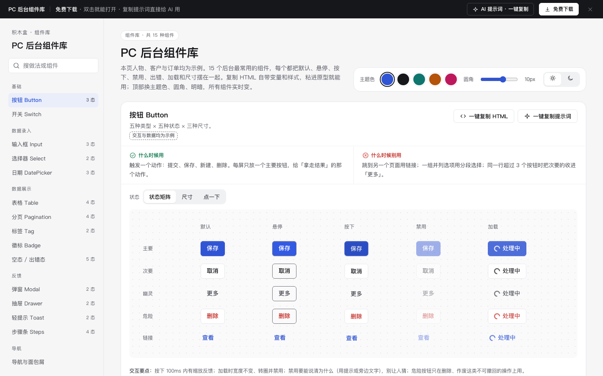

# PC 后台组件库

免费下载 · 双击就能打开 · 复制提示词直接给 AI 用。

15 类组件、39 个可切换状态，支持主题色、圆角与明暗切换；所有业务数据和交互结果均为示例。



封面为 Chrome 1440 × 900 真实截图；深色模式见 `shot-dark.png`。

## 用处

面向产品经理、设计师和前端开发者，用于比较状态、约定交互、快速拼出可点击原型。组件是单个元素；交互模块负责组合成一个任务，页面模板负责完整页面布局。可从本库复制组件到模块或页面模板，也可以把 index.html 附给 AI 拼页。全部为原创示例，不依赖在线字体、脚本、图片或服务。

## 组件清单

状态数按画廊 states 入口统计；一个矩阵状态可能同时展示多个视觉状态。

| 组件 | 状态 | 尺寸 | 什么时候用 |
| --- | --- | --- | --- |
| 按钮 Button | 状态矩阵、尺寸、点一下 | 32 / 36 / 44px | 触发一个动作：提交、保存、新建、删除。每屏只放一个主要按钮，给「拿走结果」的那个动作。 |
| 开关 Switch | 全部状态 | 32px 触控区域 | 改了马上生效、不需要再点保存的设置：启用规则、接收通知。 |
| 输入框 Input | 状态、尺寸、试一下 | 32 / 36 / 44px | 用户必须自己打字的内容：名称、编号、备注、金额。 |
| 选择器 Select | 点开试试、状态 | 36px（原生与搜索式） | 从 4–30 个固定选项里选一个：状态、负责人、城市。 |
| 日期 DatePicker | 单个日期、日期范围、输入框状态 | 36px 输入 / 296px 日历 | 选一个日期或一段日期：下单日期、有效期、报表时间范围。 |
| 表格 Table | 正常、加载、空、出错 | 自适应宽度 | 要对比多条记录的多个字段，并且要逐条或批量操作。 |
| 分页 Pagination | 完整版、简洁版、第一页、最后一页 | 32px | PC 列表超过一页（通常每页 10–50 条），用户需要跳到指定页或知道总量。 |
| 标签 Tag | 类型与尺寸、可关闭 | 20 / 24 / 32px；关闭按钮32px | 标出状态（待确认、已完成）或已选的筛选条件。 |
| 徽标 Badge | 全部 | 数字 / 99+ / 圆点 | 提醒「这里有 N 件事待处理」：待审批数、未读消息。 |
| 空态 / 出错态 | 空、无结果、出错、无权限、404 | 自适应 | 列表、详情、搜索结果没有可显示的内容时。 |
| 弹窗 Modal | 点开试试、静态预览 | 普通 / 危险 / 表单 | 需要用户停下来确认或补一两项信息，确认完回到原页面。 |
| 抽屉 Drawer | 点开试试、静态预览 | 480px（实开） / 420px（预览） | 查看或编辑一条记录的详情，看完还要回到列表继续处理下一条。 |
| 轻提示 Toast | 点一下、静态预览 | 按内容适配 | 告诉用户「刚才的操作有结果了」，不需要他做任何事。 |
| 步骤条 Steps | 进行中、全部完成、某步出错、竖向 | 横向 / 竖向 | 分步表单、审批进度、订单物流：让人知道一共几步、现在在哪。 |
| 导航与面包屑 | 组合 | 220px侧栏 / 34–40px条目 | 后台的全局导航和页面内的层级、视图切换。 |

## 用法

1. 解压后双击 index.html，离线打开组件画廊。
2. 在左侧搜索组件，在组件上方切换状态；顶部可更换主题色、圆角、浅色或深色。
3. 点「一键复制 HTML」，把带 CSS 变量、样式、图标的片段粘进 HTML。导出的是当前状态的静态外观；如需交互，使用完整 index.html 中的 mount 逻辑，或复制提示词让 AI 补齐。
4. 点组件的「一键复制提示词」，得到含用途、禁用场景、状态及键盘要求的指令。
5. 点右下角「AI 提示词」，填写高亮变量后「一键复制」，和本页 index.html 一起交给 AI。
6. 顶部「免费下载」下载同目录的 kit-admin.zip。构建脚本打包 index.html 与 README.md，按现有规则不包含 PNG。

## 页面上的 AI 提示词

| 提示词 | 什么时候用 | 填什么 |
| --- | --- | --- |
| 从零生成这套组件库 | 建立一套自己的规范与组件画廊 | 按提示列出的组件、状态和交付要求执行 |
| 用这套组件拼出整页 | 复用本库拼业务原型 | 页面类型、业务名称，附上 index.html |
| 给组件库加一个组件 | 补充已有组件之外的能力 | 组件名称、状态清单，附上 index.html |

要求输出完整单文件离线 HTML 与说明表，使用已有 CSS 变量，示例数据明确标示例，不编造业务事实。

## 自检清单

- [x] 组件清单、use / avoid / spec、三条提示词齐全。
- [x] 四组构建标记完整，已使用原构建脚本内联并打包。
- [x] DOM 环境逐态执行：15 项 / 39 态 / 3 条提示词，无脚本异常或缺失图标引用。
- [x] 三套合计 29 项 DOM 交互断言通过：表单、Tab、弹层、分页、步骤、流式停止继续、反馈、版本和 Agent 确认流程。
- [x] 抽取前三个组件生成独立 HTML，变量、样式、图标已做结构检查；补齐矩阵布局和基础字体。
- [x] 提供 README、预览封面和可下载 ZIP；目录仅保留四个交付文件。
- [x] Chrome gtest：15 项 / 39 态全部切换、复制片段和提示词生成、明暗切换，输出 OK。
- [x] 浏览器控制台：逐态打开无 JS 报错。
- [x] 对比度：浅色、深色下逐组件逐状态自动检测所有文字（正文 ≥4.5:1、大字 ≥3:1），全部达标。
- [x] 复制片段：每个组件每个状态的「一键复制 HTML」放进空白页渲染（浅色 + 深色共 78 个），字体、样式、图标、深色变量都正常，尺寸与画廊里一致。
- [x] 布局：1440 / 1280 宽无横向滚动；500 宽（手机）页面不横滚，宽组件在演示区内横向滚动。
- [x] AI 提示词面板：顶部按钮打开右侧面板，3 条提示词可展开、可填变量、可复制。
- [x] 封面换成真实截图（cover.png），另附深色截图 shot-dark.png。

### 验收结论（2026-11-10 原型组复验）

通过，可以上线。复验时顺手修了 3 处共用问题，已并入 `_kit`，所有模块和模板一起生效：①深色下实心红色徽标对比度不足（2.5:1 → 5:1）；②深色下原生勾选框仍是白色（加 `color-scheme:dark`）；③右侧抽屉和提示词面板的标题被顶部条挡住（抽屉从顶部条下方开始）。Codex 建议的「复制片段补齐基础字体 / 深色主题 / 触控尺寸 / 减少动态效果」也已并入 `_kit/gallery.js`，现在复制出的片段自带这些规则。

### 复验命令

在项目根目录运行：

```bash
python3 _kit/build.py kit-admin
bash _kit/gtest.sh kit-admin
bash _kit/check.sh kit-admin ""
bash _kit/shot.sh kit-admin "" cover.png 1440 900
```

期望 gtest 输出 `SECTIONS 15 STATES 39 PROMPTS 3 OK`。2026-11-10 原型组在 Chrome 无头模式实跑，输出与期望一致。所有演示仅在本地修改示例状态，不会发送消息、转接真人或修改真实业务数据。
