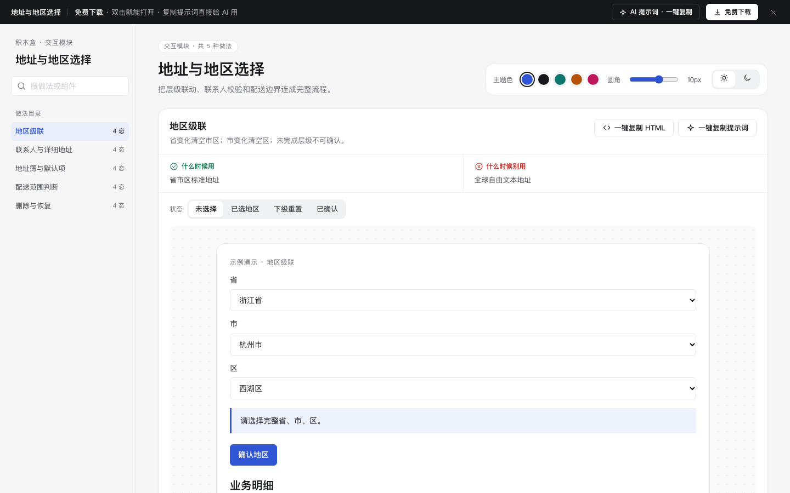

# 地址与地区选择 · 交互模块

免费下载 · 单文件 HTML · 中文 · 离线可用。老岳AI编辑部 · 积木盒 · 原型组。

把层级联动、联系人校验和配送边界连成完整流程。

## 做法与状态

| 做法 | 全部状态 | 什么时候用 | 什么时候别用 | 交互规则 |
|---|---|---|---|---|
| 地区级联 | 未选择,已选地区,下级重置,已确认 | 省市区标准地址 | 全球自由文本地址 | 省变化清空市区；市变化清空区；未完成层级不可确认。 |
| 联系人与详细地址 | 填写,校验错误,核对,保存成功 | 配送收货、客户档案 | 仅需粗略城市定位 | 中文姓名、11位演示手机号和详细地址必填；错误指向字段。 |
| 地址簿与默认项 | 地址列表,新默认,编辑,已保存 | 重复下单的登录用户 | 一次性访客地址 | 单一默认地址；编辑取消恢复原值，默认切换不删除其他项。 |
| 配送范围判断 | 待判断,可配送,超出范围,已选择自提 | 区域配送、同城服务 | 全国无差异数字商品 | 示例仅支持西湖区配送；临安区提供自提替代，不能强行下单。 |
| 删除与恢复 | 地址列表,删除确认,已删除,已恢复 | 需要管理多个地址 | 强监管地址历史不可删除 | 删除前明确默认影响；删除后可撤销，恢复原默认身份。 |

## 使用

1. 解压 `m-address.zip`，双击 `index.html`。无需依赖或服务端。
2. 左侧搜索做法，右侧切换状态；演示内按钮、输入和选择可操作。状态按钮是独立情境样例，流程操作会保留当前输入。
3. 右上切换主题、圆角与明暗，偏好保存本机。业务数据只存当前页面内存，刷新清除。
4. 每种做法可复制当前状态 HTML（含样式变量，交互逻辑需由 AI 补齐）与完整做法提示词。
5. 顶部 AI 面板含三条提示词：从零生成、改成我的业务、增加做法/状态；变量可就地填写。
6. 顶部免费下载获取同名 zip。所有数据标示例，不发送真实邀请、不扣费、不请求网络。

## 浏览器验收结论（2026-11-11 原型组）

通过，可以上线。

- [x] Chrome gtest：5 项 / 20 态全部切换、复制片段与提示词生成、明暗切换，输出 OK。
- [x] 逐态打开（20 态，浅色 + 深色各一遍）：0 个 JS 报错。
- [x] 布局：1440 / 1280 / 500 三种宽度都不横向滚动。
- [x] 对比度：所有可见文字逐态自动检测（正文 ≥4.5:1、大字 ≥3:1），浅色、深色全部达标。
- [x] 触控尺寸：所有按钮、链接、输入框、Tab 都 ≥24px。
- [x] AI 提示词面板：顶部按钮打开，3 条提示词可展开、可复制（出现「已复制」反馈）。
- [x] 数据：每种做法 ≥5 条业务明细，逐行不同、贴合业务（单号、人名、门店、金额各不相同），无占位数据。
- [x] 操作区：每个进行中的状态都有主按钮；结束态只留「重新演示 / 撤销」等次级操作，与 m-form、m-diff 标杆一致。
- [x] Node 复验：`node m-address/redo-check.cjs` 通过（`redo-validation.json`）；`dom-validation.json` 为返工前历史记录。
- [x] 封面为真实截图 cover.png（1440×900）。

验收时修了：
- 主按钮规则改为按按钮开头判断：原规则只要文字里含「取消 / 模拟」就不升主色，「确认取消」「创建模拟邀请」这类前进操作被误降级；「留在…」归入保留类。

复验命令：`bash _kit/atest.sh m-address 1440`（另跑 1280、500）、`bash _kit/gtest.sh m-address`、`bash _kit/shot.sh m-address "" cover.png 1440 900`。

## 边界

示例仅为产品原型；实际排班、核销、权限、库存和配额须由服务端校验。状态切换用于查看演示，不代表实际权限可被绕过。
