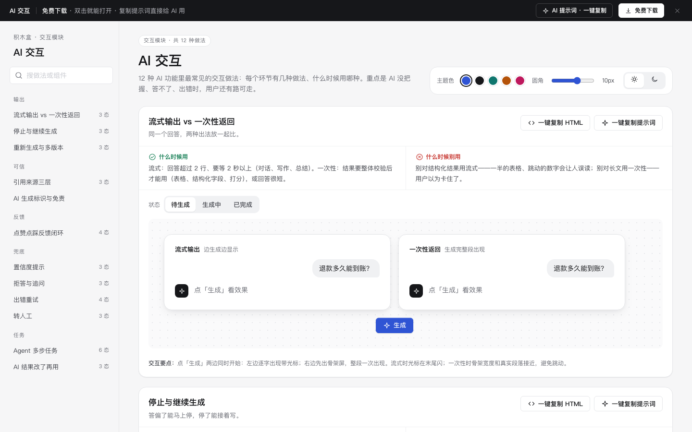

# AI 交互 · 交互模块

免费下载 · 双击就能打开 · 复制提示词直接给 AI 用。

> 积木盒 · 老岳AI编辑部 · 原型组　|　交互模块（组件 → **模块** → 页面模板）　|　单文件 HTML，离线可用　|　2026-11-10

这是一页能点的 AI 交互做法合集：12 种做法、39 个状态，讲 AI 功能里每个环节有几种做法、什么时候用哪种。重点是 AI 没把握、答不了、出错时，用户还有路可走。

---

## 一、用处

| 项 | 说明 |
|---|---|
| 解决什么 | 评审 AI 功能时最容易只画「答对了」的样子。这里把停止、引用、低置信、拒答、出错、转人工、Agent 人工确认这些环节都做成了能点的状态 |
| 适合谁 | 做 AI 助手、知识库问答、AI 起草、AI 自动执行任务的产品经理 |
| 和组件库、页面模板的关系 | 组件库 `kit-ai` 摆的是单个组件长什么样；这个模块讲「做法怎么选」；页面模板 `ai-chat` 是拼好的整页 |

## 二、做法清单

| # | 做法 | 状态 | 什么时候用 | 什么时候别用 |
|---|---|---|---|---|
| 1 | 流式输出 vs 一次性返回 | 待生成 / 生成中 / 已完成 | 流式：长回答；一次性：结构化结果 | 别对表格、打分用流式 |
| 2 | 停止与继续生成 | 生成中 / 已停止 / 继续后完成 | 所有流式输出 | 别把停止藏在角落、别清空已生成内容 |
| 3 | 引用来源三层 | 角标 / 来源卡片 / 原文高亮 | 回答依据了资料 | 闲聊、创意写作 |
| 4 | 重新生成与多版本 | 单个版本 / 多版本切换 / 并排对比 | 写作、起草、起标题 | 事实查询 |
| 5 | 点赞点踩反馈闭环 | 未反馈 / 已点赞 / 点踩选原因 / 已提交 | 所有 AI 回答 | 别弹大表单、别强制写原因 |
| 6 | 置信度提示 | 有依据 / 部分依据 / 没有依据 | 回答会被用来做决定 | 别显示看不懂的百分比 |
| 7 | 拒答与追问 | 超出范围 / 不该回答 / 信息不够先追问 | 有业务边界的助手 | 别只回「无法回答」 |
| 8 | 出错重试 | 超时 / 网络中断 / 问题太长 / 重试成功 | 所有调用 AI 的地方 | 别给技术报错原文、别清空问题 |
| 9 | 转人工 | 入口 / 排队中 / 已接入 | 客服、投诉、钱和账号问题 | 别让用户绕 5 轮才给入口 |
| 10 | Agent 多步任务 | 计划待确认 / 执行中 / 等人确认 / 完成 / 失败已回滚 / 已中断 | AI 替用户执行操作、≥3 步 | 只读查询；删除付款不能跳过确认 |
| 11 | AI 结果改了再用 | AI 草稿 / 编辑中 / 已采纳 | 对外发送、要落库的内容 | 别让 AI 内容不经人直接发出 |
| 12 | AI 生成标识与免责 | 三种放置位置 | AI 与人写内容混排 | 别每段都贴警告 |

## 三、用法

1. 下载文件夹，双击 `index.html`。
2. 左侧目录点到想要的做法，点「状态」切换，演示区里可以真实操作（生成、停止、点来源、点踩、转人工、确认 Agent 步骤）。
3. 右上角换主题色、圆角、明暗，所有演示实时跟着变。
4. **一键复制 HTML**：复制当前状态的 HTML，自带所需的 CSS 变量和样式，粘进任意 HTML 原型就能显示。复制的只有外观，交互逻辑用提示词让 AI 补上。
5. **一键复制提示词**：每种做法一条，交给 AI 就能做出带全部状态的同款。

### 页面上的 AI 提示词

页面顶部「AI 提示词 · 一键复制」里有 3 条，高亮的变量点一下就能就地填写，复制出来就是填好的完整提示词：

| # | 提示词 | 什么时候用 |
|---|---|---|
| 1 | 从零生成整套「AI 交互」模块 | 要给 AI 功能定一套交互规范 + 演示 |
| 2 | 把 AI 交互改成我的产品（变量：AI 功能、角色、资料范围、拒答范围、高风险操作） | 已下载，换成自己的场景 |
| 3 | 在此基础上加一种 AI 做法 / 状态（变量：要加的做法、状态清单） | 模块里没有你要的做法 |

## 四、交互说明

| 做法 | 元素 | 交互 | 反馈 |
|---|---|---|---|
| 流式 vs 一次性 | 生成按钮 | 点击，两边同时开始 | 左边逐字出现带光标；右边先骨架再整段出现 |
| 停止与继续 | 停止按钮 / Esc | 生成中点击或按 Esc | 保留已生成部分，出现「已停止 · 继续生成」；继续从断点接着写 |
| 引用来源 | 角标 / 来源卡片 | 点角标；点卡片 | 角标 → 对应卡片高亮；卡片 → 展开原文，命中句黄色高亮，再点收起 |
| 多版本 | ‹ › / 重新生成 / 对比 | 切换、重新生成、对比 | 重新生成不覆盖旧版，版本号变化；对比时点「用这版」选定 |
| 点赞点踩 | 拇指按钮、原因标签 | 点踩展开原因 | 至少选 1 个原因「提交」才可点；提交后显示「已收到」 |
| 置信度 | 三格指示 + 提示条 | 按依据多少显示 | 有依据不打扰；部分依据黄条「请核对」；没依据不给结论，给转人工 |
| 拒答与追问 | 推荐问题、选项 | 点击 | 超出范围给推荐问题；追问给可点选项，点了直接出回答 |
| 出错重试 | 重试按钮 | 点击 | 问题保留，先「重新生成中」再出结果；太长时可自动精简 |
| 转人工 | 转人工按钮 | 点击 → 确认 | 排队写清前面几位、预计几分钟（不跳秒），可取消；接入后显示同事名字 |
| Agent 多步 | 执行 / 确认 / 中断 | 确认计划后执行 | 高风险步骤暂停等确认；失败写清已回滚什么；中断前确认，写清保留哪些 |
| 改了再用 | 改一下 / 采纳 / 丢弃 | 原地编辑 | 采纳后标「人工改过」；丢弃 4 秒内可撤销 |
| 全页 | 主题色 / 圆角 / 明暗 | 切换 | 所有演示实时变化，记在本机 |

## 五、自检（按《交互设计规范》）

- [x] 12 种做法 39 个状态可切换，主要交互可真实操作
- [x] 每种做法写清「什么时候用 / 什么时候别用」和交互要点
- [x] AI 答错、答不了、出错、要人确认，都有出路
- [x] 可点元素 ≥ 32px；焦点框清晰；文字对比度 ≥ 4.5:1（浅色、深色）
- [x] 页面上 3 条 AI 提示词，变量可就地填写，复制有成功反馈；提示词不写具体 AI 产品名
- [x] 无 JS 报错（全部状态切换 + 复制 HTML / 提示词 + 明暗切换 + 12 项交互脚本走查）
- [x] 示例数据标「示例」，无真实公司名

---

本模块由老岳AI编辑部·原型组制作，免费下载、修改、用于工作项目。
