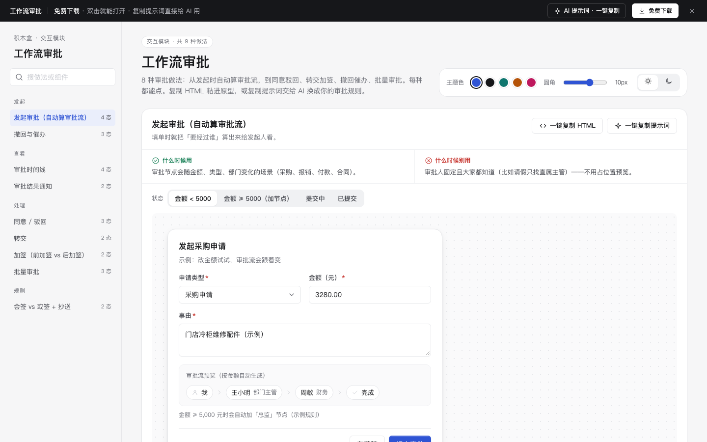

# 工作流审批 · 交互模块

免费下载 · 双击就能打开 · 复制提示词直接给 AI 用。

> 积木盒 · 老岳AI编辑部 · 原型组　|　交互模块（组件 → **模块** → 页面模板）　|　单文件 HTML，离线可用　|　2026-11-10

这一页收了 9 种审批做法，覆盖发起时自动算审批流、同意驳回、转交加签、撤回催办、批量审批和结果通知，每种都能点。挑一种，复制 HTML 粘进原型；或者复制提示词，让 AI 换成你的审批规则。

---

## 一、用处

| 项 | 说明 |
|---|---|
| 解决什么 | 画审批原型时，最容易漏这几处：驳回要不要写原因、已经有人审过还能不能撤回、催办多久能催一次、前加签和后加签有什么区别、批量审批时不符合的单子怎么办。这里每一处都做成了能点的状态 |
| 适合谁 | 做 OA、采购、报销、合同、付款等审批类后台的产品经理 |
| 和页面模板的关系 | 「审批流」页面模板（b-approval）就是用这些做法拼出来的整页 |

## 二、做法清单

| # | 做法 | 状态 | 什么时候用 | 什么时候别用 |
|---|---|---|---|---|
| 1 | 发起审批（自动算审批流） | 金额 < 5000 / ≥ 5000 / 提交中 / 已提交 | 审批节点随金额、类型变化 | 审批人固定、大家都知道 |
| 2 | 审批时间线 | 审批中 / 已通过 / 已驳回 / 有跳过节点 | 所有审批详情 | 节点超过 10 个时要折叠 |
| 3 | 同意 / 驳回 | 默认 / 驳回弹窗 / 已处理 | 所有审批节点 | 别让「同意」也必填意见 |
| 4 | 转交 | 搜人 / 已选人 | 审批人出差、单子分错人 | 想听意见但自己拍板，用加签 |
| 5 | 加签（前加签 vs 后加签） | 前加签 / 后加签 | 要请懂行的人把关 | 规则里本来就该有的节点 |
| 6 | 撤回与催办 | 可撤回 / 已有人审过 / 催办冷却中 | 「我发起的」列表与详情 | 已有人审过还允许撤回 |
| 7 | 会签 vs 或签 + 抄送 | 会签 / 或签 | 一个节点有多个审批人 | 把只需知道结果的人设成审批人 |
| 8 | 批量审批 | 未勾选 / 已勾选 / 含不符合的 | 大量小额同类单据 | 大额、要逐张看附件的单据 |
| 9 | 审批结果通知 | 通过 / 驳回 | 审批结束时通知发起人 | 每过一个节点都通知 |

## 三、用法

1. 下载文件夹，双击 `index.html`。
2. 在左侧目录点到想看的做法，再点「状态」切换效果。演示区可以真实操作：改金额、驳回、搜人、批量勾选都行。
3. 右上角可以换主题色、圆角，或切换明暗。
4. **一键复制 HTML**：复制当前状态的结构和样式，自带要用的 CSS 变量，粘进原型就能显示。交互逻辑带不走，用提示词让 AI 补上。
5. **一键复制提示词**：每种做法都有一条，交给 AI 就能做出带全部状态的同款。

示例规则：金额 ≥ 5000 元时，自动加一个「总监」节点（在脚本顶部的 `RULE` 里改）；批量同意的上限是单张 1000 元。

### 页面上的 AI 提示词

页面顶部「AI 提示词 · 一键复制」里有 3 条，高亮的变量点一下就能在原地填写：

| # | 提示词 | 什么时候用 |
|---|---|---|
| 1 | 从零生成整套「工作流审批」交互模块 | 想要一份自己的审批规范和演示 |
| 2 | 把审批流改成我的业务（要填：单据类型、发起人、审批规则、字段、常见驳回原因） | 换成自己的审批规则 |
| 3 | 在此基础上加一种审批做法 / 状态（要填：要加的做法、状态清单） | 比如审批超时自动处理 |

## 四、交互说明

| 做法 | 元素 | 交互 | 反馈 |
|---|---|---|---|
| 发起审批 | 金额输入框 | 边输边算 | 审批流预览实时变化；新加的节点高亮，并写明是哪条规则加的 |
| 发起审批 | 提交审批 | 点击 | 金额不对时就地提示；提交中按钮转圈且不能再点；成功后写清已发给谁、在哪看进度 |
| 时间线 | 节点 | 只看 | 已同意、驳回、处理中、未开始、已跳过五种，靠颜色、图标、文字三样一起区分；驳回和跳过都写原因 |
| 同意 / 驳回 | 同意 | 点击 | 4 秒内可撤销，然后自动打开下一张待审 |
| 同意 / 驳回 | 驳回 | 打开弹窗 | 原因必填，点快捷原因可直接填入；没填就点驳回会就地报错；Esc 可关闭 |
| 转交 | 搜索框 | 停 0.2 秒后开始搜 | 姓名和部门都能搜，搜不到会提示；选了人以后，按钮写「转交给 XX」 |
| 加签 | 方式卡片 | 点击切换 | 下方流程预览跟着变，新插入的节点高亮 |
| 撤回与催办 | 撤回 | 点击后确认 | 已经有人审过时，撤回按钮置灰并写明原因 |
| 撤回与催办 | 催办 | 点击 | 1 小时内只能催一次；冷却中，按钮直接写「11:42 后可再催」，不做跳秒倒计时 |
| 会签 / 或签 | 节点 | 只看 | 会签写「已同意 2/3」；或签有一人处理后，其他人显示「无需处理」 |
| 批量审批 | 全选 / 勾选 | 勾选 | 批量按钮常驻，没勾选时置灰；确认框写清同意几张、跳过几张、为什么跳过 |
| 结果通知 | 下一步按钮 | 点击 | 通过的单子出「查看单据」；被驳回的出「修改后重新提交」，会带着原来的内容进编辑 |

## 五、自检（按《交互设计规范》）

- [x] 9 种做法 25 个状态，都能切换
- [x] 驳回原因必填，错误提示写清楚哪里错、怎么改
- [x] 时间相关的提示写截止时间，不做跳秒倒计时
- [x] 弹窗按 Esc、点遮罩都能关，焦点锁在弹窗里；可点元素 ≥ 32px；对比度 ≥ 4.5:1
- [x] 页面上有 3 条 AI 提示词，变量可就地填写，复制后有成功反馈
- [x] 无 JS 报错（gtest 全部状态，加上关键交互的脚本走查）
- [x] 示例数据标「示例」，没有真实公司名

---

本模块由老岳AI编辑部·原型组制作，免费下载、修改、用于工作项目。
