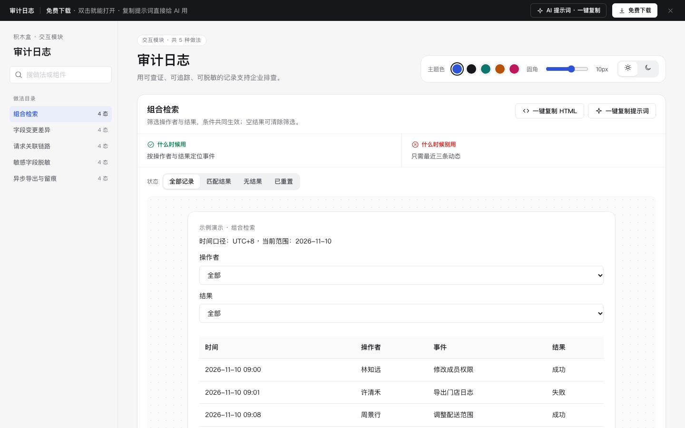

# 审计日志 · 交互模块

免费下载 · 单文件 HTML · 中文 · 离线可用。老岳AI编辑部 · 积木盒 · 原型组。

用可查证、可追踪、可脱敏的记录支持企业排查。

## 做法与状态

| 做法 | 全部状态 | 什么时候用 | 什么时候别用 | 交互规则 |
|---|---|---|---|---|
| 组合检索 | 全部记录,匹配结果,无结果,已重置 | 按操作者与结果定位事件 | 只需最近三条动态 | 筛选操作者与结果，条件共同生效；空结果可清除筛选。 |
| 字段变更差异 | 记录摘要,变更展开,只看变化,证据说明 | 配置与权限变更审计 | 没有旧值快照的点击埋点 | 并排显示修改前后，支持隐藏未变字段，历史记录不可编辑。 |
| 请求关联链路 | 请求入口,完整链路,失败节点,节点详情 | 排查跨服务异常 | 没有关联ID的独立事件 | 以关联号串联API、任务与通知，失败保留，不因重试改写原事件。 |
| 敏感字段脱敏 | 默认脱敏,权限不足,授权核对,限时查看 | 日志包含邮箱或手机号 | 密码和访问密钥，此类不得入日志 | 默认脱敏；演示授权后可查看；注明目的，关闭立即恢复脱敏。 |
| 异步导出与留痕 | 待导出,生成中,生成失败,可下载 | 较多日志的证据留存 | 少量直接查看即可满足 | 导出带筛选条件、UTC+8时间口径、脱敏字段，失败可重试。 |

## 使用

1. 解压 `m-audit-log.zip`，双击 `index.html`。无需依赖或服务端。
2. 左侧搜索做法，右侧切换状态；演示内按钮、输入和选择可操作。状态按钮是独立情境样例，流程操作会保留当前输入。
3. 右上切换主题、圆角与明暗，偏好保存本机。业务数据只存当前页面内存，刷新清除。
4. 每种做法可复制当前状态 HTML（含样式变量，交互逻辑需由 AI 补齐）与完整做法提示词。
5. 顶部 AI 面板含三条提示词：从零生成、改成我的业务、增加做法/状态；变量可就地填写。
6. 顶部免费下载获取同名 zip。所有数据标示例，不发送真实邀请、不扣费、不请求网络。

## 边界

示例仅为产品原型；实际排班、核销、权限、库存和配额须由服务端校验。状态切换用于查看演示，不代表实际权限可被绕过。

状态：已通过浏览器验收（1440/500 宽 0 报错、0 溢出、对比度与触控达标；标准外壳与跨目录比对通过）
