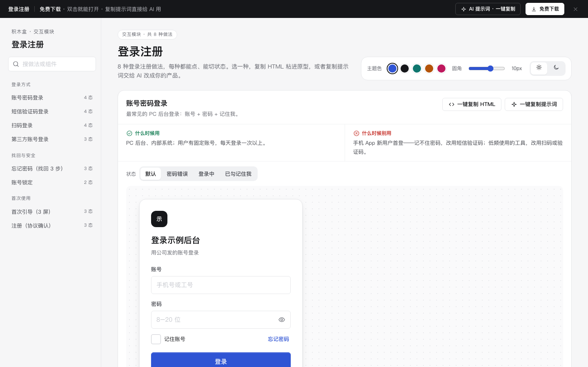

# 登录注册 · 交互模块

免费下载 · 双击就能打开 · 复制提示词直接给 AI 用。

> 积木盒 · 老岳AI编辑部 · 原型组　|　交互模块　|　单文件 HTML，离线可用　|　2026-11-10

这是一页能点的登录注册做法合集：8 种做法、26 个状态。每种做法都能切换状态、真实操作。

---

## 一、用处

| 项 | 说明 |
|---|---|
| 适合什么需求 | 新产品要定登录方式；老产品要补找回密码、锁定、协议确认这些异常流程；评审时要把「验证码错了怎么办」点给研发和测试看 |
| 解决哪一步 | 先挑做法，再拼页面。每种做法都写了「什么时候用 / 什么时候别用」，评审时不用再争该用哪种 |
| 和页面模板的关系 | 页面模板 `app-auth`（登录注册与引导）就是用这里的做法拼成的整套流程 |

**做法清单**

| # | 做法 | 状态 | 什么时候用 |
|---|---|---|---|
| 1 | 账号密码登录 | 默认 / 密码错误 / 登录中 / 已勾记住我 | PC 后台、内部系统 |
| 2 | 短信验证码登录 | 填手机号 / 已发送 / 验证码错误 / 验证码过期 | 手机 App 默认登录、新用户多 |
| 3 | 扫码登录 | 待扫码 / 已扫码待确认 / 已过期 / 已登录 | 已有手机 App，PC 端免输入 |
| 4 | 第三方账号登录 | 按钮组 / 授权中 / 首次绑定手机号 | C 端拉新、用户已有某平台账号 |
| 5 | 忘记密码（找回 3 步） | 验证身份 / 设新密码 / 完成 | 所有带密码登录的产品 |
| 6 | 首次引导（3 屏） | 第 1 / 2 / 3 屏 | 新 App 首次打开 |
| 7 | 账号锁定 | 锁定中 / 已解锁 | 连续输错密码后 |
| 8 | 注册（协议确认） | 默认 / 未勾协议点了注册 / 注册成功 | 需要用户明确同意协议的注册 |

## 二、用法

1. 下载整个文件夹，双击 `index.html`，不用联网。
2. 左侧目录点到想看的做法，在「状态」那一排切换；演示里的输入框、按钮都能真点。
   - 示例验证码：`246810`
   - 账号密码登录时，密码输入 `123456` 会模拟密码错误，连错 3 次跳到「账号锁定」
3. 每种做法右上角有两个按钮：
   - **一键复制 HTML**：复制当前状态的代码，自带用到的 CSS 变量、样式和图标，粘进任何 HTML 原型就能显示。复制的是外观，交互逻辑用提示词让 AI 补。
   - **一键复制提示词**：让 AI 按同样的状态和交互要求重做这一种。
4. 顶部可以换主题色、圆角和深浅色，复制出的代码按当前主题生成。

### 页面上的 AI 提示词

点顶部「AI 提示词 · 一键复制」，有 3 条可以直接用的提示词：

| # | 提示词 | 什么时候用 |
|---|---|---|
| 1 | 从零生成整套「登录注册」交互模块 | 想要一份自己的登录注册规范 + 可点演示 |
| 2 | 把登录注册改成我的产品 | 带变量：产品名称、角色和终端、登录方式、密码规则、锁定规则 |
| 3 | 在此基础上加一种登录做法 / 状态 | 比如新设备二次验证、邮箱验证码登录、账号已注销 |

高亮的变量点一下就能填，复制出来的是填好的完整提示词。

## 三、交互说明

| 做法 | 元素 | 交互 | 反馈 |
|---|---|---|---|
| 账号密码 | 密码框右侧眼睛 | 点击切换显示 / 隐藏 | 图标和读屏文案同步变 |
| 账号密码 | 登录按钮 | 点击 | 先转圈；失败统一说「账号或密码不对」并写剩余次数；剩 1 次时提醒会锁定 |
| 短信验证码 | 手机号 | 输入自动按 3-4-4 分隔 | 满 11 位「获取验证码」才可点 |
| 短信验证码 | 6 个格子 | 输一位跳一格、退格回上一格、粘贴自动填满 | 输满自动提交；错了格子抖一下、清空、焦点回第一格 |
| 短信验证码 | 重新获取 | 发送后 60 秒内显示「N 秒后可重新获取」 | 到时变成「重新获取验证码」按钮 |
| 扫码 | 二维码 | 扫码 / 过期 / 手机上取消 | 二维码上盖一层状态说明；过期时点「点击刷新」换新码 |
| 第三方 | 账号按钮 | 点击 | 显示「正在跳转授权」，可以取消；首次登录要绑手机号，说清绑定的用处 |
| 忘记密码 | 新密码 | 输入 | 3 条规则逐条打勾，4 档强度条实时变；两次输入不一致时在确认框下提示 |
| 首次引导 | 圆点 / 左右滑 / 键盘 ← → | 切屏 | 当前圆点拉长；最后一屏按钮变「开始使用」；「跳过」随时能点 |
| 账号锁定 | 截止时间 | — | 写「几点几分后可以再试」，不做跳秒倒计时；给「找回密码」「联系客服」两个出路 |
| 注册 | 协议勾选 | 默认不勾；没勾就点注册 | 从底部弹「同意并继续」，点了自动勾上并继续；按 Esc 或点遮罩关闭 |

## 四、自检（按《交互设计规范》）

- [x] 每种做法的状态都能切换，异常都有出路：重试、换方式、找回、联系客服
- [x] 手机端输入框和按钮 ≥ 44px；手机号、验证码弹数字键盘
- [x] 协议默认不勾；未勾时给「同意并继续」，不直接报错
- [x] 文字对比度 ≥ 4.5:1；焦点框清晰；支持「减少动态效果」
- [x] 示例数据标「示例」；第三方按钮用「示例账号 A / B」，不出现真实品牌
- [x] 无 JS 报错：8 种做法共 26 个状态逐个切换；复制 HTML、复制提示词、暗色主题都检查过
- [x] 关键交互已用脚本走过：错密码计次、粘贴验证码、扫码确认、绑定手机号、强度条、引导切屏、协议弹层

---

本模块由老岳AI编辑部·原型组制作，免费下载、可修改、可用于工作项目。

状态：已通过浏览器验收（1440/500 宽 0 报错、0 溢出、对比度与触控达标；标准外壳与跨目录比对通过）
