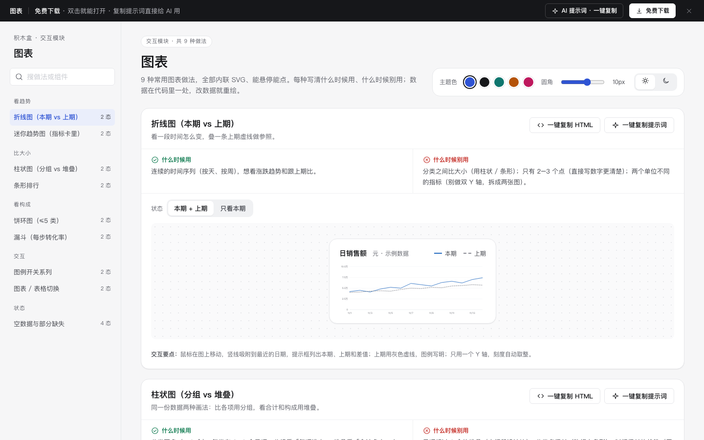

# 图表 · 交互模块

免费下载 · 双击就能打开 · 复制提示词直接给 AI 用。

> 积木盒 · 老岳AI编辑部 · 原型组　|　交互模块（组件 → **模块** → 页面模板）　|　单文件 HTML，离线可用　|　2026-11-10

这是一页能悬停能点的图表做法合集。9 种常用图表都用内联 SVG 手写，不依赖任何图表库。每种写清什么时候用、什么时候别用；数据集中在代码里一处，改数据就重绘。

---

## 一、用处

| 项 | 说明 |
|---|---|
| 解决什么 | 原型里的图表常常是一张截图，评审时问「悬停显示什么」「没数据怎么办」「能不能看表格」都答不上。这里每种图表都能真实悬停、切状态 |
| 适合谁 | 画看板、报表、数据分析页的产品经理；要和研发对齐图表交互的时候 |
| 和其他层的关系 | 页面模板「数据看板」用到了这里的折线、条形、指标卡；模块是拆开的做法，可以单独挑 |

## 二、做法清单

| # | 做法 | 状态 | 什么时候用 | 什么时候别用 |
|---|---|---|---|---|
| 1 | 折线图（本期 vs 上期） | 本期 + 上期 / 只看本期 | 按天、按周看趋势，跟上期比 | 分类比大小；只有 2–3 个点；两个单位不同的指标（别做双 Y 轴） |
| 2 | 柱状图（分组 vs 堆叠） | 分组 / 堆叠 | ≤ 8 个分类，每类 2–3 个子项 | 堆叠超过 3 段；分类名很长 |
| 3 | 条形排行 | 前 5 / 展开全部 | 排行榜、Top N，要准确数值 | 看随时间变化 |
| 4 | 饼环图（≤5 类） | 5 类 / 7 类（自动合并） | 2–5 部分的占比 | 超过 5 类；相近占比要精确比较 |
| 5 | 漏斗（每步转化率） | 正常 / 某步骤降 | 有先后顺序的流程 | 步骤之间没有先后关系 |
| 6 | 迷你趋势图 | 上涨 / 下跌 | 指标卡里看走势 | 要读具体数值和日期 |
| 7 | 图例开关系列 | 全部显示 / 只剩一条 | 3–5 条线，读者只想看几条 | 只有 1–2 条，或超过 5 条 |
| 8 | 图表 / 表格切换 | 图 / 表 | 所有给多人看的图表 | 指标卡这种本来就是数字的地方 |
| 9 | 空数据与部分缺失 | 部分缺失 / 空数据 / 加载中 / 出错 | 所有图表都要准备 | 别把缺失补成 0 再连线 |

## 三、用法

1. 下载文件夹，双击 `index.html`。
2. 左侧目录点到想要的图表，鼠标移到图上看提示框；点「状态」切换看效果。
3. 右上角换主题色、圆角、明暗：深色模式下系列颜色会换成深色版本，不是简单反色。
4. **一键复制 HTML**：复制当前图表的 SVG 和所需样式，粘进原型就能显示（悬停交互用提示词让 AI 补上）。
5. **改数据**：每种做法的 `data` 写在代码里对应 section 下，改完刷新页面就重绘；坐标轴刻度会自动取整。

### 页面上的 AI 提示词

页面顶部「AI 提示词 · 一键复制」里有 3 条，高亮的变量点一下就能就地填写：

| # | 提示词 | 什么时候用 |
|---|---|---|
| 1 | 从零生成整套「图表」交互模块 | 想要自己的一套图表做法 + 演示 |
| 2 | 把图表换成我的数据（变量：图表、指标名称、横轴、数据、越高越好还是越低越好） | 已经下载，换成自己的指标 |
| 3 | 在此基础上加一种图表 / 状态（变量：要加的图表、状态清单） | 模块里没有你要的图表 |

## 四、交互说明

| 做法 | 元素 | 交互 | 反馈 |
|---|---|---|---|
| 折线图 | 图表区 | 鼠标移动 | 竖线吸附最近日期，圆点标出各系列数值；提示框列本期、上期、差值 |
| 柱状图 | 柱子 | 悬停 | 其余柱子变淡；提示框写门店、子项、数值（堆叠时加合计） |
| 条形排行 | 展开 / 收起 | 点击 | 显示 10 条 / 回到前 5 条；数值始终写在右侧 |
| 饼环图 | 扇区 / 图例行 | 悬停任一处 | 扇区和图例行一起高亮；「其他」的提示里列出合并了哪些 |
| 漏斗 | 转化率 | — | 比上周同一步低 10 个百分点以上时：红色 + 警示图标 + 文字说明掉了多少 |
| 迷你趋势 | 涨跌标签 | — | 按指标性质判断好坏：退款率下降显示绿色；颜色之外有箭头和百分比 |
| 图例开关 | 图例按钮 | 点击 | 隐藏 / 显示该系列，其他线颜色不变，Y 轴重新取整；最后一条不能隐藏（置灰并说明） |
| 图表 / 表格 | 分段切换 | 点击 | 同一份数据切成表格；选择记在本机 |
| 空数据与缺失 | 缺失的日期 | — | 折线断开不连，图下写明缺了哪几天 |
| 空数据与缺失 | 出错「重试」 | 点击 | 先出骨架，再回到图表 |

## 五、自检（按《交互设计规范》+ 图表规范）

- [x] 只用一个 Y 轴，没有双轴图；网格线和坐标轴颜色退后
- [x] 分类颜色按固定顺序分配，跑过配色校验（色盲区分 ΔE 9.1、正常视觉 22.9 通过）；青绿、黄两色对浅色背景低于 3:1，已用「直接标数值 + 表格视图」补足
- [x] 2 个以上系列都有图例；文字用正文颜色，不用系列颜色
- [x] 每种图表有悬停或直接标数值，并提供表格视图
- [x] 空数据、部分缺失、加载、出错状态齐全，缺失不补 0
- [x] 页面上有 3 条 AI 提示词，变量可就地填写
- [x] 无 JS 报错（9 种做法 20 个状态 + 悬停 / 图例 / 展开 / 切表格 / 重试脚本走查）
- [x] 示例数据标「示例」，无真实公司名

---

本模块由老岳AI编辑部·原型组制作，免费下载、修改、用于工作项目。

状态：已通过浏览器验收（1440/500 宽 0 报错、0 溢出、对比度与触控达标；标准外壳与跨目录比对通过）
