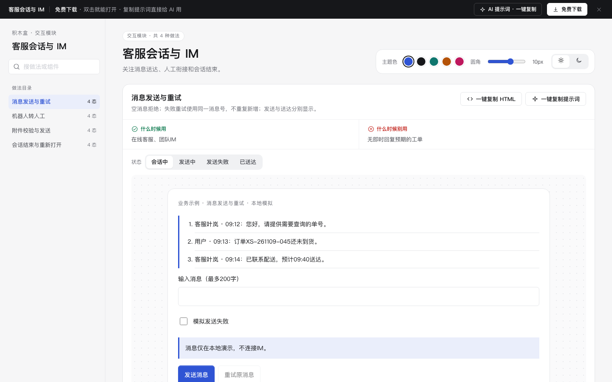

# 客服会话与 IM · 交互模块

免费下载 · 中文单文件HTML · 离线可用 · 老岳AI编辑部 · 积木盒。

关注消息送达、人工衔接和会话结束。 所有数据均为业务示例，逐行独立；日期固定为2026年11月，时区UTC+8。

## 做法与状态

| 做法 | 状态 | 什么时候用 | 什么时候别用 | 规则 |
|---|---|---|---|---|
| 消息发送与重试 | 会话中,发送中,发送失败,已送达 | 在线客服、团队IM | 无即时回复预期的工单 | 空消息拒绝；失败重试使用同一消息号，不重复新增；发送与送达分别显示。 |
| 机器人转人工 | 机器人服务,排队中,坐席繁忙,人工接入 | 复杂问题升级客服 | 没有人工服务团队 | 转接携带会话摘要，排队可取消；繁忙可继续等待，接入后明确坐席身份。 |
| 附件校验与发送 | 选择文件,待发送,类型或大小错误,发送完成 | 向客服补充截图证据 | 发送密码、证件等敏感内容 | 仅PNG/JPEG/PDF且≤5MB，预检后模拟发送，不上传任何文件。 |
| 会话结束与重新打开 | 服务中,结束核对,未解决保留,会话已结束 | 问题处理结束的服务闭环 | 后台直接强制关闭争议 | 用户确认解决后结束；未解决继续会话；重新打开保留历史。 |

## 使用

1. 解压 `m-chat.zip`，双击 `index.html`，无需服务端或外部资源。
2. 左侧目录可搜索，右侧切状态。状态按钮加载独立样例；做法内部操作保留当前输入。小屏目录折叠，页面顺序浏览。
3. 顶部免费下载本模块zip，右上调整主题色、圆角、明暗；偏好保存本机。业务数据仅当前内存，刷新清除。
4. 每种做法复制当前HTML和所需样式；为静态片段，交互可用同区提示词交给AI补齐。
5. 顶部AI提示词面板含从零生成、改成我的业务、增加做法/状态3条，变量可填写，复制有反馈。

## 交互与边界

- 所有提交先校验，错误指出修改方式；核对类输入变化须重新核对。取消不提交，异步操作期间避免重复。
- 失败重试保留业务输入；确认动作提供明确结果。状态预览的成功样例不代表真实业务已经执行。
- 打印使用系统对话框；取消与完成由系统决定，不伪造打印完成。CSV下载为真实本地示例文件，其余业务提交均为本地模拟。
- 不上传附件、不发送通知或消息、不执行CA签章、不访问真实资源预约或Agent后端，不变更真实版本或权限。
- 真实系统须在服务端实现权限、并发锁、身份核验、幂等、审计和业务持久化，页面演示不能代替这些能力。
- 手写签名支持鼠标和触屏，另有姓名输入供键盘使用；示例不具备数字证书效力。

## 历史浏览器验收记录（2026-11-11 原型组）

历史版本验收结论；本次修改后需重新进行浏览器验收。

- [x] Chrome gtest：4 项 / 16 态全部切换、复制片段与提示词生成、明暗切换，输出 OK。
- [x] 逐态打开（16 态，浅色 + 深色各一遍）：0 个 JS 报错。
- [x] 布局：1440 / 1280 / 500 三种宽度都不横向滚动。
- [x] 对比度：所有可见文字逐态自动检测（正文 ≥4.5:1、大字 ≥3:1），浅色、深色全部达标。
- [x] 触控尺寸：所有按钮、链接、输入框、Tab 都 ≥24px。
- [x] AI 提示词面板：顶部按钮打开，3 条提示词可展开、可复制（出现「已复制」反馈）。
- [x] 数据：逐行不同、贴合业务（单号、品名、金额、人员各不相同），不是批量复制的假数据。
- [x] DOM 自检复跑：断言全部通过，脚本错误 0（`dom-validation.json`）。
- [x] 封面为真实截图 cover.png（1440×900）。

验收时修了：
- 每个做法的操作区原来全是同级描边按钮，没有主操作；改为每行第一个前进类操作用主色按钮（取消 / 撤销 / 清除 / 模拟 / 只看等不升级），与 m-form 标杆一致。

复验命令：`bash _kit/atest.sh m-chat 1440`（另跑 1280、500）、`bash _kit/gtest.sh m-chat`、`bash _kit/shot.sh m-chat "" cover.png 1440 900`。

## 本次清理提示词

### 从零构建客服会话与 IM

请制作「客服会话与 IM」的单文件离线原型，服务于{{业务名称}}的{{使用角色}}。逐项实现下列做法与状态，不只画静态截图：
消息发送与重试（会话中,发送中,发送失败,已送达）；空消息拒绝；失败重试使用同一消息号，不重复新增；发送与送达分别显示。
机器人转人工（机器人服务,排队中,坐席繁忙,人工接入）；转接携带会话摘要，排队可取消；繁忙可继续等待，接入后明确坐席身份。
附件校验与发送（选择文件,待发送,类型或大小错误,发送完成）；仅PNG/JPEG/PDF且≤5MB，预检后模拟发送，不上传任何文件。
会话结束与重新打开（服务中,结束核对,未解决保留,会话已结束）；用户确认解决后结束；未解决继续会话；重新打开保留历史。
业务字段：消息编号、发送人、消息内容、送达状态、附件名称。按{{校验规则}}验证必填、格式与权限；保留搜索目录、主题色、圆角、深浅色、下载和提示词面板，提供真实操作及取消恢复。使用逐行不同的业务演示数据。

### 替换客服会话与 IM业务数据

将附件「客服会话与 IM」接入{{业务场景}}，字段映射由{{字段映射}}就地填写。必须保留这些业务做法及状态：
消息发送与重试（会话中,发送中,发送失败,已送达）；空消息拒绝；失败重试使用同一消息号，不重复新增；发送与送达分别显示。
机器人转人工（机器人服务,排队中,坐席繁忙,人工接入）；转接携带会话摘要，排队可取消；繁忙可继续等待，接入后明确坐席身份。
附件校验与发送（选择文件,待发送,类型或大小错误,发送完成）；仅PNG/JPEG/PDF且≤5MB，预检后模拟发送，不上传任何文件。
会话结束与重新打开（服务中,结束核对,未解决保留,会话已结束）；用户确认解决后结束；未解决继续会话；重新打开保留历史。
逐一核对消息编号、发送人、消息内容、送达状态、附件名称的来源、默认值与提交范围。将演示值替换为{{业务数据}}，输入变更后重新校验；说明确认前后的数据变化与失败保留内容。交付可离线运行的完整HTML与字段说明。

### 核对客服会话与 IM交互边界

请对「客服会话与 IM」开展交互边界修订，重点场景为{{边界场景}}，验收条件为{{验收条件}}。以下是本模块必须逐项走通的做法和状态清单：
消息发送与重试（会话中,发送中,发送失败,已送达）；空消息拒绝；失败重试使用同一消息号，不重复新增；发送与送达分别显示。
机器人转人工（机器人服务,排队中,坐席繁忙,人工接入）；转接携带会话摘要，排队可取消；繁忙可继续等待，接入后明确坐席身份。
附件校验与发送（选择文件,待发送,类型或大小错误,发送完成）；仅PNG/JPEG/PDF且≤5MB，预检后模拟发送，不上传任何文件。
会话结束与重新打开（服务中,结束核对,未解决保留,会话已结束）；用户确认解决后结束；未解决继续会话；重新打开保留历史。
围绕业务字段消息编号、发送人、消息内容、送达状态、附件名称检查无输入、非法值、取消、重复操作及失败恢复；每条路径写出触发、反馈和恢复位置。保持500px宽度、浅深色对比度及至少24px触控目标，返回完整代码和验收记录。

状态：已通过浏览器验收（1440/500 宽 0 报错、0 溢出、对比度与触控达标；标准外壳与跨目录比对通过）
