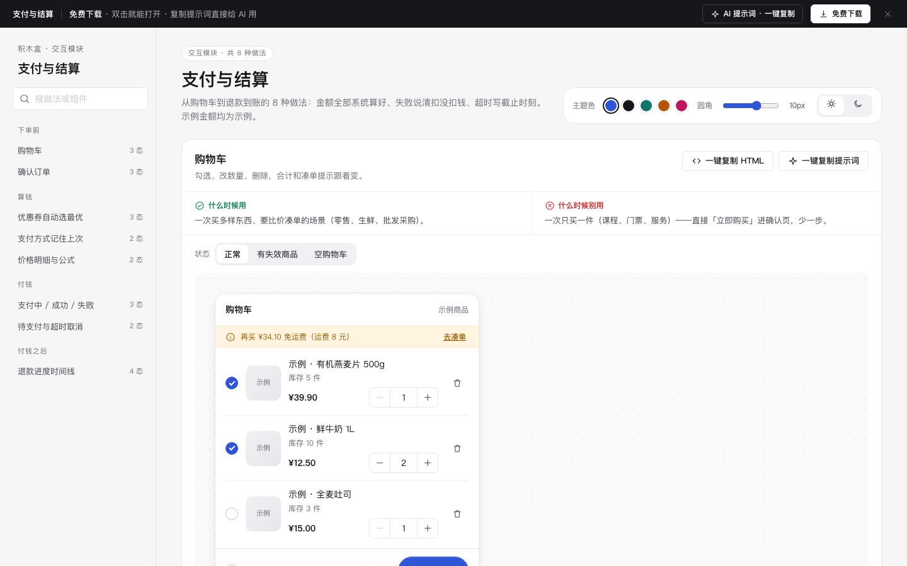

# 支付与结算 · 交互模块

免费下载 · 双击就能打开 · 复制提示词直接给 AI 用。

> 积木盒 · 老岳AI编辑部 · 原型组　|　交互模块（组件 → **模块** → 页面模板）　|　单文件 HTML，离线可用　|　2026-11-10

这是一页能点的「支付与结算」做法合集：从购物车到退款到账，8 种做法 22 个状态，每种都能切状态、能真实操作。挑一种，复制 HTML 粘进你的原型；或者复制提示词，让 AI 改成你的业务。

---

## 一、用处

| 项 | 说明 |
|---|---|
| 解决什么 | 结算流程里最容易出客诉的地方：金额让用户自己算、券要用户自己比、支付失败不说扣没扣钱、超时用跳秒倒计时吓人、退款只写「退款中」。这里每种做法把这些状态都摆出来了 |
| 适合谁 | 要画电商、外卖、生鲜、批发采购、课程购买下单链路的产品经理 |
| 和页面模板的关系 | 页面模板 `c-checkout` 是整条下单链路；模块是其中每一步的多种做法，拼页面时从这里挑 |

## 二、做法清单

| # | 做法 | 状态 | 什么时候用 | 什么时候别用 |
|---|---|---|---|---|
| 1 | 购物车 | 正常 / 有失效商品 / 空购物车 | 一次买多样、要比价凑单（零售、生鲜、批发采购） | 一次只买一件（课程、门票）——直接「立即购买」 |
| 2 | 确认订单 | 有默认地址 / 没有地址 / 商品清单展开 | 所有要收货或上门的订单 | 虚拟商品不要地址块，改成「充值到哪个账号」 |
| 3 | 优惠券自动选最优 | 自动选最优 / 手动换券 / 没有可用券 | 多张券、门槛不同 | 券可叠加（改多选 + 实时算）；只有一张券不必弹列表 |
| 4 | 支付方式记住上次 | 记住上次 / 首次购买 | 回头客多 | 上次的方式这次不可用——改选下一个并说明原因 |
| 5 | 价格明细与公式 | 收起 / 展开公式 | 有优惠、运费、服务费多项加减 | 只有一个价格，别硬加明细 |
| 6 | 支付中 / 成功 / 失败 | 支付中 / 成功 / 失败 | 所有在线支付 | 支付中允许返回或重复点；失败不说钱的去向 |
| 7 | 待支付与超时取消 | 待支付 / 已超时取消 | 下单要锁库存（限量、座位、配送时段） | 跳秒倒计时制造紧张；不锁库存的商品没必要超时 |
| 8 | 退款进度时间线 | 审核中 / 退款中 / 已到账 / 被驳回 | 所有退款、售后 | 只显示一个「退款中」标签 |

## 三、用法

1. 下载文件夹，双击 `index.html`。
2. 左侧目录点到想要的做法，点「状态」切换，演示区里可以真实操作。
3. 右上角换主题色、圆角、明暗，所有演示实时跟着变。
4. **一键复制 HTML**：复制当前状态的 HTML，自带所需 CSS 变量和样式，粘进任意 HTML 原型就能显示（交互逻辑用提示词让 AI 补）。
5. **一键复制提示词**：每种做法一条，交给 AI 就能做出带全部状态的同款。

### 页面上的 AI 提示词

页面顶部「AI 提示词 · 一键复制」里有 3 条，高亮变量点一下就能填，复制出来就是填好的完整提示词：

| # | 提示词 | 什么时候用 |
|---|---|---|
| 1 | 从零生成整套「支付与结算」交互模块 | 想要一份自己的结算链路规范 + 演示 |
| 2 | 把支付与结算改成我的业务（变量：要用的做法、业务名称、角色、规则、支付方式清单） | 已下载，换成自己的商品、运费和券规则 |
| 3 | 在此基础上加一种做法 / 状态（变量：要加的做法、状态清单） | 模块里没有你要的做法，比如定金 + 尾款 |

## 四、交互说明

| 做法 | 元素 | 交互 | 反馈 |
|---|---|---|---|
| 购物车 | 勾选 / 数量 / 全选 | 任意改动 | 合计、件数、凑单提示同时更新；到库存上限「+」置灰；未勾选时结算按钮置灰 |
| 购物车 | 删除 | 点击 | 直接删除，Toast 4 秒内可撤销；失效商品不可勾选，集中在底部一键清空 |
| 确认订单 | 地址块 | 点击换地址 | 默认带出上次地址并标「默认」；没有地址时变成「+ 添加收货地址」，提交时滚到这里并提示 |
| 确认订单 | 商品清单 | 超过 3 件 | 折叠为缩略图 +「共 N 件」，点开看明细、再点收起 |
| 优惠券 | 券列表 | 进入即自动选 | 默认选减得最多的并标「已为你选最优」；不够门槛置灰写「还差 ¥N 可用」；换券后应付立刻变；可选「不使用优惠券」 |
| 支付方式 | 方式列表 | 进入 | 上次用过的排第一、默认选中、标「上次使用」；首次默认选最常用的 |
| 价格明细 | 应付右侧箭头 | 点击 | 展开计算公式，每个数都写出来；优惠红色负号；金额等宽右对齐 |
| 支付结果 | 支付按钮 | 点击 | 支付中转圈 + 「请不要关闭页面」，按钮全部不可点；成功给订单号和预计送达；失败第一句写「这次没有扣款」+ 原因 +「重新支付」「换个方式」 |
| 待支付 | 顶部提示 | — | 写具体截止时刻「11月10日 18:30 前支付」，不跳秒；超时后说明已取消、没扣款、库存释放，「重新下单」一键带回原商品；取消订单走二次确认 |
| 退款进度 | 时间线 | — | 每步写时间；当前步高亮并写「预计 X 前完成」；到账写退到哪里；驳回写原因 +「重新申请」「联系客服」 |

## 五、自检（按《交互设计规范》）

- [x] 每种做法的状态齐全，可切换，能真实操作
- [x] 每种做法写清「什么时候用 / 什么时候别用」
- [x] 计算交给系统：合计、凑单差额、最优券、应付公式全部自动算，用户不心算
- [x] 高频选项有默认：默认地址、最优券、上次支付方式
- [x] 不做跳秒倒计时，超时写具体截止时刻
- [x] 可点元素 ≥ 32px；焦点框清晰；对比度 ≥ 4.5:1
- [x] 弹窗：Esc / 点遮罩关闭、焦点锁定、关闭后焦点回到触发处
- [x] 页面上有 3 条 AI 提示词，变量可就地填写，复制有成功反馈
- [x] 无 JS 报错（8 种做法 22 个状态自测 OK）
- [x] 示例数据标「示例」，无真实公司名和品牌

---

本模块由老岳AI编辑部·原型组制作，免费下载、修改、用于工作项目。
