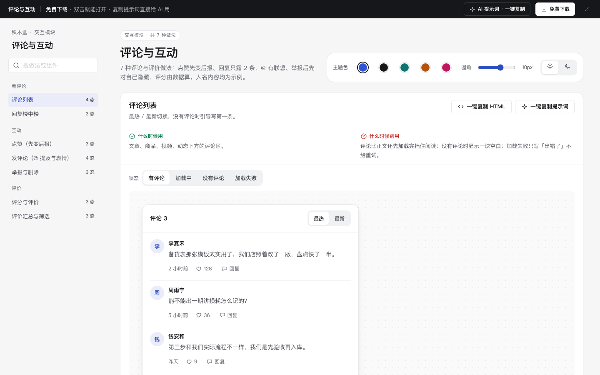

# 评论与互动 · 交互模块

免费下载 · 双击就能打开 · 复制提示词直接给 AI 用。

> 积木盒 · 老岳AI编辑部 · 原型组　|　交互模块（组件 → **模块** → 页面模板）　|　单文件 HTML，离线可用　|　2026-11-10

这是一页能点的「评论与互动」做法合集：7 种做法 23 个状态，从评论列表、楼中楼、点赞、@ 提及，到举报删除、评分评价、评价汇总筛选。挑一种，复制 HTML 粘进你的原型；或者复制提示词，让 AI 改成你的产品。

---

## 一、用处

| 项 | 说明 |
|---|---|
| 解决什么 | 评论区常见的坑：点赞要等接口转圈、回复无限嵌套、@ 要手打全名、超字数到提交才报错、发送失败清空内容、举报后那条还在眼前、星星没有文字含义、平均分写死 |
| 适合谁 | 要画社区、内容、电商评价、团队协作评论的产品经理 |
| 和页面模板的关系 | 页面模板是整页；模块是其中一块的多种做法（`c-feed` = 评论与互动 + 分享 + 搜索） |

## 二、做法清单

| # | 做法 | 状态 | 什么时候用 | 什么时候别用 |
|---|---|---|---|---|
| 1 | 评论列表 | 有评论 / 加载中 / 没有评论 / 加载失败 | 文章、商品、视频下方评论区 | 评论先于正文加载挡住阅读；空态一片空白 |
| 2 | 回复楼中楼 | 折叠 / 展开 / 回复中 | 评论下有来回讨论 | 无限嵌套；几十条回复全展开 |
| 3 | 点赞（先变后报） | 未赞 / 已赞 / 点赞失败回滚 | 点赞、收藏、关注这类低代价高频操作 | 付款、删除等不能先变的操作 |
| 4 | 发评论（@ 提及与表情） | 空 / @ 联想中 / 发送中 / 发送失败 | 协作评论、社区评论 | @ 要手打全名；失败清空内容 |
| 5 | 举报与删除 | 默认 / 选择举报原因 / 已举报 | 有用户内容的评论区 | 举报要写一大段；删除不确认 |
| 6 | 评分与评价 | 未评分 / 已评分填写中 / 已提交 | 订单、课程、客服评价 | 强制写满 15 字；星星没有含义 |
| 7 | 评价汇总与筛选 | 汇总 / 筛选「有图」/ 筛选无结果 | 商品、门店、课程评价区 | 平均分写死；只展示好评 |

## 三、用法

1. 下载文件夹，双击 `index.html`。
2. 左侧目录点到想要的做法，点「状态」切换，演示区里可以真实操作。
3. 右上角换主题色、圆角、明暗，所有演示实时跟着变。
4. **一键复制 HTML**：复制当前状态的 HTML，自带所需 CSS 变量和样式，粘进任意 HTML 原型就能显示（交互逻辑用提示词让 AI 补）。
5. **一键复制提示词**：每种做法一条，交给 AI 就能做出带全部状态的同款。

### 页面上的 AI 提示词

| # | 提示词 | 什么时候用 |
|---|---|---|
| 1 | 从零生成整套「评论与互动」交互模块 | 想要一份自己的评论区规范 + 演示 |
| 2 | 把评论区改成我的产品（变量：产品名称、对象、标签清单、举报原因清单、规则） | 已下载，换成自己的对象和规则 |
| 3 | 在此基础上加一种做法 / 状态（变量：要加的做法、状态清单） | 比如「商家回复评价」 |

## 四、交互说明

| 做法 | 元素 | 交互 | 反馈 |
|---|---|---|---|
| 评论列表 | 最热 / 最新 | 点击 | 列表即时重排；加载中 3 条骨架；失败给原因 +「重试」 |
| 楼中楼 | 展开 N 条回复 | 点击 | 展开全部，可收起；回复只嵌一层，回回复写「@某某」 |
| 楼中楼 | 回复 | 点击 | 输入框上方写「回复 @某某」并聚焦，× 取消 |
| 点赞 | 心形按钮 | 点击 | 立刻变红 +1 并轻弹；失败自动退回 + Toast；aria-pressed 同步 |
| 发评论 | 输入 @ | 输入 | 弹成员联想，按名字过滤，↑↓ 选、回车插入、Esc 关 |
| 发评论 | 字数 | 输入 | 「N / 300」实时；超出标红、发送禁用；空内容禁用 |
| 发评论 | 发送 | 点击 | 发送中禁用输入；失败保留内容，按钮变「重新发送」 |
| 举报 | 更多 → 举报 | 选原因提交 | 选「其他」才出补充说明；提交后该评论对自己折叠，可「仍要查看」 |
| 删除 | 更多 → 删除 | 点击 → 确认 | 写清回复一起删除、不能恢复 |
| 评分 | 星星 | 悬停 / 点击 | 实时显示含义；评分后出现对应正面 / 问题标签；未评分提交禁用 |
| 汇总筛选 | 筛选标签 | 点选 / 再点取消 | 列表即筛；无结果给「清除筛选」 |

## 五、自检（按《交互设计规范》）

- [x] 每种做法的状态齐全，可切换，能真实操作
- [x] 每种做法写清「什么时候用 / 什么时候别用」
- [x] 选择优于输入：@ 联想、评价标签点选、文字选填
- [x] 计算交给系统：平均分、星级占比、筛选条数由数据算出
- [x] 失败不丢内容：评论发送失败保留，点赞失败自动回滚
- [x] 可点元素 ≥ 32px；焦点框清晰；对比度 ≥ 4.5:1
- [x] 弹窗：Esc / 点遮罩关闭、焦点锁定、关闭后焦点回到触发处
- [x] 页面上有 3 条 AI 提示词，变量可就地填写
- [x] 无 JS 报错（7 种做法 23 个状态自测 OK）
- [x] 人名内容均为示例，无真实公司名和品牌

---

本模块由老岳AI编辑部·原型组制作，免费下载、修改、用于工作项目。

## 本次清理提示词

### 从零构建评论与互动

请制作「评论与互动」的单文件离线原型，服务于{{业务名称}}的{{使用角色}}。逐项实现下列做法与状态，不只画静态截图：
评论列表（有评论、加载中、没有评论、加载失败）；标题写「评论 N」；右侧「最热 / 最新」分段切换，默认最热；加载中显示 3 条骨架；没有评论时写「还没有人评论，说说你的看法」并聚焦输入框；失败写原因 +「重试」，不影响正文阅读。
回复楼中楼（折叠、展开、回复中）；回复只嵌一层，回复回复用「@某某」写在正文前；默认露前 2 条 +「展开 N 条回复」；展开后可「收起」；点「回复」后底部输入框上方写「回复 @某某」并聚焦，带 × 取消；作者的回复标「作者」。
点赞（先变后报）（未赞、已赞、点赞失败回滚）；点击立刻变红、数字加一、图标轻弹一下（只动 transform）；后台请求失败 → 自动退回原状态并 Toast 说明；再点一次取消赞，数字减一；按钮 aria-pressed 跟着变，读屏能听到。「点赞失败回滚」状态下第一次点击演示失败。
发评论（@ 提及与表情）（空、@ 联想中、发送中、发送失败）；输入 @ 弹出成员联想，继续输入按名字过滤，↑↓ 选择、回车确认、Esc 关闭；选中后插入「@名字 」；表情面板点一下插入光标处；右下角「N / 300」实时显示，超出标红且发送禁用；空内容发送按钮禁用；发送中禁用输入；失败保留内容，写原因 +「重新发送」。
举报与删除（默认、选择举报原因、已举报）；每条评论右侧「更多」：别人的评论显示「举报」，自己的显示「删除」；举报原因单选（垃圾广告 / 人身攻击 / 违法违规 / 其他），选「其他」才出现补充说明；提交后该评论对自己折叠成「你已举报这条评论，处理前对你隐藏」+「仍要查看」；删除先确认并说明回复一起删除。
评分与评价（未评分、已评分填写中、已提交）；5 颗星，悬停 / 点击即显示含义（很差 → 非常满意）；没评分时提交禁用；评分后出现常用标签（4–5 星给正面标签，1–3 星给问题标签），点选即可；文字和图片选填；提交后写清「已评价，可在 30 天内追评一次」。
评价汇总与筛选（汇总、筛选「有图」、筛选无结果）；左侧平均分（保留 1 位小数）+ 评价数，右侧 5→1 星占比条，全部由 REVIEWS 算出；筛选标签写条数「有图 2」「差评 1」，点选即筛，再点取消；无结果写「没有符合条件的评价」+「清除筛选」。
业务字段：评论编号、作者、评论内容、回复对象、审核原因。按{{校验规则}}验证必填、格式与权限；保留搜索目录、主题色、圆角、深浅色、下载和提示词面板，提供真实操作及取消恢复。使用逐行不同的业务演示数据。

### 替换评论与互动业务数据

将附件「评论与互动」接入{{业务场景}}，字段映射由{{字段映射}}就地填写。必须保留这些业务做法及状态：
评论列表（有评论、加载中、没有评论、加载失败）；标题写「评论 N」；右侧「最热 / 最新」分段切换，默认最热；加载中显示 3 条骨架；没有评论时写「还没有人评论，说说你的看法」并聚焦输入框；失败写原因 +「重试」，不影响正文阅读。
回复楼中楼（折叠、展开、回复中）；回复只嵌一层，回复回复用「@某某」写在正文前；默认露前 2 条 +「展开 N 条回复」；展开后可「收起」；点「回复」后底部输入框上方写「回复 @某某」并聚焦，带 × 取消；作者的回复标「作者」。
点赞（先变后报）（未赞、已赞、点赞失败回滚）；点击立刻变红、数字加一、图标轻弹一下（只动 transform）；后台请求失败 → 自动退回原状态并 Toast 说明；再点一次取消赞，数字减一；按钮 aria-pressed 跟着变，读屏能听到。「点赞失败回滚」状态下第一次点击演示失败。
发评论（@ 提及与表情）（空、@ 联想中、发送中、发送失败）；输入 @ 弹出成员联想，继续输入按名字过滤，↑↓ 选择、回车确认、Esc 关闭；选中后插入「@名字 」；表情面板点一下插入光标处；右下角「N / 300」实时显示，超出标红且发送禁用；空内容发送按钮禁用；发送中禁用输入；失败保留内容，写原因 +「重新发送」。
举报与删除（默认、选择举报原因、已举报）；每条评论右侧「更多」：别人的评论显示「举报」，自己的显示「删除」；举报原因单选（垃圾广告 / 人身攻击 / 违法违规 / 其他），选「其他」才出现补充说明；提交后该评论对自己折叠成「你已举报这条评论，处理前对你隐藏」+「仍要查看」；删除先确认并说明回复一起删除。
评分与评价（未评分、已评分填写中、已提交）；5 颗星，悬停 / 点击即显示含义（很差 → 非常满意）；没评分时提交禁用；评分后出现常用标签（4–5 星给正面标签，1–3 星给问题标签），点选即可；文字和图片选填；提交后写清「已评价，可在 30 天内追评一次」。
评价汇总与筛选（汇总、筛选「有图」、筛选无结果）；左侧平均分（保留 1 位小数）+ 评价数，右侧 5→1 星占比条，全部由 REVIEWS 算出；筛选标签写条数「有图 2」「差评 1」，点选即筛，再点取消；无结果写「没有符合条件的评价」+「清除筛选」。
逐一核对评论编号、作者、评论内容、回复对象、审核原因的来源、默认值与提交范围。将演示值替换为{{业务数据}}，输入变更后重新校验；说明确认前后的数据变化与失败保留内容。交付可离线运行的完整HTML与字段说明。

### 核对评论与互动交互边界

请对「评论与互动」开展交互边界修订，重点场景为{{边界场景}}，验收条件为{{验收条件}}。以下是本模块必须逐项走通的做法和状态清单：
评论列表（有评论、加载中、没有评论、加载失败）；标题写「评论 N」；右侧「最热 / 最新」分段切换，默认最热；加载中显示 3 条骨架；没有评论时写「还没有人评论，说说你的看法」并聚焦输入框；失败写原因 +「重试」，不影响正文阅读。
回复楼中楼（折叠、展开、回复中）；回复只嵌一层，回复回复用「@某某」写在正文前；默认露前 2 条 +「展开 N 条回复」；展开后可「收起」；点「回复」后底部输入框上方写「回复 @某某」并聚焦，带 × 取消；作者的回复标「作者」。
点赞（先变后报）（未赞、已赞、点赞失败回滚）；点击立刻变红、数字加一、图标轻弹一下（只动 transform）；后台请求失败 → 自动退回原状态并 Toast 说明；再点一次取消赞，数字减一；按钮 aria-pressed 跟着变，读屏能听到。「点赞失败回滚」状态下第一次点击演示失败。
发评论（@ 提及与表情）（空、@ 联想中、发送中、发送失败）；输入 @ 弹出成员联想，继续输入按名字过滤，↑↓ 选择、回车确认、Esc 关闭；选中后插入「@名字 」；表情面板点一下插入光标处；右下角「N / 300」实时显示，超出标红且发送禁用；空内容发送按钮禁用；发送中禁用输入；失败保留内容，写原因 +「重新发送」。
举报与删除（默认、选择举报原因、已举报）；每条评论右侧「更多」：别人的评论显示「举报」，自己的显示「删除」；举报原因单选（垃圾广告 / 人身攻击 / 违法违规 / 其他），选「其他」才出现补充说明；提交后该评论对自己折叠成「你已举报这条评论，处理前对你隐藏」+「仍要查看」；删除先确认并说明回复一起删除。
评分与评价（未评分、已评分填写中、已提交）；5 颗星，悬停 / 点击即显示含义（很差 → 非常满意）；没评分时提交禁用；评分后出现常用标签（4–5 星给正面标签，1–3 星给问题标签），点选即可；文字和图片选填；提交后写清「已评价，可在 30 天内追评一次」。
评价汇总与筛选（汇总、筛选「有图」、筛选无结果）；左侧平均分（保留 1 位小数）+ 评价数，右侧 5→1 星占比条，全部由 REVIEWS 算出；筛选标签写条数「有图 2」「差评 1」，点选即筛，再点取消；无结果写「没有符合条件的评价」+「清除筛选」。
围绕业务字段评论编号、作者、评论内容、回复对象、审核原因检查无输入、非法值、取消、重复操作及失败恢复；每条路径写出触发、反馈和恢复位置。保持500px宽度、浅深色对比度及至少24px触控目标，返回完整代码和验收记录。

## 第2轮完整实测清单修订（fix14b）

修正店长说明文字色；头像、作者、@提及、展开回复、仍要查看、评价筛选及新鲜/送得快标签使用修正后的主题前景；滑块44px。

本轮保留全部业务内容与提示词。已通过脚本语法与静态增量检查；本轮未运行真实浏览器验收，详见根目录 `codex_交付_fix14b.md`。

状态：已通过浏览器验收（1440/500 宽 0 报错、0 溢出、对比度与触控达标；标准外壳与跨目录比对通过）
