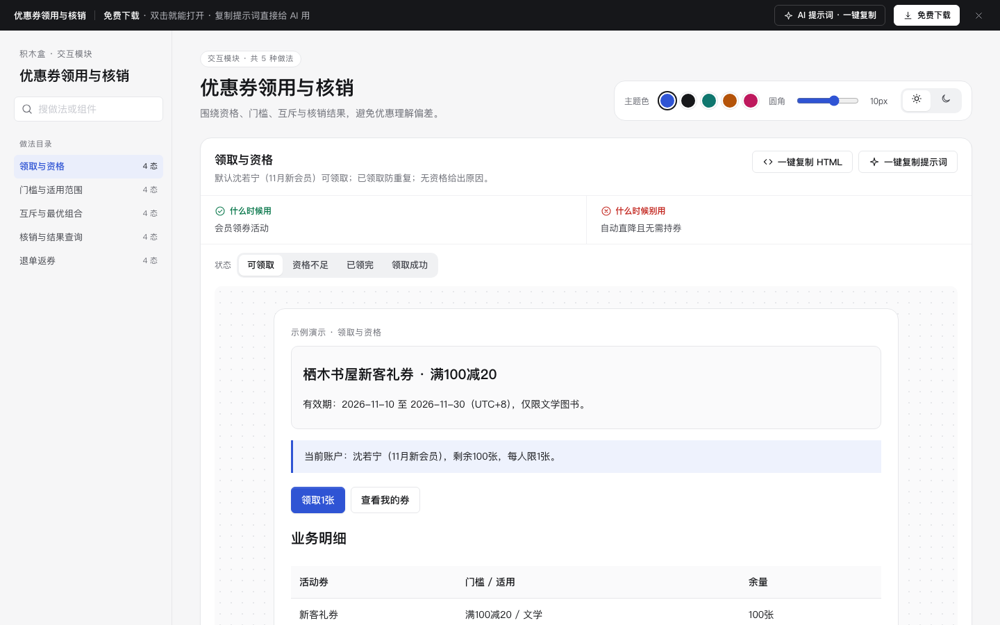

# 优惠券领用与核销 · 交互模块

免费下载 · 单文件 HTML · 中文 · 离线可用。老岳AI编辑部 · 积木盒 · 原型组。

围绕资格、门槛、互斥与核销结果，避免优惠理解偏差。

## 做法与状态

| 做法 | 全部状态 | 什么时候用 | 什么时候别用 | 交互规则 |
|---|---|---|---|---|
| 领取与资格 | 可领取,资格不足,已领完,领取成功 | 会员领券活动 | 自动直降且无需持券 | 默认沈若宁（11月新会员）可领取；已领取防重复；无资格给出原因。 |
| 门槛与适用范围 | 可用,差额不足,不适用商品,已应用 | 满减与指定类目优惠 | 所有订单统一折扣 | 仅文学图书计入满100减20门槛，运费不计，实时显示差额。 |
| 互斥与最优组合 | 待选择,互斥提示,组合核对,已应用 | 券和会员折扣共存 | 单一无门槛券 | 优惠券减20与会员九折互斥；按200元商品金额比较实际优惠。 |
| 核销与结果查询 | 待核销,核对,结果未知,核销成功 | 线下扫码核销 | 线上自动抵扣 | 输入演示券码，核对后核销；超时先查原流水，不重复核销。 |
| 退单返券 | 待退款,返券核对,不返说明,已处理 | 支付后取消订单 | 没有退款的兑换券 | 未过期全单退可返原券；过期或部分退款给出明确说明。 |

## 使用

1. 解压 `m-coupon.zip`，双击 `index.html`。无需依赖或服务端。
2. 左侧搜索做法，右侧切换状态；演示内按钮、输入和选择可操作。状态按钮是独立情境样例，流程操作会保留当前输入。
3. 右上切换主题、圆角与明暗，偏好保存本机。业务数据只存当前页面内存，刷新清除。
4. 每种做法可复制当前状态 HTML（含样式变量，交互逻辑需由 AI 补齐）与完整做法提示词。
5. 顶部 AI 面板含三条提示词：从零生成、改成我的业务、增加做法/状态；变量可就地填写。
6. 顶部免费下载获取同名 zip。所有数据标示例，不发送真实邀请、不扣费、不请求网络。

## 浏览器验收结论（2026-11-11 原型组）

通过，可以上线。

- [x] Chrome gtest：5 项 / 20 态全部切换、复制片段与提示词生成、明暗切换，输出 OK。
- [x] 逐态打开（20 态，浅色 + 深色各一遍）：0 个 JS 报错。
- [x] 布局：1440 / 1280 / 500 三种宽度都不横向滚动。
- [x] 对比度：所有可见文字逐态自动检测（正文 ≥4.5:1、大字 ≥3:1），浅色、深色全部达标。
- [x] 触控尺寸：所有按钮、链接、输入框、Tab 都 ≥24px。
- [x] AI 提示词面板：顶部按钮打开，3 条提示词可展开、可复制（出现「已复制」反馈）。
- [x] 数据：每种做法 ≥5 条业务明细，逐行不同、贴合业务（单号、人名、门店、金额各不相同），无占位数据。
- [x] 操作区：每个进行中的状态都有主按钮；结束态只留「重新演示 / 撤销」等次级操作，与 m-form、m-diff 标杆一致。
- [x] Node 复验：`node m-coupon/redo-check.cjs` 通过（`redo-validation.json`）；`dom-validation.json` 为返工前历史记录。
- [x] 封面为真实截图 cover.png（1440×900）。

验收时修了：
- 主按钮规则改为按按钮开头判断：原规则只要文字里含「取消 / 模拟」就不升主色，「确认取消」「创建模拟邀请」这类前进操作被误降级；「留在…」归入保留类。

复验命令：`bash _kit/atest.sh m-coupon 1440`（另跑 1280、500）、`bash _kit/gtest.sh m-coupon`、`bash _kit/shot.sh m-coupon "" cover.png 1440 900`。

## 边界

示例仅为产品原型；实际排班、核销、权限、库存和配额须由服务端校验。状态切换用于查看演示，不代表实际权限可被绕过。
