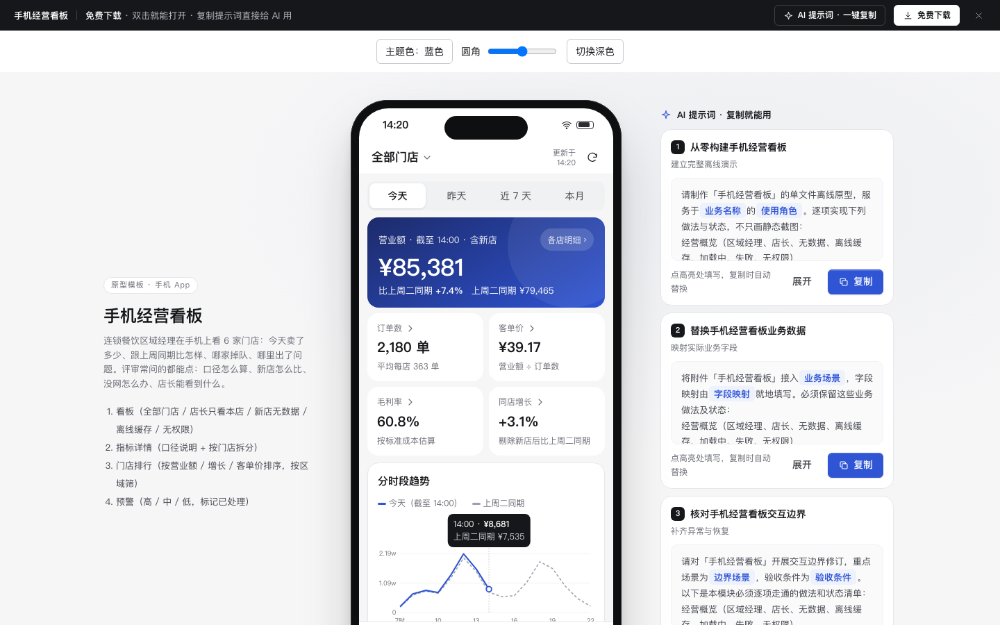

# 手机经营看板（App · 手机框）

免费下载 · 双击就能打开 · 复制提示词直接给 AI 用。

> 积木盒 · 老岳AI编辑部 · 原型组　|　手机 390×844（带手机框，500 宽不横滚）　|　单文件 HTML，离线可用　|　2026-11-11 重做

连锁餐饮区域经理在手机上看 6 家门店的经营数据：营业额和对比期、客单价 / 毛利率 / 同店增长、分时段趋势（按住拖动看数）、渠道构成、预警、门店排行。所有合计和比率由 `DATA` 现算，各店之和 = 合计。

---

## 一、用处

| 项 | 说明 |
|---|---|
| 适合什么需求 | 老板 / 区域经理 / 店长的手机经营看板：餐饮、零售、酒店、门诊、加盟连锁 |
| 解决哪一步 | 评审常问的都能点：今天比谁（上周同一天同时段，不是昨天全天）、新店怎么比（不参与同店增长）、目标落后多少（和时间进度比）、指标口径、店长能看到什么、没网时看什么 |
| 不适合 | PC 大屏（见 `bi-screen`）；PC 后台看板（见 `b-dashboard`） |

**页面和状态**（右下角「原型面板」切换）

| 页面 | 状态 |
|---|---|
| ① 看板 | 区域经理 · 全部门店 / 店长视角（只看本店）/ 空（新店昨天还没开业）/ 离线（缓存数据）/ 加载中 / 加载失败 / 无权限 |
| ② 指标详情 | 营业额 / 客单价 / 加载中 / 加载失败 |
| ③ 门店排行 | 正常 / 空（区域没有门店）/ 加载中 / 加载失败 |
| ④ 预警 | 5 条未处理 / 空（都处理完了）/ 加载中 / 加载失败 |

## 二、用法

1. 双击 `index.html`；右下角「原型面板」切页面和状态，按 `H` 隐藏；直达例：`#page=home&state=offline`。
2. 改数据只改 `<script>` 顶部 `DATA`：`stores` 门店与区域、`margin` 毛利率、`monthGoal` 月目标、`ranges` 四个时间范围（各店营业额 / 订单数 / 对比期、趋势、渠道）、`alerts` 预警。
3. 改颜色：`:root` 的 `--accent`；涨跌色 `--up` / `--down`（默认涨红跌绿，对调即国际习惯）。
4. 手机框右侧「AI 提示词」3 条：从零生成 / 改成我的业务（变量：行业和角色、主指标、小指标公式、对比口径、拆分维度、预警规则）/ 加页面或状态（门店详情、日报推送、自定义首屏、横屏看图）。

## 三、交互说明

| 元素 | 交互 | 反馈 |
|---|---|---|
| 门店切换 | 点顶部「全部门店 ⌄」 | 底部弹层选门店；店长视角下其他门店置灰并写「店长只能看本店」，点了提示原因 |
| 时间切换 | 今天 / 昨天 / 近 7 天 / 本月 | 全页数字、对比期名称、趋势横轴一起变 |
| 营业额主卡 | — | 大数字 + 比对比期 + 对比期金额；含新店时标注；本月显示目标进度条和时间进度标线，写领先 / 落后几个百分点、后面日均要多少；「各店明细 ›」进指标详情 |
| 4 个小指标 | 点击 | 进指标详情：口径说明（怎么算、对比期）+ 按门店拆分 + 合计；客单价、毛利率写明合计是加权平均 |
| 趋势图 | 按住左右拖动；聚焦后左右方向键 | 浮层显示该点本期和对比期金额；今天 14 点后只显示对比期虚线 |
| 渠道构成 | — | 分段条 + 堂食 / 外卖 / 自提金额与占比 |
| 预警 | 点一条 | 底部弹层：原因、建议动作、「打电话给店长」「标记已处理」；处理后 Tab 角标减 1 |
| 门店排行 | 按营业额 / 增长 / 客单价排序；按区域筛 | 前 3 名高亮；新店标「新店」、按增长排序时排最后；7 日迷你折线；点一行切到该店看板 |
| 刷新 | 点刷新 | 显示「正在刷新…」后提示已是最新；离线时提示没有网络 |
| 离线 | — | 顶部黄条写缓存时间（13:55），数据照常显示，「重试」恢复 |
| 我的 | 切换演示角色 | 区域经理 ↔ 店长（滨江店） |

**指标口径**

| 指标 | 公式 | 对比期 | 特殊情况 |
|---|---|---|---|
| 营业额 | 顾客实付 + 平台补贴，不含退款 | 今天比上周同一天同时段；昨天比上周同一天；近 7 天比前 7 天；本月比上月同期 | 含新店时标「含新店」 |
| 客单价 | 营业额 ÷ 订单数 | 同上 | 合计为加权平均 |
| 毛利率 | (营业额 − 标准成本) ÷ 营业额 | — | 月底按实际成本重算 |
| 同店增长 | 只算对比期也营业的门店 | 同上 | 良渚店 11-08 开业，不参与 |

## 四、验收结论（2026-11-11 原型组）

**通过。** 对照上轮打回原因逐条处理：

| 上轮问题 | 本次 |
|---|---|
| 定位手机看板，交付成了 PC 后台 | 改为 390×844 手机框 App：底部 Tab、底部弹层、按住看数，触控区 ≥44px |
| 数据批量复制 | 6 家店 × 4 个时间范围各自写实，合计、客单价、增长率、同店增长、目标进度全部由数据现算 |
| 提示词套话 | 3 条写明对比口径、新店规则、目标 vs 时间进度、离线与店长视角边界 |
| 柱状图横轴对比度 1.38:1 | 图表文字用 `--ink-500`（白底 ≥4.5:1） |

机器验收：`_kit/atest.sh` 1440 / 1280 / 500 宽 × 19 个状态：0 JS 报错、0 横滚、0 对比度问题、0 小于 24px 的可点元素；提示词面板可见 / 展开 / 复制。交互断言 15 条通过（合计与各店之和、增长与同店增长、客单价计算、本月目标与时间进度、按住图表看数、方向键、切换门店、指标口径、按增长排序、区域空态、预警角标、标记已处理、店长视角、店长不能切店）。`gtest.sh` 面向组件画廊（Gallery），页面模板不适用，以交互断言代替。

---

本模板由老岳AI编辑部·原型组制作，可免费下载、修改、用于工作项目。

## 本次清理提示词

### 从零构建手机经营看板

请制作「手机经营看板」的单文件离线原型，服务于{{业务名称}}的{{使用角色}}。逐项实现下列做法与状态，不只画静态截图：
经营概览（区域经理、店长、无数据、离线缓存、加载中、失败、无权限）
指标详情（营业额、客单价、加载、失败）
门店排行（正常、区域为空、加载、失败）
预警（未处理、全部处理、加载、失败）
业务字段：门店、营业额、订单数、客单价、对比期、预警级别。按{{校验规则}}验证必填、格式与权限；保留搜索目录、主题色、圆角、深浅色、下载和提示词面板，提供真实操作及取消恢复。使用逐行不同的业务演示数据。

### 替换手机经营看板业务数据

将附件「手机经营看板」接入{{业务场景}}，字段映射由{{字段映射}}就地填写。必须保留这些业务做法及状态：
经营概览（区域经理、店长、无数据、离线缓存、加载中、失败、无权限）
指标详情（营业额、客单价、加载、失败）
门店排行（正常、区域为空、加载、失败）
预警（未处理、全部处理、加载、失败）
逐一核对门店、营业额、订单数、客单价、对比期、预警级别的来源、默认值与提交范围。将演示值替换为{{业务数据}}，输入变更后重新校验；说明确认前后的数据变化与失败保留内容。交付可离线运行的完整HTML与字段说明。

### 核对手机经营看板交互边界

请对「手机经营看板」开展交互边界修订，重点场景为{{边界场景}}，验收条件为{{验收条件}}。以下是本模块必须逐项走通的做法和状态清单：
经营概览（区域经理、店长、无数据、离线缓存、加载中、失败、无权限）
指标详情（营业额、客单价、加载、失败）
门店排行（正常、区域为空、加载、失败）
预警（未处理、全部处理、加载、失败）
围绕业务字段门店、营业额、订单数、客单价、对比期、预警级别检查无输入、非法值、取消、重复操作及失败恢复；每条路径写出触发、反馈和恢复位置。保持500px宽度、浅深色对比度及至少24px触控目标，返回完整代码和验收记录。

状态：已通过浏览器验收（1440/500 宽 0 报错、0 溢出、对比度与触控达标；标准外壳与跨目录比对通过）
