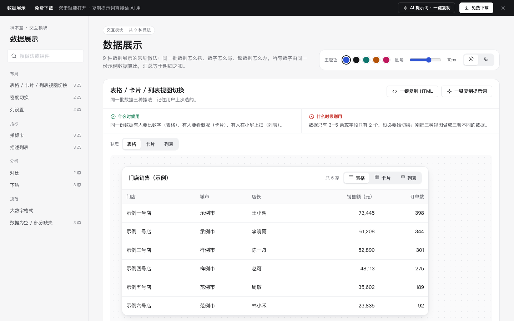

# 数据展示 · 交互模块

免费下载 · 双击就能打开 · 复制提示词直接给 AI 用。

> 积木盒 · 老岳AI编辑部 · 原型组　|　交互模块（组件 → **模块** → 页面模板）　|　单文件 HTML，离线可用　|　2026-11-10

这是一页能点的数据展示做法合集：9 种做法、22 个状态，讲同一批数据怎么摆、数字怎么写、缺数据怎么办。所有数字由同一份示例数据算出，汇总等于明细之和。

---

## 一、用处

| 项 | 说明 |
|---|---|
| 解决什么 | 后台和看板原型里常见的坑：数字格式不统一、缺数据显示成 0、指标涨了不知道是好是坏、下钻后回不去。这里每种做法给出对的写法和能点的演示 |
| 适合谁 | 画后台列表、看板、详情页的产品经理 |
| 和页面模板的关系 | 页面模板 `b-dashboard`（数据看板）、`b-list-drawer`（列表）就是用这些做法拼出来的 |

## 二、做法清单

| # | 做法 | 状态 | 什么时候用 | 什么时候别用 |
|---|---|---|---|---|
| 1 | 表格 / 卡片 / 列表视图切换 | 表格 / 卡片 / 列表 | 不同人要不同摆法 | 数据只有 3–5 条 |
| 2 | 密度切换 | 标准 / 紧凑 | 一屏要对比很多行 | 手机端、新手为主 |
| 3 | 指标卡 | 正常 / 无对比数据 / 加载 | 看板顶部、详情概况 | 超过 6 个；累计值不放环比 |
| 4 | 描述列表 | 两列 / 单列 / 空值与长文本 | 详情页展示一条记录 | 要比较多条记录时用表格 |
| 5 | 对比 | 本期 vs 上期 / A vs B | 周报、复盘、方案选型 | 超过 3 组、量纲不同 |
| 6 | 下钻 | 全部城市 / 某个城市 / 某家门店 | 层级数据 | 超过 4 层 |
| 7 | 列设置 | 默认 / 设置面板 | 列多、角色关心的列不同 | 列少于 5 个 |
| 8 | 大数字格式 | 对照表 | 所有出现数字的地方 | 对账页别四舍五入 |
| 9 | 数据为空 / 部分缺失 | 部分缺失 / 整体无数据 / 加载失败 | 多系统、有延迟的数据 | 别把缺失显示成 0 |

## 三、用法

1. 下载文件夹，双击 `index.html`。
2. 左侧目录点到想要的做法，点「状态」切换，演示区里可以真实操作（切视图、切密度、下钻、列设置、展开长文本、重试）。
3. 右上角换主题色、圆角、明暗，所有演示实时跟着变。
4. **一键复制 HTML**：复制当前状态的 HTML，自带所需的 CSS 变量和样式，粘进任意 HTML 原型就能显示。复制的只有外观，交互逻辑用提示词让 AI 补上。
5. **一键复制提示词**：每种做法一条，交给 AI 就能做出带全部状态的同款。

### 页面上的 AI 提示词

页面顶部「AI 提示词 · 一键复制」里有 3 条，高亮的变量点一下就能就地填写，复制出来就是填好的完整提示词：

| # | 提示词 | 什么时候用 |
|---|---|---|
| 1 | 从零生成整套「数据展示」模块 | 要定一套数据展示规范 + 演示 |
| 2 | 把数据展示改成我的业务（变量：业务名称、角色、指标列表、字段列表、下钻层级） | 已下载，换成自己的指标 |
| 3 | 在此基础上加一种数据展示做法（变量：要加的做法、状态清单） | 模块里没有你要的展示方式 |

## 四、交互说明

| 做法 | 元素 | 交互 | 反馈 |
|---|---|---|---|
| 视图切换 | 表格 / 卡片 / 列表 | 点击切换 | 当前高亮；选择存本机，下次打开提示「已按你上次的视图显示」，可改回表格 |
| 密度切换 | 标准 / 紧凑 | 点击 | 行高 52 ↔ 36px，字号不变 |
| 指标卡 | 环比标签 | 自动判断 | 按「越高越好 / 越低越好」上色：退款率下降是绿色；无上期数据显示「—」并写原因 |
| 描述列表 | 展开 / 收起 | 点击 | 长文本超过 2 行折叠；空值统一「—」 |
| 对比 | 条形 + 变化 | 只读 | 本期主色、上期灰色，图例写清；A vs B 胜出项绿色加粗 |
| 下钻 | 首列 / 面包屑 | 点击行或回车；点面包屑 | 进入下一层，面包屑多一级；点任一级返回；每层合计等于上层这一行 |
| 列设置 | 勾选、上移 / 下移、恢复默认 | 点击；Esc 关闭 | 表格实时变化；只剩 1 列时勾选置灰；恢复默认有 Toast |
| 大数字格式 | 对照表 | 只读 | 左边错误写法（删除线），右边正确写法 |
| 数据缺失 | 看昨天 / 重新加载 | 点击 | 缺失显示灰色「—」并写补齐时间；真实为 0 显示 0；失败保留表头可重试 |
| 全页 | 主题色 / 圆角 / 明暗 | 切换 | 所有演示实时变化，记在本机 |

## 五、自检（按《交互设计规范》）

- [x] 9 种做法 22 个状态可切换，主要交互可真实操作
- [x] 每种做法写清「什么时候用 / 什么时候别用」和交互要点
- [x] 数字等宽右对齐；单位不拆行；汇总等于明细之和
- [x] 可点元素 ≥ 32px；焦点框清晰；文字对比度 ≥ 4.5:1（浅色、深色）
- [x] 页面上 3 条 AI 提示词，变量可就地填写，复制有成功反馈
- [x] 无 JS 报错（全部状态切换 + 复制 HTML / 提示词 + 明暗切换 + 交互脚本走查）
- [x] 示例数据标「示例」，无真实公司名

---

本模块由老岳AI编辑部·原型组制作，免费下载、修改、用于工作项目。
