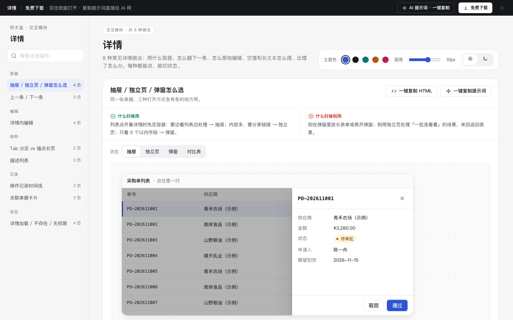

# 详情 · 交互模块

免费下载 · 双击就能打开 · 复制提示词直接给 AI 用。

> 积木盒 · 老岳AI编辑部 · 原型组　|　交互模块（组件 → **模块** → 页面模板）　|　单文件 HTML，离线可用　|　2026-11-10

这页把详情的 8 种做法放在一起，每种都能点、能切状态：用什么容器打开、怎么翻到下一条、怎么原地编辑、空值和长文本怎么摆、打不开时怎么办。挑一种，复制 HTML 粘进你的原型；或者复制提示词，让 AI 改成你的单据。

---

## 一、用处

| 项 | 说明 |
|---|---|
| 解决什么 | 画详情原型时最常被追问：用抽屉还是新页面？改完怎么保存？字段没值显示什么？单据被删了打开是什么样？这里每种做法把这些都摆出来了 |
| 适合谁 | 要画订单、工单、客户、审批等单据详情的产品经理；和研发、测试对齐详情交互的时候 |
| 和页面模板的关系 | 页面模板「列表 + 详情抽屉」「审批流」里的详情就是用这里的做法拼的 |

## 二、做法清单

| # | 做法 | 状态 | 什么时候用 | 什么时候别用 |
|---|---|---|---|---|
| 1 | 抽屉 / 独立页 / 弹窗怎么选 | 抽屉 / 独立页 / 弹窗 / 对比表 | 打开详情前先定容器 | 弹窗里放长表单；连着看一批时用独立页 |
| 2 | 上一条 / 下一条 | 中间某条 / 第一条 / 最后一条 | 逐条处理一批单据 | 用户通常只看一条（从消息跳进来） |
| 3 | 详情内编辑 | 查看态 / 编辑态 / 保存中 / 保存失败 | 要改的字段 ≤ 10 个 | 字段多、联动复杂，跳编辑页 |
| 4 | Tab 分区 vs 锚点长页 | Tab 分区 / 锚点长页 | Tab：各块独立；锚点：要从头看到尾 | Tab 超过 6 个；锚点页不到两屏 |
| 5 | 描述列表 | 两列 / 有空值 / 长文本折叠 | 所有只读字段 | 多条同结构数据用表格 |
| 6 | 操作记录时间线 | 完整记录 / 含失败节点 / 记录很多 | 多人经手、要追溯 | 只有一两条；上千条用日志表 |
| 7 | 关联单据卡片 | 有关联 / 无关联 / 关联单据已删除 | 单据有上下游 | 超过 6 张改用表格 |
| 8 | 详情加载 / 不存在 / 无权限 | 加载中 / 不存在 / 无权限 / 加载出错 | 所有详情都要有 | 只写「出错了」；无权限还露数据 |

## 三、用法

1. 下载文件夹，双击 `index.html`。
2. 左侧目录点到想要的做法，点「状态」切换看效果，演示区里可以真实操作（翻页、编辑保存、展开收起）。
3. 右上角换主题色、圆角、明暗，所有演示实时跟着变。
4. **一键复制 HTML**：复制当前状态的 HTML，自带所需 CSS 变量和样式，粘进任意 HTML 原型就能显示（交互逻辑用提示词让 AI 补上）。
5. **一键复制提示词**：每种做法一条，交给 AI 就能做出带全部状态的同款。

### 页面上的 AI 提示词

页面顶部「AI 提示词 · 一键复制」里有 3 条，高亮的变量点一下就能就地填写，复制出来就是填好的完整提示词：

| # | 提示词 | 什么时候用 |
|---|---|---|
| 1 | 从零生成整套「详情」交互模块 | 想要一份自己的详情交互规范 + 演示 |
| 2 | 把详情改成我的业务（变量：做法、业务名称、角色、字段列表、状态枚举） | 已经下载，换成自己的单据 |
| 3 | 在此基础上加一种做法 / 状态（变量：要加的做法、状态清单） | 模块里没有你要的做法 |

## 四、交互说明

| 做法 | 元素 | 交互 | 反馈 |
|---|---|---|---|
| 容器选择 | 抽屉 / 弹窗 | 点遮罩、关闭按钮、Esc 关闭；点列表行重新打开 | 当前行左侧主色竖条；关闭后高亮去掉 |
| 容器选择 | 独立页 | 返回列表 | 回到列表并定位到刚才那一行 |
| 上一条 / 下一条 | 上下箭头按钮、键盘 ↑ ↓、点列表行 | 切换当前单据 | 顶部「n / 12」更新；列表同步高亮并滚到可见；到头按钮置灰 |
| 上一条 / 下一条 | 通过并看下一条 | 点击 | Toast「已通过，已跳到下一条」；最后一条提示「这一批处理完了」 |
| 详情内编辑 | 编辑 / 取消 / 保存 | 编辑原地变输入框；取消还原；保存校验必填 | 保存中按钮转圈、输入框禁用；演示中第一次保存会失败，顶部写原因 + 重试，改的内容保留；成功显示「已保存」 |
| Tab vs 锚点 | Tab | 点击切换 | 当前 Tab 主色下划线，带条数 |
| Tab vs 锚点 | 锚点目录 | 点目录 / 滚动内容 | 平滑滚到对应块；滚动时目录高亮跟随 |
| 描述列表 | 展开 / 收起 | 点击 | 长文本默认两行，展开看全文 |
| 时间线 | 查看全部 N 条 | 点击 | 超过 5 条默认收起，展开后可再收起 |
| 时间线 | 失败节点「手动重试」 | 点击 | Toast 提示已重新推送 |
| 关联单据 | 卡片 | 点击 | 打开对应单据；已删除的卡片划线、不可点 |
| 异常 | 申请权限 / 返回列表 / 重新加载 | 点击 | 重新加载先出骨架屏 |

## 五、自检（按《交互设计规范》）

- [x] 每种做法：正常、空、加载、出错、无权限等适用状态齐全，可切换
- [x] 每种做法写清「什么时候用 / 什么时候别用」
- [x] 空值统一「—」；金额、日期数字等宽；长文本可展开
- [x] 弹层 Esc 关闭；键盘 ↑ ↓、Tab 可操作；焦点框清晰
- [x] 可点元素 ≥ 32px；文字对比度 ≥ 4.5:1（浅色、深色）
- [x] 页面上有 3 条 AI 提示词，变量可就地填写，复制有成功反馈
- [x] 无 JS 报错（8 种做法 26 个状态 + 复制 HTML / 提示词 + 明暗切换 + 关键交互脚本走查）
- [x] 示例数据标「示例」，无真实公司名

---

本模块由老岳AI编辑部·原型组制作，免费下载、修改、用于工作项目。
