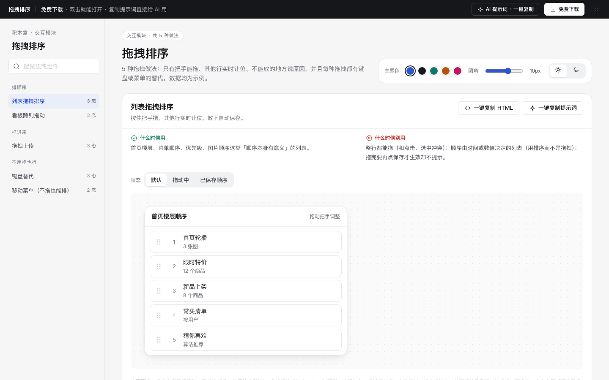

# 拖拽排序 · 交互模块

免费下载 · 双击就能打开 · 复制提示词直接给 AI 用。

> 积木盒 · 老岳AI编辑部 · 原型组　|　交互模块（组件 → **模块** → 页面模板）　|　单文件 HTML，离线可用　|　2026-11-10

这是一页能点的「拖拽排序」做法合集：5 种做法 14 个状态，每种都能切状态、能真实操作。5 种拖拽做法：只有把手能拖、其他行实时让位、不能放的地方说原因，并且每种拖拽都有键盘或菜单的替代。数据均为示例。 挑一种，复制 HTML 粘进你的原型；或者复制提示词，让 AI 改成你的业务。

---

## 一、用处

| 项 | 说明 |
|---|---|
| 解决什么 | 拖拽最常见的坑：整行都能拖和点击冲突、拿起没反馈、不能放的地方松手才报错、只能拖不能点选文件、只能用鼠标（键盘和读屏用户用不了）、长列表要拖几十行 |
| 适合谁 | 要画排序配置、任务看板、图片上传、菜单编辑的产品经理 |
| 和页面模板的关系 | 页面模板是整页；模块是其中一块的多种做法（后台的楼层配置、任务看板、图片上传从这里挑） |

## 二、做法清单

| # | 做法 | 状态 | 什么时候用 | 什么时候别用 |
|---|---|---|---|---|
| 1 | 列表拖拽排序 | 默认 / 拖动中 / 已保存顺序 | 首页楼层、菜单顺序、优先级、图片顺序这类「顺序本身有意义」的列表。 | 整行都能拖（和点击、选中冲突）；顺序由时间或数值决定的列表（用排序而不是拖拽）；拖完要再点保存才生效却不提示。 |
| 2 | 看板跨列拖动 | 默认 / 拖动中 / 不允许放入 | 任务、工单、招聘、销售线索这类按状态分列推进的工作。 | 拖到不允许的列松手后才报错；列满了不提示；拖动后不告诉其他人状态变了。 |
| 3 | 拖拽上传 | 默认 / 文件悬停 / 格式不对 | 后台上传图片、附件、导入表格。 | 只能拖不能点选（触屏和不熟悉拖拽的人用不了）；格式不对要等上传完才报错；投放区太小、拖进来没有任何反馈。 |
| 4 | 键盘替代 | 默认 / 已拿起 / 已放下 | 所有拖拽排序都应该有；后台用户常用键盘、读屏用户只能用键盘。 | 只能用鼠标拖；拿起后没有任何提示当前位置；Esc 不能取消。 |
| 5 | 移动菜单（不拖也能排） | 默认 / 菜单打开 | 手机端、长列表（拖 50 行很累）、要跨分组移动的场景。 | 长列表只给拖拽，要把第 50 项拖到第 1 项；菜单里已经在顶部还能点「移到顶部」。 |

## 三、用法

1. 下载文件夹，双击 `index.html`。
2. 左侧目录点到想要的做法，点「状态」切换，演示区里可以真实操作。
3. 右上角换主题色、圆角、明暗，所有演示实时跟着变。
4. **一键复制 HTML**：复制当前状态的 HTML，自带所需 CSS 变量和样式，粘进任意 HTML 原型就能显示（交互逻辑用提示词让 AI 补）。
5. **一键复制提示词**：每种做法一条，交给 AI 就能做出带全部状态的同款。

### 页面上的 AI 提示词

页面顶部「AI 提示词 · 一键复制」里有 3 条，高亮变量点一下就能填，复制出来就是填好的完整提示词：

| # | 提示词 | 什么时候用 |
|---|---|---|
| 1 | 从零生成整套「拖拽排序」交互模块 | 想要一份自己的拖拽排序规范 + 演示 |
| 2 | 把拖拽排序改成我的产品（变量：产品名称、对象、规则、文件规则、保存方式） | 已下载，换成自己的数据和规则 |
| 3 | 在此基础上加一种做法 / 状态（变量：要加的做法、状态清单） | 模块里没有你要的做法 |

## 四、交互说明

| 做法 | 元素 → 交互 → 反馈 |
|---|---|
| 列表拖拽排序 | 只有左侧把手可拖（鼠标变抓手，触屏按住即拖）；拿起后该行放大 1.02、加阴影、边框主色；经过其他行一半高度时，其他行让位；放下后编号重排、该行闪一下底色，右上角写「顺序已保存」；拖到列表外松手 = 取消，回原位。 |
| 看板跨列拖动 | 按住卡片即可拖，原位置留虚线占位；经过可放的列：列边框主色 + 浅底；经过不满足条件的列：列变红，列头规则写成红字（如「进行中最多 3 个，已满」），松手卡片弹回原处并 Toast 说原因；放入「已完成」要求补填处理结果（弹窗预填）。 |
| 拖拽上传 | 投放区写「把图片拖到这里，或点击选择」+ 格式和大小限制；文件拖进卡片：边框主色、底色变浅、图标变主色、轻微放大，文案变「松手上传」；拖入的文件格式不对：变红写「只支持 JPG、PNG」，松手不上传；整个区域可点击、可回车打开文件选择。 |
| 键盘替代 | Tab 聚焦到某行（焦点框清晰）；空格 / 回车拿起：行变主色描边，播报「已拿起 限时特价，当前第 2 位，共 5 位」；↑↓ 移动并播报新位置；再按空格放下并保存，播报「已放下，第 1 位」；Esc 取消回原位；底部常显按键说明。 |
| 移动菜单（不拖也能排） | 每行右侧「更多」按钮，菜单项：移到顶部 / 上移一位 / 下移一位 / 移到底部 / 移到其他分组…；在顶部时「移到顶部」「上移」置灰，底部同理；移动后该行闪一下并 Toast「已移到第 1 位」，5 秒内可撤销；Esc 或点外面关闭菜单。 |

## 五、自检（按《交互设计规范》）

- [x] 每种做法的状态齐全，可切换，能真实操作
- [x] 每种做法写清「什么时候用 / 什么时候别用」
- [x] 只有把手可拖，拿起有放大 + 阴影，其他行实时让位
- [x] 不能放的位置拖到时就变红并写原因，松手弹回
- [x] 每种拖拽都有替代：键盘（空格拿起 / 方向键 / 空格放下 / Esc 取消）或移动菜单
- [x] 键盘操作每一步都用 aria-live 播报当前位置
- [x] 可点元素 ≥ 32px；焦点框清晰；对比度 ≥ 4.5:1
- [x] 弹窗：Esc / 点遮罩关闭、焦点锁定、关闭后焦点回到触发处
- [x] 页面上有 3 条 AI 提示词，变量可就地填写，复制有成功反馈
- [x] 无 JS 报错（5 种做法 14 个状态自测 OK + 关键交互走查）
- [x] 示例数据标「示例」，无真实公司名和品牌

---

本模块由老岳AI编辑部·原型组制作，免费下载、修改、用于工作项目。
