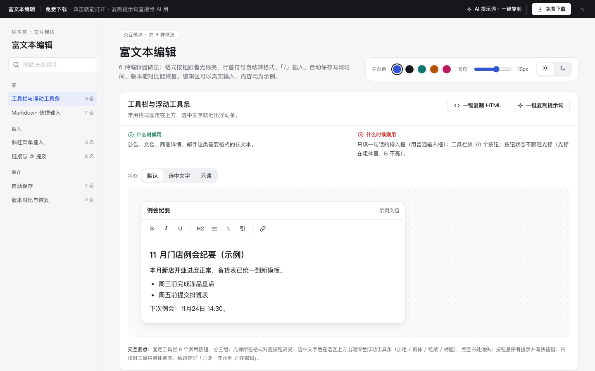

# 富文本编辑 · 交互模块

免费下载 · 双击就能打开 · 复制提示词直接给 AI 用。

> 积木盒 · 老岳AI编辑部 · 原型组　|　交互模块（组件 → **模块** → 页面模板）　|　单文件 HTML，离线可用　|　2026-11-10

这是一页能点的「富文本编辑」做法合集：6 种做法 17 个状态，每种都能切状态、能真实操作。6 种编辑器做法：格式按钮跟着光标亮、行首符号自动转格式、「/」插入、自动保存写清时间、版本能对比能恢复。编辑区可以真实输入，内容均为示例。 挑一种，复制 HTML 粘进你的原型；或者复制提示词，让 AI 改成你的业务。

---

## 一、用处

| 项 | 说明 |
|---|---|
| 解决什么 | 编辑器最常见的坑：按钮状态不跟光标、选中文字后要回到顶部找按钮、插入表格藏得深、网址格式不对也能存、@ 出来对方收不到、只有保存按钮关页面就丢、版本只能恢复不能先看差别 |
| 适合谁 | 要画公告后台、文档、商品详情、知识库编辑器的产品经理 |
| 和页面模板的关系 | 页面模板是整页；模块是其中一块的多种做法（中后台的公告 / 详情编辑页从这里挑） |

## 二、做法清单

| # | 做法 | 状态 | 什么时候用 | 什么时候别用 |
|---|---|---|---|---|
| 1 | 工具栏与浮动工具条 | 默认 / 选中文字 / 只读 | 公告、文档、商品详情、邮件这类需要格式的长文本。 | 只填一句话的输入框（用普通输入框）；工具栏放 30 个按钮；按钮状态不跟随光标（光标在粗体里，B 不亮）。 |
| 2 | Markdown 快捷输入 | 默认 / 已自动转换 | 面向经常写东西的用户（运营、产品、研发），文档类产品。 | 面向不熟悉 Markdown 的用户却不给工具栏；转换后不能撤销（Ctrl/⌘+Z 应恢复原符号）。 |
| 3 | 斜杠菜单插入 | 默认 / 菜单打开 / 已插入表格 | 要插入表格、图片、分割线等块级内容的文档编辑器。 | 插入项藏在三级菜单里；菜单不能用键盘选；在行中间输入「/」也弹菜单（网址里有「/」会被打断）。 |
| 4 | 链接与 @ 提及 | 默认 / 链接浮层 | 文档里引用外部资料、提醒同事看某段内容。 | 加链接要先删文字再粘网址；网址格式不对也能保存；@ 出来的只是普通文字、对方收不到提醒。 |
| 5 | 自动保存 | 已保存 / 保存中 / 离线未保存 / 保存失败 | 所有长文本编辑；用户不该担心「我点保存了吗」。 | 只有「保存」按钮、关页面就丢；状态只写「已保存」不写时间；保存失败把内容清掉或不告诉用户。 |
| 6 | 版本对比与恢复 | 版本列表 / 对比 / 已恢复 | 多人编辑的文档、合同、公告、商品详情；要查「谁改了什么」。 | 只能恢复不能先看差别；恢复直接覆盖当前内容且不能撤回；版本只写编号不写时间和作者。 |

## 三、用法

1. 下载文件夹，双击 `index.html`。
2. 左侧目录点到想要的做法，点「状态」切换，演示区里可以真实操作。
3. 右上角换主题色、圆角、明暗，所有演示实时跟着变。
4. **一键复制 HTML**：复制当前状态的 HTML，自带所需 CSS 变量和样式，粘进任意 HTML 原型就能显示（交互逻辑用提示词让 AI 补）。
5. **一键复制提示词**：每种做法一条，交给 AI 就能做出带全部状态的同款。

### 页面上的 AI 提示词

页面顶部「AI 提示词 · 一键复制」里有 3 条，高亮变量点一下就能填，复制出来就是填好的完整提示词：

| # | 提示词 | 什么时候用 |
|---|---|---|
| 1 | 从零生成整套「富文本编辑」交互模块 | 想要一份自己的富文本编辑规范 + 演示 |
| 2 | 把富文本编辑改成我的产品（变量：产品名称、内容类型、格式清单、成员清单、规则） | 已下载，换成自己的数据和规则 |
| 3 | 在此基础上加一种做法 / 状态（变量：要加的做法、状态清单） | 模块里没有你要的做法 |

## 四、交互说明

| 做法 | 元素 → 交互 → 反馈 |
|---|---|
| 工具栏与浮动工具条 | 固定工具栏 9 个常用按钮，分三组；光标所在格式对应按钮高亮；选中文字后在选区上方出现深色浮动工具条（加粗 / 斜体 / 链接 / 标题），点空白处消失；按钮悬停有提示并写快捷键；只读时工具栏整体置灰，标题旁写「只读 · 李示例 正在编辑」。 |
| Markdown 快捷输入 | 在行首输入「# 」→ 标题，「## 」→ 小标题，「- 」或「* 」→ 列表，「1. 」→ 编号，「> 」→ 引用，「--- 」→ 分割线；Ctrl/⌘+B / I / U 加粗斜体下划线；转换后 Toast 一次「已转为标题，Ctrl/⌘+Z 可撤销」；底部速查表常显。 |
| 斜杠菜单插入 | 只有在空行行首输入「/」才弹菜单，菜单贴在光标下方；分「基础 / 媒体」两组，每项写名称和快捷写法；继续输入如「/表」即过滤；↑↓ 选择、回车插入、Esc 关闭（保留已输入的「/」）；插入表格默认 3×3 并带表头，插入图片先出占位块。 |
| 链接与 @ 提及 | 选中文字点「链接」或按 Ctrl/⌘+K，弹出浮层：文字一栏预填选中内容，网址一栏聚焦；网址不以 http(s):// 开头时自动补上并提示；格式不对「确定」置灰；已有链接再点可「修改 / 移除」；工具栏「@」插入成员，成员显示为主色标签，保存后对方收到通知。 |
| 自动保存 | 标题旁常显状态：输入时「编辑中…」，停止输入 1 秒「保存中…」，成功「已保存 · 14:32」；离线：黄字「离线 · 内容已存在本机，联网后自动同步」；失败：红字 +「重试」，内容保留在编辑区；有未同步内容时关闭页面要确认。 |
| 版本对比与恢复 | 左侧版本列表：时间 + 作者，最新在上并标「当前」；点某版本右侧显示它和当前版本的差别：新增绿色底、删除红色划线；「恢复到这个版本」先确认，恢复后当前内容存为一个新版本（不丢），Toast 10 秒内可撤销。 |

## 五、自检（按《交互设计规范》）

- [x] 每种做法的状态齐全，可切换，能真实操作
- [x] 每种做法写清「什么时候用 / 什么时候别用」
- [x] 编辑区 contenteditable 可真实输入，格式按钮状态跟随光标
- [x] 自动保存：停手 1 秒自动存、写清时间，离线和失败都不丢内容
- [x] 恢复版本前确认，恢复后可撤销，当前内容先存为新版本
- [x] 快捷键同时写 Ctrl 和 ⌘，斜杠菜单与链接浮层可全程键盘操作
- [x] 可点元素 ≥ 32px；焦点框清晰；对比度 ≥ 4.5:1
- [x] 弹窗：Esc / 点遮罩关闭、焦点锁定、关闭后焦点回到触发处
- [x] 页面上有 3 条 AI 提示词，变量可就地填写，复制有成功反馈
- [x] 无 JS 报错（6 种做法 17 个状态自测 OK + 关键交互走查）
- [x] 示例数据标「示例」，无真实公司名和品牌

---

本模块由老岳AI编辑部·原型组制作，免费下载、修改、用于工作项目。

状态：已通过浏览器验收（1440/500 宽 0 报错、0 溢出、对比度与触控达标；标准外壳与跨目录比对通过）
