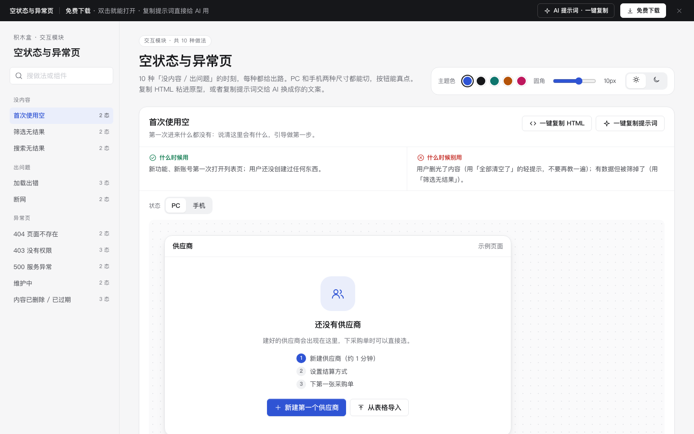

# 空状态与异常页 · 交互模块

免费下载 · 双击就能打开 · 复制提示词直接给 AI 用。

> 积木盒 · 老岳AI编辑部 · 原型组　|　交互模块（组件 → **模块** → 页面模板）　|　单文件 HTML，离线可用　|　2026-11-10

10 种「没内容 / 出问题」的时刻，每种都给出路。PC 和手机两种尺寸都能切，按钮能真点。挑一种，复制 HTML 粘进你的原型；或者复制提示词，让 AI 换成你的文案。

---

## 一、用处

| 项 | 说明 |
|---|---|
| 解决什么 | 原型里最常被漏掉的就是这些页：评审时研发问「没数据时显示什么」「接口挂了怎么办」，答不上来。这里 10 种情况一次配齐，每种都写了出路 |
| 适合谁 | 画列表、详情、权限相关页面的产品经理；要和研发、测试对齐异常场景的时候 |
| 和页面模板的关系 | 页面模板里的「空 / 出错」状态就是从这里挑的做法；拼新页面时直接复制 |

## 二、做法清单

| # | 做法 | 状态 | 什么时候用 | 什么时候别用 |
|---|---|---|---|---|
| 1 | 首次使用空 | PC / 手机 | 新功能、新账号第一次打开 | 用户自己删光的（轻提示即可）；被筛掉的 |
| 2 | 筛选无结果 | PC / 手机 | 加了筛选后结果为 0 | 完全没数据；搜索没搜到 |
| 3 | 搜索无结果 | PC / 手机 | 搜索结果为 0 | 还没输入就显示无结果 |
| 4 | 加载出错 | PC / 手机 / 重试后又失败 | 接口失败、超时 | 整站挂了（用 500）；断网 |
| 5 | 断网 | PC / 手机 | 网络不稳定的门店、仓库、手机端 | 服务端报错；用整页挡住能看的旧内容 |
| 6 | 404 页面不存在 | PC / 手机 | 链接失效、地址写错 | 内容被删除；没权限 |
| 7 | 403 没有权限 | PC / 手机 / 已申请 | 按角色控制的页面 | 没登录；按钮级权限 |
| 8 | 500 服务异常 | PC / 手机 | 服务端未知错误 | 单个模块出错；可预期的业务错误 |
| 9 | 维护中 | PC / 手机 | 计划内停机 | 突发故障写死时间；只影响一个功能 |
| 10 | 内容已删除 / 已过期 | 已删除 / 已过期 / 手机 | 打开已删除的单据、过期活动 | 地址本来就错；还能直接恢复的 |

## 三、用法

1. 下载文件夹，双击 `index.html`。
2. 左侧目录点到想要的情况，切 PC / 手机和状态，按钮都能点。
3. 右上角换主题色、圆角、明暗，所有演示实时跟着变。
4. **一键复制 HTML**：复制的是当前状态的 HTML，自带所需的 CSS 变量和样式，粘进任意 HTML 原型就能显示（交互逻辑用提示词让 AI 补）。
5. **一键复制提示词**：每种情况都有一条，交给 AI 就能做出带全部状态的同款。

### 页面上的 AI 提示词

页面顶部「AI 提示词 · 一键复制」里有 3 条，高亮的变量点一下就能就地填写，复制出来就是填好的完整提示词：

| # | 提示词 | 什么时候用 |
|---|---|---|
| 1 | 从零生成整套「空状态与异常页」交互模块 | 想要一份自己的空态 / 异常页规范 + 演示 |
| 2 | 把空态和异常页改成我的业务（变量：做法、业务名称、角色、内容说明、出路清单） | 已经下载，换成自己的文案 |
| 3 | 在此基础上加一种空态 / 异常页（变量：要加的情况、额外状态） | 模块里没有你要的情况 |

## 四、交互说明

| 做法 | 元素 | 交互 | 反馈 |
|---|---|---|---|
| 首次使用空 | 新建第一个 | 点击 | 当前页直接出现第一条，并提示下一步 |
| 筛选无结果 | 条件标签 × / 清除全部 | 删一个条件 | 实时刷新；清除后 Toast 可撤销 |
| 搜索无结果 | 相近词 | 点击 | 直接按这个词搜出结果 |
| 加载出错 | 重新加载 | 点击 | 按钮转圈；成功出列表；连续失败给「反馈问题」，条件保留 |
| 断网 | 离线横幅 | 网络恢复 | 横幅变绿「已恢复，正在刷新」，2 秒后消失；置灰按钮恢复可点 |
| 403 | 申请权限 | 填理由提交 | 变「审批中」，写清谁审、多久、怎么通知；可撤回、提醒 |
| 500 | 错误编号 | 复制 | 按钮变「已复制」+ Toast |
| 维护中 | 恢复后提醒我 | 点击 | 按钮变「已设置提醒」；写具体恢复时间，不做倒计时 |
| 已删除 / 过期 | 出路按钮 | 点击 | 申请恢复 / 看正在进行的活动 |
| 全页 | 主题色 / 圆角 / 明暗 | 切换 | 所有演示实时变化，记在本机 |

## 五、自检（按《交互设计规范》）

- [x] 每种情况都有出路按钮，文案先说发生了什么、再说能做什么
- [x] PC / 手机两种尺寸都有；手机按钮纵向排满宽、高 44px
- [x] 维护中写具体恢复时间，不做跳秒倒计时
- [x] 可点元素 ≥ 32px；焦点框清晰；文字对比度 ≥ 4.5:1（浅色、深色都检查）
- [x] 页面上有 3 条 AI 提示词，变量可就地填写，复制有成功反馈
- [x] 无 JS 报错（10 种做法 23 个状态 + 复制 HTML / 提示词 + 明暗切换 + 关键交互脚本走查）
- [x] 示例数据标「示例」，无真实公司名

---

本模块由老岳AI编辑部·原型组制作，免费下载、修改、用于工作项目。
