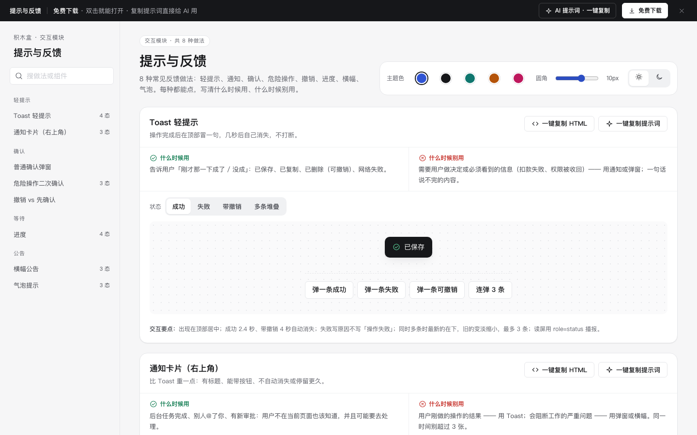

# 提示与反馈 · 交互模块

免费下载 · 双击就能打开 · 复制提示词直接给 AI 用。

> 积木盒 · 老岳AI编辑部 · 原型组　|　PC　|　单文件 HTML，离线可用　|　2026-11-10

一页里放了 8 种反馈做法：Toast、通知、确认、危险操作、撤销、进度、横幅、气泡。每种都写清什么时候用、什么时候别用。

---

## 一、用处

| 项 | 说明 |
|---|---|
| 适合什么 | 设计任何操作的「做完以后」：该弹 Toast 还是弹窗、要不要二次确认、等待时给什么 |
| 解决什么 | 最常见的两个错：该拦的没拦（删了找不回），不该拦的天天拦（用户不看就点确定） |
| 和页面模板的关系 | 页面模板里用到的反馈都出自这里，这里把每种单独拆开讲 |

## 二、做法清单

| # | 做法 | 状态 | 什么时候用 | 什么时候别用 |
|---|---|---|---|---|
| 1 | Toast 轻提示 | 成功 / 失败 / 带撤销 / 多条堆叠 | 刚才的操作成没成 | 必须看到、要做决定的信息 |
| 2 | 通知卡片（右上角） | 普通 / 带操作 / 已关闭 | 后台任务完成、新审批、被@ | 刚做的操作结果；阻断性问题 |
| 3 | 普通确认弹窗 | 默认（可打开真弹窗） | 能撤回但代价不小：发布、批量确认 | 随手可撤销的操作 |
| 4 | 危险操作二次确认 | 未输入 / 已输入名称 / 删除中 | 永久删除、注销、清空 | 能做成回收站或撤销的 |
| 5 | 撤销 vs 先确认 | 对比（两边都能操作） | 归档用撤销；永久删除先确认 | 不可恢复的给撤销；高频小操作给确认 |
| 6 | 进度 | 确定 / 不确定 / 分步骤长任务 / 失败可重试 | 超过 1 秒的操作 | 1 秒内完成的；假百分比 |
| 7 | 横幅公告 | 信息 / 警告 / 已关闭 | 维护预告、到期提醒、数据延迟 | 一次性结果；营销广告 |
| 8 | 气泡提示 | 默认 / Tooltip 显示 / Popover 展开 | 图标按钮名称、口径解释、一个快捷操作 | 关键信息藏在气泡里；气泡里套表单 |

## 三、用法

1. 下载整个文件夹，双击 `index.html`，不用联网。
2. 左侧目录点到某种做法 → 切「状态」→ 点「试一下」类按钮看真实效果。
3. 拿走：**一键复制 HTML**（自带所需变量和样式，粘进原型就能显示）；**一键复制提示词**（让 AI 生成或改造这一种做法）。
4. 右上角可切主题色、圆角、明暗，实时预览。

## 四、页面上的 AI 提示词

页面顶部「AI 提示词 · 一键复制」打开右侧抽屉，3 条提示词，`{{变量}}` 点一下就能填：

| # | 提示词 | 什么时候用 |
|---|---|---|
| 1 | 从零生成整套「提示与反馈」交互模块 | 想要一份反馈交互规范 + 可点演示 |
| 2 | 把提示文案改成我的业务（`{{业务名称}}` `{{角色}}` `{{操作与后果}}` `{{出错原因}}`） | 换成自己场景的文案和反馈方式 |
| 3 | 在此基础上加一种反馈 / 状态（`{{要加的做法}}` `{{状态清单}}`） | 模块里没有你要的 |

## 五、交互说明

| 做法 | 元素 | 交互 | 反馈 |
|---|---|---|---|
| Toast | 试一下按钮 | 点击弹出真实 Toast | 顶部居中；成功 2.4 秒、带撤销 4 秒后消失；多条依次堆叠 |
| 通知 | 关闭 / 去处理 / 稍后 | 点击 | 卡片滑出消失；「去处理」关闭并跳转（示例 Toast） |
| 确认弹窗 | 试一下 | 打开真弹窗 | 焦点在主按钮；Esc、遮罩关闭；结果用 Toast 告知 |
| 危险操作 | 名称输入框 | 输入完整名称 | 一致时红色「永久删除」才可点；删除中转圈；完成 Toast |
| 撤销 | 归档 | 立即从列表消失 | Toast 带撤销 4 秒，撤销后回到原位置 |
| 先确认 | 永久删除 | 先弹红色确认 | 确认后才删除 |
| 进度 | 确定进度 | 自动推进 | 百分比 + 已导入条数；可取消，已导入的保留 |
| 进度 | 分步骤 | 「放到后台」 | Toast：好了会通知你 |
| 进度 | 失败 | 「继续导入剩下 180 条」 | 只重试失败部分 |
| 横幅 | 关闭 + 不再提示 | 勾选后关闭 | 记在本机，下次不出现；可一键清除重新显示 |
| 气泡 | Tooltip | 悬停或键盘聚焦 | 0.16 秒淡入，不含可点内容 |
| 气泡 | Popover | 点击打开，再点 / Esc / 点外面关闭 | 打开时焦点进入卡片，关闭后回到按钮 |

## 六、自检

- [x] 8 种做法、22 个状态，逐个切换无 JS 报错（`_kit/gtest.sh` 输出 OK）
- [x] 脚本走查：连弹 3 条 Toast、真确认弹窗、输入名称删除、归档撤销、永久删除确认、进度推进、横幅不再提示、Popover 打开与 Esc 关闭
- [x] 每种做法有「什么时候用 / 别用」、交互要点、复制 HTML、复制提示词
- [x] 页面顶部「免费下载 · 双击就能打开 · 复制提示词直接给 AI 用」，AI 提示词 3 条
- [x] 文字对比度 ≥4.5:1；示例文案标「示例」，不出现真实品牌

---

本模块由老岳AI编辑部·原型组制作，可免费下载、修改、用于工作项目。

## 本次清理提示词

### 从零构建提示与反馈

请制作「提示与反馈」的单文件离线原型，服务于{{业务名称}}的{{使用角色}}。逐项实现下列做法与状态，不只画静态截图：
Toast 轻提示（成功、失败、带撤销、多条堆叠）；出现在顶部居中；成功 2.4 秒、带撤销 4 秒自动消失；失败写原因不写「操作失败」；同时多条时最新的在下，旧的变淡缩小，最多 3 条；读屏用 role=status 播报。
通知卡片（右上角）（普通、带操作、已关闭）；从右侧滑入，叠在右上角；有关闭按钮；带操作的通知不自动消失，普通通知 6 秒后收起；点操作按钮后通知自动关闭并跳转；关闭后可在消息中心找回。
普通确认弹窗（默认）；标题用问句写清要做什么和数量；正文写后果；主按钮写具体动作（「发布并通知 12 人」）不写「确定」；取消按钮写「再想想」；Esc、点遮罩关闭；打开时焦点在主按钮，Tab 只在弹窗里循环，关闭后焦点回到原按钮。
危险操作二次确认（未输入、已输入名称、删除中）；标题带红色警示图标；列出会被一起删除的东西和数量；输入框要求输入完整名称，不一致时红色按钮置灰；删除中转圈并禁用；默认焦点在输入框而不是删除按钮；成功后 Toast 告诉结果。
撤销 vs 先确认（对比）；撤销模式：点击立刻从列表消失，Toast「已归档 · 撤销」停留 4 秒，撤销后回到原位置；确认模式：点击先弹确认，确认后才删除。两边用同一份示例数据方便对比。
进度（确定进度、不确定进度、分步骤长任务、失败可重试）；确定进度显示百分比和剩余数量；不确定进度用来回滑动条 + 说明在做什么；超过 10 秒的任务给「放到后台」，完成后用通知告诉你；失败时保留已完成部分，只重试失败的。
横幅公告（信息、警告、已关闭）；信息用主色浅底、警告用琥珀浅底；写清时间和影响，给一个链接看详情；可关闭的横幅勾「不再提示」后记在本机，下次不出现；影响使用的警告不给关闭按钮。
气泡提示（默认、Tooltip 显示、Popover 展开）；Tooltip 在悬停和键盘聚焦时都出现，延迟约 0.1 秒，不放可点内容；Popover 点击打开、再点或 Esc 或点外面关闭，打开时焦点进入卡片；图标按钮必须同时有 aria-label。
业务字段：提示内容、反馈类型、持续时间、操作结果。按{{校验规则}}验证必填、格式与权限；保留搜索目录、主题色、圆角、深浅色、下载和提示词面板，提供真实操作及取消恢复。使用逐行不同的业务演示数据。

### 替换提示与反馈业务数据

将附件「提示与反馈」接入{{业务场景}}，字段映射由{{字段映射}}就地填写。必须保留这些业务做法及状态：
Toast 轻提示（成功、失败、带撤销、多条堆叠）；出现在顶部居中；成功 2.4 秒、带撤销 4 秒自动消失；失败写原因不写「操作失败」；同时多条时最新的在下，旧的变淡缩小，最多 3 条；读屏用 role=status 播报。
通知卡片（右上角）（普通、带操作、已关闭）；从右侧滑入，叠在右上角；有关闭按钮；带操作的通知不自动消失，普通通知 6 秒后收起；点操作按钮后通知自动关闭并跳转；关闭后可在消息中心找回。
普通确认弹窗（默认）；标题用问句写清要做什么和数量；正文写后果；主按钮写具体动作（「发布并通知 12 人」）不写「确定」；取消按钮写「再想想」；Esc、点遮罩关闭；打开时焦点在主按钮，Tab 只在弹窗里循环，关闭后焦点回到原按钮。
危险操作二次确认（未输入、已输入名称、删除中）；标题带红色警示图标；列出会被一起删除的东西和数量；输入框要求输入完整名称，不一致时红色按钮置灰；删除中转圈并禁用；默认焦点在输入框而不是删除按钮；成功后 Toast 告诉结果。
撤销 vs 先确认（对比）；撤销模式：点击立刻从列表消失，Toast「已归档 · 撤销」停留 4 秒，撤销后回到原位置；确认模式：点击先弹确认，确认后才删除。两边用同一份示例数据方便对比。
进度（确定进度、不确定进度、分步骤长任务、失败可重试）；确定进度显示百分比和剩余数量；不确定进度用来回滑动条 + 说明在做什么；超过 10 秒的任务给「放到后台」，完成后用通知告诉你；失败时保留已完成部分，只重试失败的。
横幅公告（信息、警告、已关闭）；信息用主色浅底、警告用琥珀浅底；写清时间和影响，给一个链接看详情；可关闭的横幅勾「不再提示」后记在本机，下次不出现；影响使用的警告不给关闭按钮。
气泡提示（默认、Tooltip 显示、Popover 展开）；Tooltip 在悬停和键盘聚焦时都出现，延迟约 0.1 秒，不放可点内容；Popover 点击打开、再点或 Esc 或点外面关闭，打开时焦点进入卡片；图标按钮必须同时有 aria-label。
逐一核对提示内容、反馈类型、持续时间、操作结果的来源、默认值与提交范围。将演示值替换为{{业务数据}}，输入变更后重新校验；说明确认前后的数据变化与失败保留内容。交付可离线运行的完整HTML与字段说明。

### 核对提示与反馈交互边界

请对「提示与反馈」开展交互边界修订，重点场景为{{边界场景}}，验收条件为{{验收条件}}。以下是本模块必须逐项走通的做法和状态清单：
Toast 轻提示（成功、失败、带撤销、多条堆叠）；出现在顶部居中；成功 2.4 秒、带撤销 4 秒自动消失；失败写原因不写「操作失败」；同时多条时最新的在下，旧的变淡缩小，最多 3 条；读屏用 role=status 播报。
通知卡片（右上角）（普通、带操作、已关闭）；从右侧滑入，叠在右上角；有关闭按钮；带操作的通知不自动消失，普通通知 6 秒后收起；点操作按钮后通知自动关闭并跳转；关闭后可在消息中心找回。
普通确认弹窗（默认）；标题用问句写清要做什么和数量；正文写后果；主按钮写具体动作（「发布并通知 12 人」）不写「确定」；取消按钮写「再想想」；Esc、点遮罩关闭；打开时焦点在主按钮，Tab 只在弹窗里循环，关闭后焦点回到原按钮。
危险操作二次确认（未输入、已输入名称、删除中）；标题带红色警示图标；列出会被一起删除的东西和数量；输入框要求输入完整名称，不一致时红色按钮置灰；删除中转圈并禁用；默认焦点在输入框而不是删除按钮；成功后 Toast 告诉结果。
撤销 vs 先确认（对比）；撤销模式：点击立刻从列表消失，Toast「已归档 · 撤销」停留 4 秒，撤销后回到原位置；确认模式：点击先弹确认，确认后才删除。两边用同一份示例数据方便对比。
进度（确定进度、不确定进度、分步骤长任务、失败可重试）；确定进度显示百分比和剩余数量；不确定进度用来回滑动条 + 说明在做什么；超过 10 秒的任务给「放到后台」，完成后用通知告诉你；失败时保留已完成部分，只重试失败的。
横幅公告（信息、警告、已关闭）；信息用主色浅底、警告用琥珀浅底；写清时间和影响，给一个链接看详情；可关闭的横幅勾「不再提示」后记在本机，下次不出现；影响使用的警告不给关闭按钮。
气泡提示（默认、Tooltip 显示、Popover 展开）；Tooltip 在悬停和键盘聚焦时都出现，延迟约 0.1 秒，不放可点内容；Popover 点击打开、再点或 Esc 或点外面关闭，打开时焦点进入卡片；图标按钮必须同时有 aria-label。
围绕业务字段提示内容、反馈类型、持续时间、操作结果检查无输入、非法值、取消、重复操作及失败恢复；每条路径写出触发、反馈和恢复位置。保持500px宽度、浅深色对比度及至少24px触控目标，返回完整代码和验收记录。

## 第2轮完整实测清单修订（fix14b）

修正深色链接与信息横幅前景；危险实心按钮根据危险底色使用深色字；删除中等禁用按钮不再靠降低整体透明度显示状态；不再提示label扩热区，帮助与撤销按钮至少32px（窄屏44px），滑块44px。

本轮保留全部业务内容与提示词。已通过脚本语法与静态增量检查；本轮未运行真实浏览器验收，详见根目录 `codex_交付_fix14b.md`。

状态：已通过浏览器验收（1440/500 宽 0 报错、0 溢出、对比度与触控达标；标准外壳与跨目录比对通过）
