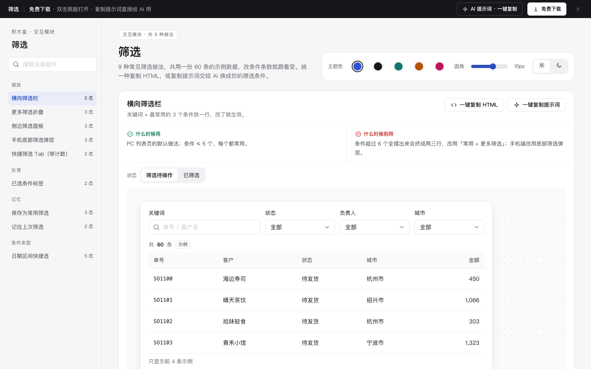

# 筛选 · 交互模块

免费下载 · 双击就能打开 · 复制提示词直接给 AI 用。

> 积木盒 · 老岳AI编辑部 · 原型组　|　交互模块（组件 → **模块** → 页面模板）　|　单文件 HTML，离线可用　|　2026-11-10

这是一页能点的筛选做法合集：9 种常见做法，共用一份 60 条的示例数据，改条件条数就跟着变。挑一种，复制 HTML 粘进你的原型；或者复制提示词，让 AI 换成你的筛选条件。

---

## 一、用处

| 项 | 说明 |
|---|---|
| 解决什么 | 画筛选原型时最容易漏的是：条件放哪、选完会有几条、0 条怎么办、填错区间怎么提示、下次打开还记不记得。这里每种做法把这些都摆出来了 |
| 适合谁 | 要画后台列表、商品列表、报表筛选、App 筛选弹层的产品经理 |
| 和页面模板的关系 | 页面模板是整页；模块是其中一块的多种做法，拼页面时从这里挑。「列表 + 详情抽屉」「数据看板」都用到这里的做法。 |

## 二、做法清单

| # | 做法 | 状态 | 什么时候用 | 什么时候别用 |
|---|---|---|---|---|
| 1 | 横向筛选栏 | 默认 / 已筛选 | PC 列表，条件 ≤ 5 个且都常用 | 条件太多挤成多行；手机端 |
| 2 | 更多筛选折叠 | 收起 / 展开 / 收起·里面有已选 | 条件多但常用的只有 2–3 个 | 收起来的条件其实每次都要用 |
| 3 | 侧边筛选面板 | 默认 / 已勾选 / 区间填错 | 条件多、以多选为主的浏览型列表 | 窄屏；条件少于 3 组 |
| 4 | 手机底部筛选弹层 | 关闭 / 打开 / 已选 | App、小程序、手机网页 | 只有一个条件；不告诉用户会找到几条 |
| 5 | 已选条件标签 | 有条件 / 无条件 | 条件藏在弹层、侧栏、更多里 | 条件全摆在外面一眼可见 |
| 6 | 快捷筛选 Tab（带计数） | 默认 / 某个 Tab 为 0 | 有一个主维度按批处理 | 选项超过 7 个；要同时看多种状态 |
| 7 | 保存为常用筛选 | 还没有常用 / 已有常用 / 起名保存 | 同一个人反复用固定组合 | 条件少、一两下就选好 |
| 8 | 记住上次筛选 | 首次打开 / 再次打开·已恢复 | 每天打开同一个列表、条件基本不变 | 静默恢复；多人共用电脑 |
| 9 | 日期区间快捷选 | 今天 / 近 7 天 / 本月 / 自定义 / 自定义填错 | 按时间查数据的列表和报表 | 只给两个日期框让用户自己算 |

## 三、用法

1. 下载文件夹，双击 `index.html`。
2. 左侧目录点到想要的做法，点「状态」切换看效果，演示区里可以真实输入、点击。
3. 右上角换主题色、圆角、明暗，所有演示实时跟着变。
4. **一键复制 HTML**：复制当前状态的 HTML，自带所需的 CSS 变量和样式，粘进任意 HTML 原型就能显示（交互逻辑用提示词让 AI 补）。
5. **一键复制提示词**：每种做法都有一条，交给 AI 就能做出带全部状态的同款。

### 页面上的 AI 提示词

页面顶部「AI 提示词 · 一键复制」里有 3 条，高亮的变量点一下就能就地填写，复制出来就是填好的完整提示词：

| # | 提示词 | 什么时候用 |
|---|---|---|
| 1 | 从零生成整套「筛选」交互模块 | 想要一份自己的筛选规范 + 演示 |
| 2 | 把筛选改成我的业务（变量：做法、业务名称、角色、筛选条件清单、常用条件） | 已经下载，换成自己的业务 |
| 3 | 在此基础上加一种做法 / 状态（变量：要加的做法、状态清单） | 模块里没有你要的做法 |

## 四、交互说明

| 做法 | 元素 | 交互 | 反馈 |
|---|---|---|---|
| 横向筛选栏 | 下拉、关键词 | 选完立即生效；关键词停 0.25 秒再筛 | 「找到 N 条」实时变；有条件时出「清除筛选」 |
| 更多筛选 | 「更多筛选」按钮 | 展开 / 收起 | 收起时里面有条件，按钮写「已用 N 个」 |
| 侧边面板 | 多选、金额区间 | 勾选即筛；区间改完校验 | 选项后写选中后条数，0 条变浅；最低 > 最高时就地提示 +「对调」 |
| 底部弹层 | 选项按钮、重置、确定 | 选项 ≥ 44px；确定生效，点遮罩 / × 不生效 | 确定按钮写「将找到 N 条」；生效后「筛选」按钮出数量角标 |
| 已选标签 | ×、全部清除 | 删一个立即重筛 | 全部清除后 Toast 4 秒内可撤销 |
| 快捷 Tab | Tab | 切换不清空其他条件 | Tab 数字跟其他条件变；0 条照样可点，给空态和出路 |
| 常用筛选 | 保存、常用标签 | 起名保存（默认名按条件生成）、点击套用、删除 | 重名就地提示；套用后高亮；删除可撤销；最多 8 个 |
| 记住上次 | 提示条「清除」 | 再次打开自动带上上次条件 | 顶部提示「已按你上次的条件筛好」，清除后不再带上 |
| 日期快捷选 | 快捷按钮、自定义日期 | 一键选区间；自定义两个日期框 | 写出具体日期和条数；开始晚于结束提示 +「对调」；超 90 天提示 |

## 五、自检（按《交互设计规范》）

- [x] 每种做法的状态齐全，可切换，可真实操作
- [x] 每种做法写清「什么时候用 / 什么时候别用」和交互要点
- [x] 可点元素 PC ≥ 32px、手机演示 ≥ 44px；焦点框清晰；文字对比度 ≥ 4.5:1（浅色、深色都检查）
- [x] 页面上有 3 条 AI 提示词，变量可就地填写，复制有成功反馈
- [x] 无 JS 报错（9 种做法 25 个状态 + 复制 HTML / 提示词 + 明暗切换自测；关键交互脚本走查）
- [x] 示例数据标「示例」，无真实公司名

---

本模块由老岳AI编辑部·原型组制作，免费下载、修改、用于工作项目。

## 本次清理提示词

### 从零构建筛选

请制作「筛选」的单文件离线原型，服务于{{业务名称}}的{{使用角色}}。逐项实现下列做法与状态，不只画静态截图：
横向筛选栏（默认、已筛选）；选完立即生效，不用再点「查询」；关键词输入停 0.25 秒再筛；下方实时写「找到 N 条」；有条件时出现「清除筛选」，没有时不显示。
更多筛选折叠（收起、展开、收起 · 里面有已选）；展开有下滑动画，展开状态记在本机；收起时如果里面用了条件，按钮写「更多筛选 · 已用 N 个」，避免「条数对不上但看不到条件」。
侧边筛选面板（默认、已勾选、区间填错）；每个选项后面的数字 = 勾上它之后会有几条；0 条的选项变浅但可以点；每组有「清除」；金额区间失焦时校验最小 ≤ 最大，填错就地提示怎么改，不清空用户的数。
手机底部筛选弹层（关闭、打开、已选）；选项用 ≥44px 的大按钮；「确定」按钮上实时写「将找到 N 条」，0 条时写「没有结果」并保持可点；「重置」只清弹层里的选择；点遮罩或「×」关闭 = 不生效；生效后「筛选」按钮上出现已选数量。
已选条件标签（有条件、无条件）；标签写「条件名：值」；删一个立刻重新筛；「全部清除」后 Toast 4 秒内可撤销；没有条件时整行不显示。
快捷筛选 Tab（带计数）（默认、某个 Tab 为 0）；Tab 上的数字跟着其他筛选条件变；0 条的 Tab 颜色变浅但照样可点，点进去给空态 + 出路（如「去掉城市条件可看到 N 条」）；切 Tab 不清空其他条件。
保存为常用筛选（还没有常用、已有常用、起名保存）；「保存为常用」后就地出一个起名框（默认名按条件自动生成，可改）；重名时提示；常用条件显示在筛选栏上方，点一下套用并高亮；可删除，删除可撤销；最多 8 个。
记住上次筛选（首次打开、再次打开 · 已恢复）；只记常用的「人、地、状态」类条件，不记关键词和日期；存在本机；恢复时顶部一行提示 + 「清除」，清除后提示条消失、条件回到默认。
日期区间快捷选（今天、近 7 天、本月、自定义、自定义填错）；快捷按钮选中即生效，下方写出具体日期和条数；「自定义」展开两个日期框；开始晚于结束时就地提示并给「对调」；区间最长 90 天，超出时提示。
业务字段：关键词、门店、负责人、金额范围、筛选条件。按{{校验规则}}验证必填、格式与权限；保留搜索目录、主题色、圆角、深浅色、下载和提示词面板，提供真实操作及取消恢复。使用逐行不同的业务演示数据。

### 替换筛选业务数据

将附件「筛选」接入{{业务场景}}，字段映射由{{字段映射}}就地填写。必须保留这些业务做法及状态：
横向筛选栏（默认、已筛选）；选完立即生效，不用再点「查询」；关键词输入停 0.25 秒再筛；下方实时写「找到 N 条」；有条件时出现「清除筛选」，没有时不显示。
更多筛选折叠（收起、展开、收起 · 里面有已选）；展开有下滑动画，展开状态记在本机；收起时如果里面用了条件，按钮写「更多筛选 · 已用 N 个」，避免「条数对不上但看不到条件」。
侧边筛选面板（默认、已勾选、区间填错）；每个选项后面的数字 = 勾上它之后会有几条；0 条的选项变浅但可以点；每组有「清除」；金额区间失焦时校验最小 ≤ 最大，填错就地提示怎么改，不清空用户的数。
手机底部筛选弹层（关闭、打开、已选）；选项用 ≥44px 的大按钮；「确定」按钮上实时写「将找到 N 条」，0 条时写「没有结果」并保持可点；「重置」只清弹层里的选择；点遮罩或「×」关闭 = 不生效；生效后「筛选」按钮上出现已选数量。
已选条件标签（有条件、无条件）；标签写「条件名：值」；删一个立刻重新筛；「全部清除」后 Toast 4 秒内可撤销；没有条件时整行不显示。
快捷筛选 Tab（带计数）（默认、某个 Tab 为 0）；Tab 上的数字跟着其他筛选条件变；0 条的 Tab 颜色变浅但照样可点，点进去给空态 + 出路（如「去掉城市条件可看到 N 条」）；切 Tab 不清空其他条件。
保存为常用筛选（还没有常用、已有常用、起名保存）；「保存为常用」后就地出一个起名框（默认名按条件自动生成，可改）；重名时提示；常用条件显示在筛选栏上方，点一下套用并高亮；可删除，删除可撤销；最多 8 个。
记住上次筛选（首次打开、再次打开 · 已恢复）；只记常用的「人、地、状态」类条件，不记关键词和日期；存在本机；恢复时顶部一行提示 + 「清除」，清除后提示条消失、条件回到默认。
日期区间快捷选（今天、近 7 天、本月、自定义、自定义填错）；快捷按钮选中即生效，下方写出具体日期和条数；「自定义」展开两个日期框；开始晚于结束时就地提示并给「对调」；区间最长 90 天，超出时提示。
逐一核对关键词、门店、负责人、金额范围、筛选条件的来源、默认值与提交范围。将演示值替换为{{业务数据}}，输入变更后重新校验；说明确认前后的数据变化与失败保留内容。交付可离线运行的完整HTML与字段说明。

### 核对筛选交互边界

请对「筛选」开展交互边界修订，重点场景为{{边界场景}}，验收条件为{{验收条件}}。以下是本模块必须逐项走通的做法和状态清单：
横向筛选栏（默认、已筛选）；选完立即生效，不用再点「查询」；关键词输入停 0.25 秒再筛；下方实时写「找到 N 条」；有条件时出现「清除筛选」，没有时不显示。
更多筛选折叠（收起、展开、收起 · 里面有已选）；展开有下滑动画，展开状态记在本机；收起时如果里面用了条件，按钮写「更多筛选 · 已用 N 个」，避免「条数对不上但看不到条件」。
侧边筛选面板（默认、已勾选、区间填错）；每个选项后面的数字 = 勾上它之后会有几条；0 条的选项变浅但可以点；每组有「清除」；金额区间失焦时校验最小 ≤ 最大，填错就地提示怎么改，不清空用户的数。
手机底部筛选弹层（关闭、打开、已选）；选项用 ≥44px 的大按钮；「确定」按钮上实时写「将找到 N 条」，0 条时写「没有结果」并保持可点；「重置」只清弹层里的选择；点遮罩或「×」关闭 = 不生效；生效后「筛选」按钮上出现已选数量。
已选条件标签（有条件、无条件）；标签写「条件名：值」；删一个立刻重新筛；「全部清除」后 Toast 4 秒内可撤销；没有条件时整行不显示。
快捷筛选 Tab（带计数）（默认、某个 Tab 为 0）；Tab 上的数字跟着其他筛选条件变；0 条的 Tab 颜色变浅但照样可点，点进去给空态 + 出路（如「去掉城市条件可看到 N 条」）；切 Tab 不清空其他条件。
保存为常用筛选（还没有常用、已有常用、起名保存）；「保存为常用」后就地出一个起名框（默认名按条件自动生成，可改）；重名时提示；常用条件显示在筛选栏上方，点一下套用并高亮；可删除，删除可撤销；最多 8 个。
记住上次筛选（首次打开、再次打开 · 已恢复）；只记常用的「人、地、状态」类条件，不记关键词和日期；存在本机；恢复时顶部一行提示 + 「清除」，清除后提示条消失、条件回到默认。
日期区间快捷选（今天、近 7 天、本月、自定义、自定义填错）；快捷按钮选中即生效，下方写出具体日期和条数；「自定义」展开两个日期框；开始晚于结束时就地提示并给「对调」；区间最长 90 天，超出时提示。
围绕业务字段关键词、门店、负责人、金额范围、筛选条件检查无输入、非法值、取消、重复操作及失败恢复；每条路径写出触发、反馈和恢复位置。保持500px宽度、浅深色对比度及至少24px触控目标，返回完整代码和验收记录。

## 第2轮完整实测清单修订（fix14b）

修正筛选条件键名色；零结果选项仍保留业务状态，文字改用可读墨色；条件pill、恢复筛选提示、清除与对调使用修正后的主题前景；常用筛选名从span改为button并保留data-use事件；滑块44px。

本轮保留全部业务内容与提示词。已通过脚本语法与静态增量检查；本轮未运行真实浏览器验收，详见根目录 `codex_交付_fix14b.md`。

状态：已通过浏览器验收（1440/500 宽 0 报错、0 溢出、对比度与触控达标；标准外壳与跨目录比对通过）
